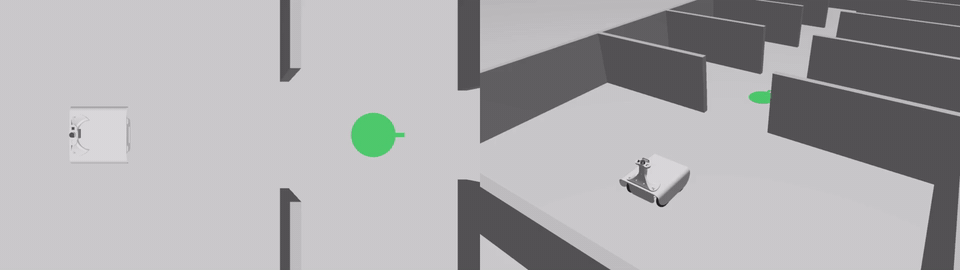
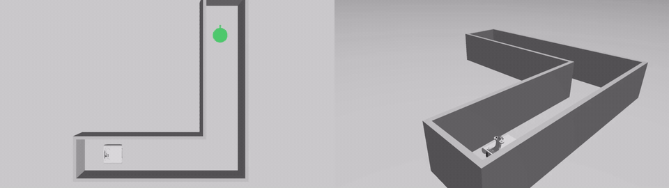
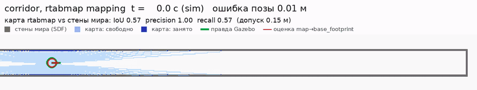
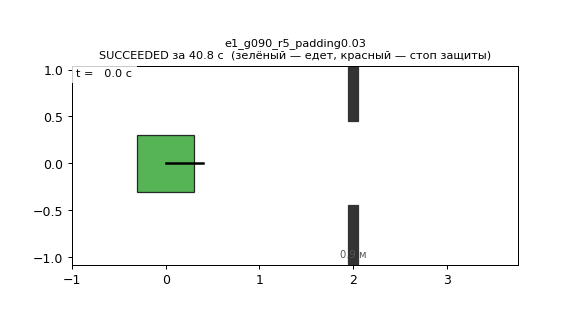
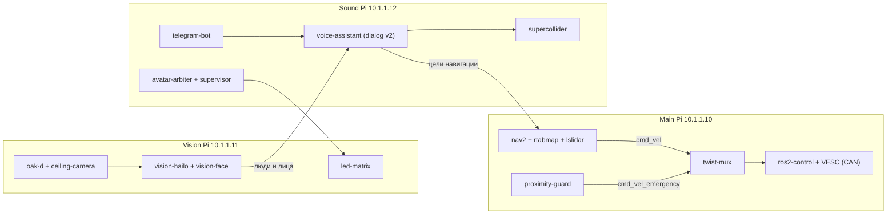

  

  # РОББОКС

  **Автономный четырёхколёсный ровер на ROS 2: ездит по карте, слушает, узнаёт людей, говорит, играет музыку и показывает лицо на светодиодах.**

  
  
  

  
   Лицо ровера на NeoPixel-матрицах. Картинка из репозитория <a href="https://github.com/krikz/ros2leds/blob/main/docs/images/rover.gif">ros2leds</a>.

РОББОКС — образовательный проект робота-доставщика для помещений. Три Raspberry Pi 5 на борту, ROS 2 Humble,
Docker, Zenoh. Репозиторий ведёт товарищ Шифу; код и документы пишут люди и AI-агенты по правилам из [AGENTS.md](AGENTS.md).

## Что умеет

- **Голосовой диалог v2 с вейк-словом.** Модель отдаёт команду, код исполняет её и сам говорит об исходе ([ADR-0150](docs/adr/0150-dialog-v2-session-command-event.md), [ADR-0148](docs/adr/0148-code-decides-llm-speaks.md)).
- **Узнаёт людей по голосу и лицу.** Лицо и голос связываются, незнакомцу выдаётся кличка ([ADR-0164](docs/adr/0164-person-identity-face-voice-nickname.md)).
- **Пульт в Telegram.** Бот оператора живёт на Sound Pi (`docker/sound/telegram_bot`, пакет `rob_box_telegram`).
- **Живая музыка и DJ-сеты.** Синтез в SuperCollider, аранжировщик и DJ-движок ([ADR-0149](docs/adr/0149-arranger-v2-dj-engine.md), [ADR-0147](docs/adr/0147-dj-set-energy-arc.md)).
- **Лицо на светодиодах.** Драйвер [ros2leds](https://github.com/krikz/ros2leds) подключён сабмодулем (`src/ros2leds`), общие эффекты — его пакет `led_matrix_effects`, анимации лица — [`src/rob_box_animations`](src/rob_box_animations/README.md).
- **Навигация Nav2 с картами и точками** (RTAB-Map и лидар LSLIDAR N10). Минимальный проём — **0.90 м**, подобран экспериментом в HIL 05.11 ([решение](docs/shifu-decisions.md#d-20261105-min-doorway), [замеры](docs/research/2026-11-05-nav2-hil-tuning.md)).
- **Защита по лидару.** В движении `proximity_guard_node` включает «внимание» (маячок и бипер) и «стоп» (нулевой Twist в `cmd_vel_emergency`), см. «Зона безопасности» в [CONTEXT.md](CONTEXT.md).
- **HIL-симуляция в Gazebo.** Стек настоящего робота работает на данных симулятора с песочницы ([`scripts/hil/`](scripts/hil/), [`docker/sim/`](docker/sim/)).

## Симуляция (HIL)

Записи настоящих прогонов: Gazebo и RTAB-Map на стеке робота. Устройство и план — [docs/research/2026-11-04-hil-robot-on-gazebo-data.md](docs/research/2026-11-04-hil-robot-on-gazebo-data.md).

<table>
  <tr>
    <td align="center"> <b>Gazebo: проезд полигона (04.11).</b> Сверху и 3D-камера за роботом. Мир тогда был с проёмом 0.8 м, не 0.90 м.</td>
    <td align="center"> <b>Gazebo: Г-образный поворот (04.11).</b></td>
  </tr>
  <tr>
    <td align="center"> <b>RTAB-Map строит карту коридора (04.11):</b> истинная поза против оценки.</td>
    <td align="center"> <b>Проём 0.90 м, вид сверху (05.11).</b> После подбора запаса корпуса (<code>footprint_padding</code> 0.03).</td>
  </tr>
</table>

Проезд через тот же проём в обратную сторону — [w4_g090_r5.gif](docs/assets/hil/w4_g090_r5.gif).

## Железо и узлы

Три Raspberry Pi 5 в одной сети, у каждого свой `docker-compose.yaml`. IP: `eth0` / `wlan0`.

| Узел | IP | Контейнеры (по compose) |
|---|---|---|
| **Main Pi** | `10.1.1.10` / `10.1.1.20` | `ros2-control` (VESC по CAN), `lslidar`, `rtabmap`, `nav2`, `imu-filter`, `robot-state-publisher`, `twist-mux`, `proximity-guard`, `perception`, `teleop`, `zenoh-router` — [`docker/main/`](docker/main/docker-compose.yaml) |
| **Vision Pi** | `10.1.1.11` / `10.1.1.21` | `oak-d` (OAK-D-Lite), `ceiling-camera`, `led-matrix`, `vision-hailo`, `vision-face`, `zenoh-router` — [`docker/vision/`](docker/vision/docker-compose.yaml) |
| **Sound Pi** | `10.1.1.12` / `10.1.1.22` | `voice-assistant`, `supercollider`, `supervisor`, `avatar-arbiter`, `quest`, `telegram-bot`, `sensor-bridge`, `zenoh-router` — [`docker/sound/`](docker/sound/docker-compose.yaml), [ADR-0159](docs/adr/0159-sound-pi-third-node-voice-stack-and-sensor-hub.md) |

- **Привод:** 4 колеса 10″ от электросамоката, 4× VESC на CAN, драйвер [vesc_nexus](https://github.com/krikz/vesc_nexus) (сабмодуль).
- **Датчики:** OAK-D-Lite, лидар LSLIDAR N10, ReSpeaker Mic Array v2.0, плата ESP32 [robot_sensor_hub](https://github.com/krikz/robot_sensor_hub).
- **Питание:** две гироскутерные батареи smartONE 10S2P Li-ion, 36 В номинал, 42 В заряженные ([HARDWARE.md](docs/architecture/HARDWARE.md)).
- **ПО:** ROS 2 Humble, Zenoh (`rmw_zenoh_cpp`), Docker Compose. Каталоги `config/` и `scripts/` монтируются volumes, а не копируются в образ.

## Архитектура

Все три узла связаны через Zenoh-роутеры. Схема упрощена: контейнеры взяты из compose-файлов, связи показаны по смыслу.
Подробнее — [SYSTEM_OVERVIEW.md](docs/architecture/SYSTEM_OVERVIEW.md), [NETWORK_TOPOLOGY.md](docs/architecture/NETWORK_TOPOLOGY.md).

## Быстрые ссылки

| Нужно | Куда |
|---|---|
| Как работать в репо (единственная точка входа) | [AGENTS.md](AGENTS.md) |
| Карта документации | [docs/README.md](docs/README.md) ([ADR-0163](docs/adr/0163-docs-structure-and-spec-driven-deprecation.md)) |
| Словарь терминов | [CONTEXT.md](CONTEXT.md) |
| Решения товарища Шифу | [docs/shifu-decisions.md](docs/shifu-decisions.md) |
| Все архитектурные решения (ADR) | [docs/adr/](docs/adr/) |
| Процесс: координатор и воркеры | [docs/process/claude-coordinator-robot-flow.md](docs/process/claude-coordinator-robot-flow.md) |
| Быстрый старт и неполадки | [QUICK_START.md](docs/guides/QUICK_START.md), [TROUBLESHOOTING.md](docs/guides/TROUBLESHOOTING.md) |
| HIL: симуляция на стеке робота | [scripts/hil/](scripts/hil/), [docker/sim/](docker/sim/) |
| Сборка и деплой | [L: Build All Services](.github/workflows/L-Build-All-Services.yml), [L: Deploy and Verify](.github/workflows/L-Deploy%20and%20Verify.yml), [CI_CD_PIPELINE.md](docs/CI_CD_PIPELINE.md) |

Раздела «Последние изменения» здесь нет: CHANGELOG выведен по ADR-0163. Что и почему решено — в своде решений и списке ADR выше.
