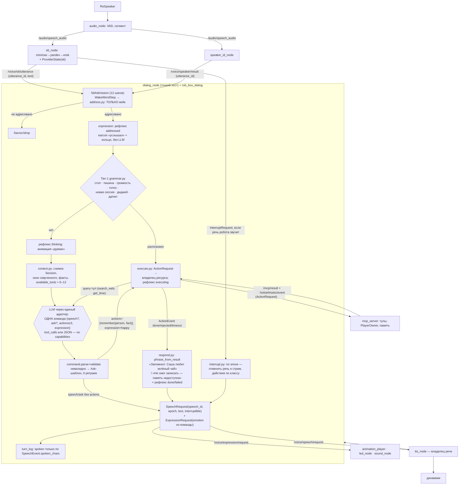

# ADR-0150: Новый виток диалоговой системы (dialog v2) — сессия с одним владельцем, команда вместо свободного ответа, фраза об исполнении из события

| Поле | Значение |
|---|---|
| Статус | Proposed (на утверждение товарищу Шифу). Только дизайн и план поставки, код не меняется. Ревизия 2 (02.10.2026) — по решениям Шифу В1–В11, см. §18. Ревизия 3 (02.10.2026) — планировщик ресурсов и одновременное исполнение (§5.6) по материалу `07-action-scheduler.md`. Ревизия 4 (02.10.2026) — решения Шифу О1, О2, О6–О12 (§18), учёт влитых PR-3b/3c/5/6 эпика #3312. **Ревизия 5 (20.10.2026, #3676)** — актуализация после 18 дней изменений (§0.2: музыка v1 удалена, Sound Pi, LED #3674/#3675, живой лог 20.10), §5.5 переписан под **процедурное лицо** и DSL сцены для LLM, новый §7.5 (шов с ADR-0130), правило бэклога В12, новый план PR §11 с моделями воркеров, решения В12–В18 (§18.3) |
| Дата | 2026-10-01; ревизии 2–4 — 2026-10-02; ревизия 5 — 2026-10-20 |
| Автор | Claude Code (шисюн), по брифу товарища Шифу `docs/research/dialog-v2/00-brief.md` |
| Issue | **эпик #3683** (заведён 20.10 с карточками PR-0…PR-15, §11); задача-напоминание #3676; входные карточки ревизии 4 (#3266, #3271, #3297, #3145, #3144, #3108, #3109, #3000, #2754, #3269, #3296) на 20.10 **все закрыты** заплатками в v1 — классы отказов остались (§0.2.2); открытые, которые эпик вбирает: #3600, #3565, #3616, #3618 |
| Основание | `docs/research/dialog-v2/01…07` (в git; `07-action-scheduler.md` — планировщик, хотелки Х1–Х15); аудиты CI run 36918223549 (статика, 01.10) и 36689419795 (рантайм, 30.09); код сверен на этом worktree: ревизия 1 — `61fd84ff7`, ревизии 2–3 — `0e7371fed`/`71bdcf50a`, ревизия 4 — `19cb5d6f5` (влит `origin/develop` с PR-3b `30c36ca6b`, PR-3c `dfe5a6be7`, PR-5 `fca5e2e5e`, PR-6 `cac5ec03c` эпика #3312); **ревизия 5 — `8703242b8`** (20.10; живой лог Sound Pi 20.10 16:55 МСК — §0.2); история git по В1/В2/В10/О7/О8 — §18.1 |
| Родители | ADR-0148 (код решает, LLM говорит — обязателен), ADR-0149 (музыка v2: владелец плеера, события `started/rejected`, флаг `music_engine`), ADR-0141, ADR-0131 (`utterance_id`), ADR-0102/0103 («Повод»), ADR-0083 (`build_agent`), ADR-0051 (ТАРС), ADR-0145 (бюджет классов), ADR-AF-0013 (мелкие PR), ADR-0018 (честный FAIL) |
| Заменяет после приёмки | ADR-0084 целиком; ADR-0021 целиком (R1–R5); ADR-0066 §2–§3 (pause/resume без владельца → типизированный `DialogControl` с полем `set_by` и TTL); ADR-0143 (ретраи Bug B/C как норма → режим команд по возможностям провайдера); ADR-0129-dj §2 (штамп персоны в промпт → кадр сцены); ADR-0140 остаток; ADR-0065 §2 (списки вейк-слов в `dialogue_text.py` → `rob_box_dialog.knowledge`); ADR-0001 §Telegram-харнес (телеграм-агент на общем движке, §9.2); ADR-0011 (action protocol: HTTP-сайдкар и PASTE — заменяются планировщиком ресурсов §5.6, берётся контракт accepted/feedback/result/cancel и `commit` пред-генерации); ADR-0033 (MERGE не трогает музыку — заменяется таблицей `COMPOSITION`); ADR-0056/0092 §pregenerate (поле в payload чанка никто не публикует — заменяется пред-генерацией выступления §5.6.3). Подробно — §13 |

---

## Оглавление

0. Что проверено, что нет; 0.1 расхождения материалов с кодом; **0.2 ревизия 5: что изменилось после 02.10, живой лог 20.10**
1. Проблема: классы отказов и семь корней
2. Решение: границы, модули, владельцы
3. Поток одной реплики (как будет)
4. Что решает код, что — LLM; 4.4 канал речи: бейк-офф; 4.5 провайдер-агностик
5. Исполнение, событие, фраза; **5.5 экспрессия и живость без LLM: процедурное лицо, огибающая TTS, DSL сцены для LLM (ревизия 5)**; **5.6 исполнение во времени: планировщик ресурсов** (ресурсы и владельцы, матрица одновременности, класс «выступление», политики APPEND/MERGE/REPLACE/REJECT, синхронизация с тактом, эталонные сценарии X3 и #993)
6. Речь, перебивание, тишина (перебивание — по классу текущего действия)
7. Сессия, сцены, персоны, история, память; **7.5 собеседник: шов с ADR-0130 (ревизия 5)**
8. Провайдеры: возможности и честная деградация
9. Интерфейс с музыкой (ADR-0149), Telegram-агент, ТАРС
10. Типы сообщений: уход от JSON в `std_msgs/String`
11. Миграция: strangler за флагом `dialog_engine`, **план PR ревизии 5 с фазами, моделями и усилием воркеров**, зависимости (#3312 снят; ADR-0130, ADR-0159)
12. Таблица костылей на удаление (в т.ч. планировщик: мёртвые хуки, второй планировщик в tts_node, пять гардов исполнителя)
13. Какие ADR замещаются (в т.ч. ADR-0011); что поправить в CONTEXT.md
14. Приёмка числами (A1–A23) и трассировка хотелок Х1–Х15
15. Что сохранить из старого
16. Риски и откат
17. Альтернативы (в том числе отвергнутое окно адресации без вейка — с доказательством)
18. Решения владельца (02.10.2026) и 18.1 находки в истории; 18.2 что осталось открытым; **18.3 решения, нужные по ревизии 5 (В12–В18)**
19. Что не проверено

---

## 0. Что проверено, что нет

- Прочитаны целиком: `00-brief.md`, `01-bug-archaeology.md` (488 строк), `02-current-architecture.md` (398), `03-kludge-inventory.md` (286), `04-adr-landscape.md` (223), `05-oss-landscape.md` (402), `06-architecture-audit-digest.md` (185), ADR-0148, ADR-0149, `AGENTS.md`.
- **Сверено мной по коду на HEAD `61fd84ff7`/`0e7371fed`** (grep/Read; ниже каждое помечено «(проверено)»):

| # | Утверждение | Результат на HEAD |
|---|---|---|
| V1 | `dialogue_node.py` 9 954 строки; `dialogue_guards.py` 3 063; `music_guard.py` 876; `tts_node.py` 7 316; `agent_core.py` 2 690 | `wc -l` — совпало; **после `19cb5d6f5`**: `dialogue_node.py` 9 987 (PR-5/PR-6 добавили `music_engine_of`, `run_media_plan`), остальные без изменений; `re.compile` 34 и `Bug A–F` 113 — без изменений |
| V2 | `re.compile` в `dialogue_guards.py` = 34, `skill_router.py` = 27, `speak_helpers.py` = 15 | совпало; в `music_guard.py` — **0** (см. §0.1) |
| V3 | Меток `Bug A–F`: 113 в `dialogue_node.py`, 57 в `dialogue_guards.py`; ссылок `#NNNN` в `dialogue_node.py` 705 (144 уникальных) | совпало |
| V4 | `DEFAULT_SYNTHETIC_RETRIES = 2` (`dialogue_node.py:7861`) против `DEFAULT_MAX_SYNTHETIC_RETRIES = 3` (`core/turn.py:36`) | совпало |
| V5 | `_MAX_TOOL_ITERATIONS = 8` (`agent_core.py:87`), цикл `:1598` | совпало |
| V6 | `skill_tool_narrowing: false` в обоих yaml (`docker/vision/config/voice_assistant/dialogue_node.yaml:112`, `src/rob_box_voice/config/dialogue_node.yaml:43`) | совпало |
| V7 | `music_engine: "v1"` (`mcp_server.yaml:12`), выбор движка `mcp_server.py:299-327` | совпало |
| V8 | «Принял.» на пустой ответ — `dialogue_node.py:8508` | совпало |
| V9 | `/voice/current_dialogue_id`: подписчики `tts_node.py:1308`, `tools/dialogue.py:109`; писателя нет, `dialogue_node.py:9456` только присваивает атрибут | совпало |
| V10 | `DEFAULT_WAKE_WORDS` — 26 вариантов, включая «бот», «роб», «рома», «робота» (`dialogue_text.py:31-75`); `is_silence_command` — подстрока (`:215-218`); `stt_node.py:226-240` — запасная копия с подстрочным матчем и «пустой список = пропускать всё» | совпало |
| V11 | Писатели `/voice/tts/request`: `tools/dialogue.py:99`, `tools/say.py:61`, `telegram_node.py:206`, `stt_node.py:605`, супервизор через `GRIP_TTS_REQUEST_TOPIC` (`supervisor_node.py:397`); рантайм добавляет `joystick_control_node` | 5–6 писателей, совпало |
| V12 | Писатели `/voice/tts/control`: `audio_node.py:152`, `stt_node.py:587`, `dialogue_node.py:848`, `quest_node.py:1752` | 4, совпало |
| V13 | `/voice/dj_mode` пишут `dialogue_node.py:1051,5274` и `tools/music.py:7055`; два владельца DJ-флага: `DJState` (`dj_mode.py:157`) и `MusicManager._dj_mode_enabled` (`music.py:714`) | совпало; **после `19cb5d6f5`** строки сдвинулись (`dialogue_node.py:1089`, `music.py:7064`), писателей по-прежнему два; при `music_engine: v2` `DJModeController.tick` не заводится (`dialogue_node.py:531-538`) |
| V14 | `/voice/stt/result` пишут `stt_node.py:578` и `telegram_node.py:168`; telegram также пишет `/voice/dialogue/response`, `/avatar/command`, `/voice/tts/request`, `/voice/sound/stop` (`telegram_node.py:168-223`); dialogue_node разбирает префикс `[TG:chat_id]` (`:2977`) и кладёт `[TG]` в текст пользователя (`:6896`) | совпало |
| V15 | `check_silence_timeout` (`dialogue_state_machine.py:456`) в prod не вызывается; докстринг `:6` обещает «SILENCED → IDLE (after timeout)» | совпало — SILENCED бессрочен |
| V16 | `IGNORE_STOP_MS:700` (`dialogue_node.py:9639`, `tts_node.py:1843`) | совпало |
| V17 | Таймаут тула 10 с, `_LONG_TOOL_TIMEOUTS = {}` (`executors/ros_mcp.py:25,48`) | совпало |
| V18 | 10 флагов `_*_retry_used` в `dialogue_node.py`; 11 `build_*_retry_prompt` в `dialogue_guards.py`; `PHANTOM_ACTION_VERB_STEMS :2074`, `detect_phantom_action_claim :2216`, `detect_universal_action_claim :1830`, `is_metalanguage_babble :719` | совпало |
| V19 | `_SILENT_DONE_MARKERS` (`agent_core.py:440`, проверки `:1241,1265`) | совпало |
| V20 | `master_prompt_compact.txt` 60 490 байт, 45 упоминаний `RULE #`; промпт ссылается на гард (`:228`) | совпало |
| V21 | Каталог тулов: 66 записей, 60 видимых LLM (`python -c` через `rob_box_core.tool_catalog`) | совпало на `61fd84ff7`; **после `19cb5d6f5`** (PR-6): 68 записей, `llm_visible_tools(music_engine)` — при `v1` 60, при `v2` 58, из них два v2-only: `dj_set`, `request_music` (`tool_catalog.py:150-162`). Срез по движку уже реализован как функция каталога — §4.2 `tools_view` опирается на неё |
| V22 | `architecture/ownership.yml` — `nodes: {}`, `topics: {}`, `capabilities: {}`, `features: {}` | пуст, совпало |
| V23 | Пакетов сообщений в `src/`: `rob_box_perception_msgs`, `rob_box_supervisor_msgs`, `robot_sensor_hub_msg`; голосовых `*_msgs` нет; `rob_box_core/utterance.py` даёт dataclass `Utterance{text, sink, priority, voice, language, emotion, speech_id}` | совпало |
| V24 | ADR-0084 «Статус: accepted»; ADR-0021 «Статус: proposed» (18.08); `CONTEXT.md:109-116` «Ход» ссылается на `TurnGuards`; файлов `docs/adr/015*` кроме этого нет | совпало |
| V25 | Интерфейс LLM: `rob_box_llm/provider.py:226 class LLMProvider` с `capabilities -> ProviderCapabilities{text, streaming_text, tools, streaming_tools, image_input}` (`:78-94`); флагов `tool_choice/json_mode/structured_output` нет; адаптеры `providers/{deepseek,mimo,minimax}.py` | совпало — основа для §4.5 есть, расширяется |
| V26 | Экспрессия: `KNOWN_ANIMATIONS` — 18 имён (`mcp_tools/animations.py:36`), `speak_text(text, animation, voice)` (`tools/dialogue.py:409`); `/voice/animation/request` читают `animation_player_node.py:66` (матрица) и `led_node.py:180` (кольцо ReSpeaker), `led_node` ещё читает `/voice/dialogue/state` и `/audio/direction` (`:165,172`); `animation_player` сам переключается по `/voice/tts/state` (`:74`); `/voice/sound/trigger` пишут `stt_node.py:608` («boop»), `dialogue_node.py:834`, `tools/sound.py:30` (+ `health_monitor` в рантайме), читает `sound_node.py:59`; алиас `boop → button_click` `sound_node.py:108` | совпало — 4 писателя звука, 2 исполнителя анимаций без владельца решения |
| V27 | Telegram: `telegram_bot.yaml:llm_provider/llm_model/llm_max_history` присутствуют, но в `src/rob_box_telegram` ни один `.py` их не читает (grep пуст) — мёртвые с W7 (`07dfc28aa`) | совпало |
| V28 | **Голосовая задача завершена в момент публикации**: `SpeakTextTool.execute` публикует чанки в `/voice/tts/request` и возвращает `success=True, data.async=True` (`tools/dialogue.py:625-645`); ожидание `tts/finished` отсутствует — `EffectAwaiterRegistry.register_tts` определён (`speak_helpers.py:663`), вызывающих вне определения нет (grep `register_tts` даёт только `def` и несвязанный `_register_tts_loop_atexit` в tts_node) | совпало — ключевое утверждение 07 §0 п.2 |
| V29 | `barge_in_policy: "replace"` в боевом конфиге (`docker/vision/config/voice_assistant/dialogue_node.yaml:23`) — ветка `classify` (QUEUE/MERGE через `quick_decide`) выключена | совпало |
| V30 | Планировщик: `scheduler/task_scheduler.py` 1 312 строк, `tool_executor.py` 691, `quick_decide.py` 137, `delta.py` 109, `event_bus.py` 45; каналы — `_VOICE_TOOLS={speak_text}`, `_MUSIC_TOOLS={stop_music}`, `_ANIM_TOOLS={play_animation}` (`tool_executor.py:82-97`), музыкальные стартеры в bypass; подключение `dialogue_node.py:2204-2215` | совпало (2 395 строк) |
| V31 | `harness/decision/scheduler_shadow.py` — вне самого файла и тестов ссылок нет (grep `scheduler_shadow\|SchedulerShadow` = 0) | совпало — мёртвый PoC |
| V32 | Поле `pregenerate` payload чанка: в `src` вне `scheduler/pregen` и тестов встречается только в комментариях/параметрах `tts_node.py:870-878,1478-1488`; публикатора поля нет | совпало — подключено, данных не получает |
| V33 | `play_sound` отвечает `success=True, message="Звук запущен…"` сразу после `publish` (`tools/sound.py:145-151`); `sound_node.trigger_callback` молча `return` при активном голосовом стриме или если звук уже играет (`sound_node.py:221-228`) | совпало — класс честности К2 |
| V34 | Гарды исполнителя: `track_start_guard.py` несёт #2859 (`:1`), #2878 (`:79,263`), #3221 (`:30,238,276`), #3246 (`:106,289`), #3247 (`:116,331`); гейт #2913 — `tool_executor.py:128`; `tts_node` держит второй планировщик: `priority` вклинивание (`:1435`), `_pending_speech_queue` чужих батчей (`:1468`) | совпало |
| V35 | ADR-0011 — статус Accepted, транспорт HTTP-сайдкар `voice-action-server` вместо ROS2 Action (ADR-0002); пакет `action_server/{http,http_server,paste,server}.py` на месте; `PlayerOwner.track_started` — колбэк из потока клока «трек реально встал на долю `start_beat`» (`engine/player_owner.py:78-89`) — источник точки синхронизации для §5.6 | совпало |
| V36 (после `19cb5d6f5`) | PR-6 #3312: `core/media_plan_run.py` (75 строк) — фраза об успехе роутера **только по событию `started`** с `track_id` из ответа тула, `rejected` → `say_fail`, нет события за `STARTED_WAIT_S = 6.0` → `NOT_STARTED_TEXT` «Музыка пока не заиграла» (`media_plan_run.py:6-8,24,52-72`); `media_router.py` 695 строк (+`DJ_V2_FAIL_TEXT`, `REQUEST_FAIL_TEXT`, `NOT_STARTED_TEXT` `:189-192`) | совпало — для музыки v2 принцип «фраза из события» уже работает в v1-ноде; §5.3/§9.1 переиспользуют `run_media_plan` |
| V37 (после `19cb5d6f5`) | Схема `request_music`: `intent ∈ {track, melody}`, `mood` из `knowledge.MOOD_ENERGY`, `genre ∈ {auto, club, classical, folk}` (`engine/tools_v2.py:222-253`); `dj_set.action ∈ {start, stop}` (`:139-140`). **`intent=backing` и `min_form_beats` отсутствуют** | ADR-0149 §5.1 обещал `backing`, PR-6 его не принёс — подложка выступления (§5.6.3) остаётся запросом к #3312 (§11.1) |
| V38 (после `19cb5d6f5`) | PR-5 #3312: `engine/session.py` — `SetSession` с очередью, предгенерацией N+1, `nearly_finished` за `(phrase_bars+1)×4` долей через `owner.watch(track_id, form_end, lead, cb)` (`session.py:1-9,33,141-188`); `dj_set` под `v2`; `/voice/music/event` публикует `mcp_server.py:332` | совпало — события `started/nearly_finished` для кадра `DJ` (§7.2) и продления подложки (§5.6.3) есть |
| V39 (после `19cb5d6f5`) | Флаг `music_engine` — один файл `config/music_engine.yaml` (`/**:` на две ноды), `dialogue_node` объявляет параметр (`:1575`), `ToolRegistry(music_engine=…)` (`:2176`) | совпало — образец для `dialog_engine` (§11): один yaml, две ноды, тест синхронизации |
| V40 (О8) | Приглушения музыки под речь **в коде нет**: ни `mcp_server.py`, ни `engine/*`, ни `tools/music.py` не подписаны на `/voice/tts/state|finished` (grep — только комментарии `mcp_server.py:1996,2068`); `set_master_gain` зовут только `SetMusicVolumeTool` и старт (`music.py:1739-1762,2099-2101`); `tts_node` и `audio_node` музыкальный gain не трогают. Что **есть**: (а) сайдчейн **внутри музыки** под бочку — `arranger.py:1500-1542` `DUCK_FLOOR=0.3`, `_duck_expr_from_drum_pattern`; после PR-3c — `rob_box_music/arrange/mix.py:53-81` `duck_envelope`, `kn.DUCK_ROLES/DUCK_DEPTH`; (б) авто-выравниватель мастер-шины `masterfilter.scd:49-76,104-107` (`lvlRatio 3`, `lvlUp 3`, `lvlDown 1`) — тянет уровень музыки к `lvlTarget` по её собственной огибающей; (в) микс TTS и музыки — программный `dmix` (`docker/vision/config/audio/asound.conf:5-16`, `tts_node.py:1580-1582`, `start_supercollider.sh:4-5`), без аттенюации; (г) AGC/AEC XVF-3000 — только микрофонный тракт (`respeaker_interface.py:44,58,242`) | 07 §4.1 «grep duck = 0» неточно: `duck` есть, но это сайдчейн под бочку, а не под голос. См. §18.1 О8 |
| V41 (О7) | Правило «текущий сегмент доигрывает, PENDING переписываются» описано в `docs/design/SCHEDULER_DESIGN.md:152` («`update(delta)` модифицирует ТОЛЬКО сегменты PENDING… ACTIVE доигрывает до естественной границы»), §4 `:311-320` (таблица MERGE/REPLACE), §4.4 `:356-378` (блокер П1: классификация ДО barge-in), §4.5 `:393-397` (авто-ход LLM после MERGE), §6.5 `:134-136` (`PENDING_LIVE/FROZEN`); план `docs/plans/2026-08-28-scheduler-segments-merge-plan.md:7-9` («текущий сегмент доигрывает до естественной границы, ещё не начатые — переписываются»); спека `docs/design/dialogue-mode-spec-2026-08-28.md:47,57,146`; ADR-0033 закрепил MERGE только для голоса | найдено — §18.1 О7 |

- **Ничего не запускалось** ни локально, ни на роботе. Все величины задержек, долей и частот — из тел issue, памяти проекта и материалов 01–06; где я их цитирую, стоит «(из материалов)».

### 0.1 Расхождения материалов с кодом (верю коду)

| Утверждение в материалах | Что на HEAD | Следствие |
|---|---|---|
| 03 §0, 01 §0: меток `TEMP(ADR-0148)` в `src` — 0 | `grep "TEMP(ADR"` даёт **2**: `club_transition.py:233`, `dj_mode.py:85` (страховка #3136 на музыкальном пути); точная строка не матчилась из-за запятой `TEMP(ADR-0148, #3136…)` | на диалоговом пути меток 0 — вывод 03 остаётся; гард моратория (PR-0) ищет `TEMP(ADR-0148` без закрывающей скобки |
| ADR-0149 §5.3: «число `re.compile` в `dialogue_guards.py` (34) и `music_guard.py` должно падать» | в `music_guard.py` `re.compile` = 0 | метрика для `music_guard.py` — размер файла и число вердиктов (§14 A8) |
| 00-brief: «ADR-0013 — малые PR» | `0013-respeaker-dsp-tuning-mix-ch0.md` — про ReSpeaker; правило PR — `AF-0013-incremental-delivery-over-big-bang.md` | ссылаюсь на ADR-AF-0013 |
| 02 §2.2: `/voice/tts/request` — 5 писателей в коде | по `create_publisher` с литералом — 3; ещё 2 через константы; рантайм — 5 с `joystick_control_node` | статический аудит пропускает константы — гард владельцев (§10.3) считает по рантайм-снимку |
| 02 §4: «живого вызова `save_turn` нет» | вызовы `voice_memory.py:33,36` — докстринг; `VoiceMemoryAdapter.save_turn` — deprecated-заглушка по **директиве Шифу 02.09** («forbids persisting dialogue turns in production», `voice_memory_adapter.py:47-49`) | история не персистится намеренно; v2 — §7.4, решение В8 |
| 02 §2.5: «Telegram-канал: отдельных ADR нет», 01 §17: «[TG] отдельно не разбирал» | история git: Telegram **имел собственную LLM** с 28.02 (`3c91ba155`) до W7 28.07 (`07dfc28aa`), потом стал мостом в `/voice/stt/result`; эхо удалено `88cecc91f`, возвращено #1195 (`def24baaa`) с маркером `[TG:chat_id]` | §9.2 возвращает телеграм-агента на новом движке (решение В10) |
| 05 §1–§2: `Pipecat #5305`, `LiveKit FallbackAdapter` — «(поиск)» | не проверял | беру форму паттерна, не API |
| Ревизия 2 этого ADR: §3 «`_order_tool_calls` переносится», §5.2 «одна `SpeechRequest` на ход», §4.1 «при действиях `speech` не озвучивается», §6.2 «вейк во время речи → отмена всегда» | 07 §9 показал: эти четыре формулировки делают «рэп под бит» и «дочитай и вплети» невозможными (Х1–Х5), а `_order_tool_calls` тащит холостой `deferred_call_ids` (`agent_core.py:426-431`) | исправлено в ревизии 3: §4.1 (класс «выступление»), §5.2 (последовательность сегментов), §5.6 (таблица `COMPOSITION` вместо перестановки), §6.2 (перебивание по классу) |
| 07 §1.6 «`led_node` слушает `/voice/animation/request` — взято из ADR-0150, код не открывал» | я открывал: `led_node.py:180` (V26) | подтверждено |
| 07 §4.1: «ducking музыки под речь отсутствует (grep `duck` в голосовом стеке = 0)» | в голосовом стеке — верно; в музыкальном `duck` есть как сайдчейн под бочку (V40), под речь — ничего; Шифу слышит приглушение «иногда даже синхронно» — гипотезы §18.1 О8 | вывод 07 остаётся: ducking под речь надо строить; проверка на роботе — §18.1 О8 |
| ADR-0149 §5.1 и ревизия 3 §5.6.3: `request_music(intent=backing)` | PR-6 влит без `backing` и `min_form_beats` (V37) | подложка выступления — запрос к #3312 (§11.1); до него `intent=track` + продление по `nearly_finished` |
| Ревизия 3 §11.1: PR-7c «ждёт #3312 PR-5/PR-6» | PR-5 и PR-6 влиты в `19cb5d6f5` (V36–V38) | зависимость снята, кроме поля `backing` |

### 0.2 Ревизия 5 (20.10.2026): что изменилось после ревизии 4 и что это меняет в дизайне

Код сверен на `origin/develop` @ **`8703242b8`** (20.10). Живой робот смотрел 20.10 16:55 МСК (`docker logs voice-assistant --tail 6000` на Sound Pi, файл в `artifacts_live_check_2026-10-20/`). С 02.10 в `develop` вошло: `src/rob_box_voice` — 59 коммитов, `src/rob_box_mcp_tools` — 89, `src/rob_box_music` — 105, `docker/sound` — 17, `docker/vision` — 114; ADR-0152…0159. Ниже — только то, что меняет решения этого ADR; всё, что ниже не упомянуто, остаётся как в ревизии 4.

#### 0.2.1 Пересверка утверждений V1–V40 (верю коду на `8703242b8`)

| # | Было (ревизия 4, `19cb5d6f5`) | Стало (`8703242b8`) | Следствие для ADR |
|---|---|---|---|
| V1′ | `dialogue_node.py` 9 987; `dialogue_guards.py` 3 063; `music_guard.py` 876; `tts_node.py` 7 316; `agent_core.py` 2 690 | `dialogue_node.py` **7 956** (166 методов, один класс); `core/dialogue_guards.py` **1 695** (переехал из корня пакета); `music_guard.py`, `dj_mode.py`, `dj_set_boundary.py`, `dj_material.py` — **удалены** (#3391, #3614); `tts_node.py` 7 303; `agent_core.py` 2 641; `stt_node.py` 2 073 | хост по-прежнему божественный (A4 не изменился), но музыкальные ветки ушли сами — §11.1 и §12 ревизии 4 про «общие файлы удаляет #3312» исполнены |
| V2′ | `re.compile`: `dialogue_guards.py` 34, `skill_router.py` 27, `speak_helpers.py` 15 | `dialogue_guards.py` **21**, `core/skill_router.py` **26**, `speak_helpers.py` **19**, `media_command_grammar.py` 9 | метрика A8 стартует с 21/26/19 |
| V3′ | `Bug A–F` 113 в `dialogue_node.py`; `_retry_used` 10 флагов | `Bug [A-F]` **47**; `_retry_used` **46 упоминаний** (флаги те же, упоминаний больше) | A8 |
| V7′ | `music_engine: "v1"` — флаг strangler'а музыки | **флаг снят** (#3393), `MusicManager`/`ExecuteMusicCodeTool` удалены (#3615), `grep -rn music_engine src --include=*.py` (вне тестов) = **0** | образец «один yaml на две ноды» для `dialog_engine` остаётся в истории (`96ff9e38a`…`98fa551dd`); зависимостей §11.1 от эпика #3312 **больше нет** — он закрыт |
| V13′ | два владельца DJ-флага, `/voice/dj_mode` | `DJState`/`MusicManager._dj_mode_enabled` удалены; состояние DJ — в снимке `PlayerOwner` (`/voice/music/state`, `music_player_state.py:49-52`) | кадр `DJ` (§7.2) читает только снимок плеера |
| V21′ | каталог 68 записей, `llm_visible_tools(music_engine)` | **52 записи, 47 видимых LLM, 48 оператору**; `llm_visible_tools()` без аргумента; скиллы: `composer, core, dj, expression, knowledge, mapping, memory, navigation, player, scheduler, voice-tts`. В живом логе 20.10 каждый вызов LLM получает **`tools(48)`** | A5 (токены) и §4.2 `tools_view` — цель ≤ 12 схем остаётся; сегодня 48 |
| V26′ | `KNOWN_ANIMATIONS` 18; анимации — PNG-кадры, 2–10 к/с | **21** имя (`animations.py:36`); все 21 перерисованы процедурно и запечены в PNG 25 к/с генератором `tools/led_face_lab/` (#3675); транспорт ленты без сна 100 мс, ≤ 60 Гц, ограничитель тока 4,5 А (#3674, `led_matrix_driver.yaml`: `brightness: 25`, `max_current_ma: 4500`); `animation_player_node.py` (375 строк) по-прежнему крутит PNG по кругу и сам переключает `talking/idle` по `/voice/tts/state` (`:74`, дебаунс 0,6 с `:85`), `led_node.py` слушает `/voice/dialogue/state`, `/audio/direction` (`Int32`, `:172`), `/voice/animation/request` (`:180`) | §5.5 переписан: исполнитель лица — **процедурный**, PNG-плеер удаляется |
| V30′ | `scheduler/` 2 395 строк, подключён как `SchedulerToolExecutor` | `task_scheduler.py` 1 312, `tool_executor.py` 630, `delta.py`, `event_bus.py`, `pregen/` (в т.ч. `speculative_executor.py` 565) — **на месте**, подключение `dialogue_node.py:2088-2092`; ответ тула по-прежнему `{"status": "queued", …, "channel": "anim"}` (живой лог 20.10, строка 1833) | §5.6/PR-7b без изменений |
| V33′/V34′ | `play_sound` «Звук запущен» без события; `sound_node` молча `return`; `track_start_guard.py`, `turn_speech_gate.py` | без изменений: `tools/sound.py:151`, `sound_node.py:215-229` (живой лог 20.10: «Звук уже играет (button_click), пропускаю thinking»), `core/track_start_guard.py`, `core/turn_speech_gate.py` на месте | без изменений |
| V35′ | сайдкар `voice-action-server` без клиентов | **переехал на Sound Pi вместе со стеком** (`docker/sound/docker-compose.yaml:332-367`), 21 МБ RSS, клиентов по-прежнему нет (`grep -rn action_server src` вне пакета — только `setup.py` и `quest/server/ws_server.py` по имени) | удаляется в PR-7c, как и было |
| V37′ | `request_music.intent ∈ {track, melody}`, `backing` нет | `intent ∈ {track, melody}`, `mood ∈ {bright, calm, dark, epic, groove, playful}`, `genre ∈ {auto, club, classical, folk}`; `dj_set{action: start|stop, theme, persona, style ∈ 10 стилей ADR-0153, tracks}`; **новые тулы ADR-0158**: `generate_music{kind ∈ {instrumental, song, robot_song}, style, theme}`, `music_library{action ∈ {list, search, info, play, rate, update, delete}, track_id, query}` | `intent=backing` и `min_form_beats` — теперь **карточка этого эпика** (музыкальный код больше никто параллельно не меняет); `generate_music`/`music_library` — классы `action.media` с событием `started`/`rejected` плеера (ADR-0158 §2: трек кэша играет на деке `PlayerOwner`) |
| V40′ | ducking под речь в коде нет | без изменений; мастер-шина — `docker/sound/voice_assistant/custom_synthdefs/masterfilter.scd` (переехала с `docker/vision`) | PR-7d — реализация **здесь**, не «запрос к #3312» |
| V41 (новое) | — | **Sound Pi (ADR-0159, влит PR-1…PR-7, задеплоен 20.10):** контейнер `voice-assistant` (10 нод: `audio, led, voice_animation_player, dialogue, tts, stt, sound, command, mcp_server, speaker_id`), `supercollider`, `voice-action-server`, `avatar-supervisor`, `avatar-arbiter`, `rob-box-quest`, `telegram-bot` — на **Sound Pi `10.1.1.22`/`.12`**; на Vision Pi остались `oak-d`, `ceiling-camera`, `vision-face`, `vision-hailo`, **`led-matrix`** (SPI). Замер 20.10 16:55: Sound load 0,96, `voice-assistant` 2,08 ГБ / 20,9 % CPU; Vision после волны 2 — load 1,4 | кадры лица идут через Zenoh Sound → Vision (сегодня `/panel_image` 13 Гц); решение о размещении процедурного лица — §5.5.2 (В14) |
| V42 (новое) | — | **LLM:** `llm_providers: "minimax,deepseek"` (`docker/sound/config/voice_assistant/dialogue_node.yaml:31`), MiniMax `DEFAULT_MODEL = MiniMax-M3` (M3.1-Flash адаптер есть, по замеру 20.10 хуже на нашем промпте — #3670); DeepSeek баланс **$4,56** (20.10). `ProviderCapabilities` по-прежнему 5 флагов без `tool_choice/json_mode/structured_output` (`provider.py:79-92`) | §4.5/PR-1b без изменений; честная деградация по `quota` (§8) актуальнее: денег у запасного провайдера на дни |
| V43 (новое) | — | **Telegram:** `coordinator_address.py` (#3518) — реплика «Клод …» из чата роботу не адресована (читает координатор из лога); #3601 — TG-ход Личности ведётся по `chat_id`, рассуждения модели и теги разметки не озвучиваются; бот на Sound Pi, после рестарта не знает чат до первого сообщения | `address.py` (§4.2): префикс «Клод» — Tier-1 правило `source=telegram → not_addressed(coordinator)`; телеграм-агент §9.2 без изменений |
| V44 (новое) | — | **Заплатки с меткой `TEMP(ADR-0148` в диалоге: 5** (`media_phrases.py:16,294,328` — `honest_launch_reply` #3461/#3565; `dialogue_node.py:6366`; `harness/core/tool_loop/text_classify.py:93` — `quoted_turn_context` #3600). Все три — проверка **текста ответа LLM после хода** («ставлю…» без тула; цитирование `<music_state>`/`speak_text` вслух). Прямо тот класс (К1/К6), который v2 закрывает структурно (речь при действиях не озвучивается, §4.1) | §12 дополнен; удаляются в PR-7 с grep-критерием `TEMP(ADR-0148` в диалоговых файлах = 0 |
| V45 (новое) | — | **Музыкальный путь уже живёт по ADR-0148** и дал проверенные образцы: фраза о запуске только по `started` (`media_plan_run.py`, `music_turn.py`), «запуск не пишется в историю модели» (#3579), «что играет / когда будет X» отвечает код по фактам плеера (#3474/#3475), тема/стиль/длина сета — слотами из фразы кодом (#3476, #3492, #3514), одна таблица музыкальных тулов `rob_box_core.music_tools` (#3635) | §5.3/§7.3/§9.1 ссылаются на эти модули как на образцы; `phrases/ru.yaml` **вбирает** `media_phrases.py`, а не дублирует |
| V46 (новое) | — | **Восприятие (ADR-0130):** этапы 0–1 влиты (#3124): `Observation.msg` (`candidate_id`, `candidate_similarity`, `position`, `distance_m`), chrony, фрейм микрофона, фикс `/audio/direction`; этапы 2–8 (трекер, реестр Знакомых `entities.db`, облики, DOA → трек) **не начаты**; ADR-0139 face→voice hint реализован в `dialogue_node` (`:671-680`, `harness/identity/base.py`). Идентичность в диалоге сегодня: `_identity_confirmations` (`dialogue_node.py:689-700`), `identity_ack.py` 242, `meeting.py` 259 | новый §7.5: контракт `SpeakerRef` и правило вопроса об имени — у диалога; владелец `id` — реестр ADR-0130 этап 3, до него адаптер |
| V47 (новое) | — | **Эталонные сценарии e2e:** `scripts/e2e/gen_night_marathon.py` — SSoT марафона (10 актов, 117 шагов), раннер `run_night_marathon.sh`, workflow `L-E2E Voice Test.yml` (45 мин на акт); `scripts/dialog/` **не существует**, `docs/dialog/` **не существует** (PR-0 ревизии 4 не делался) | PR-0 — первая карточка эпика |
| V48 (новое) | — | **Мёртвое:** `startup_greeting_node.py` (в launch закомментирован с 06.08, `voice_assistant_headless.launch.py:179-182`), `core/voice_command_handler.py` 340 строк (импортов вне тестов — 0), `scripts/audio_reactive_animation_node.py` (пользователей вне теста — 0), `master_prompt.txt` 39 КБ и `master_prompt_simple.txt` 18 КБ (читается только `master_prompt_compact.txt`, 49 КБ, 38 `RULE #`) | PR-0 удаляет с grep-критерием |

#### 0.2.2 Живой робот 20.10 (лог `voice-assistant` на Sound Pi, 6 000 строк, 15:11–16:54 МСК) — два эпизода, которые ревизия 4 не видела

**Эпизод А — «покажи анимацию» (строки 1782–2537).** Шифу проверяет новые анимации #3675.

| Строка | Что было | Что это за класс |
|---|---|---|
| 1790→1875 | «робот покажи анимацию сон» → `play_animation{sleep, 10}` + `speak_text` — ход 4,1 с, тул отвечает `{"status": "queued", "channel": "anim"}` | норма, но «успех» — публикация (V28/К2) |
| 1879 | следом TTS: **«Как тебя зовут?»** — код задал вопрос об имени поверх команды; реплика `speak_text` «Показываю анимацию «сон»» не прозвучала | вопрос об имени перебивает команду (§7.5 правило 2) |
| 1923–1926 | «ну вот покажи анимацию ускорения» (без вейка) → `backlog_accumulated` | по В2 — верно |
| 1953–2069 | «робот» → LLM получает `[Spkr:Дэнчик] робот` + `[URGENT_BACKLOG]` → `play_animation{accelerating}` — ход 7,4 с (STT 1,3 с + LLM) | бэклог сработал, но ценой полного хода LLM на слово «робот» |
| 2122→2156 | «робот еще раз покажи анимацию ускорения» → **ни одного тула**, TTS снова «Как тебя зовут?» (второй раз за 46 с) | команда проглочена вопросом об имени |
| 2198–2201 | «да похер как меня зовут покажи анимацию ускорения» (вейка нет) → бэклог | человек отвечает на вопрос робота — а робот его не слышит, потому что в ответе нет «робот» (§7.1 `pending_ask`: ответ на вопрос робота ожидается **с** вейком — так решено В2; но вопрос задан кодом, а ответ ждёт LLM — нечему связать) |
| 2226–2279 | «робот» → LLM: **«Я РОББОКС, Дэнчик. Слушаю тебя.»** — бэклог с просьбой проигнорирован | тот же вход, что в 1953, другой исход: решение у LLM (К1) |
| 2344 | «**рома** епта блядь покажи анимацию ускорения» → сработал вейк «рома» (V10) → `play_animation` | ложно-положительный вейк спас ход; A15 про такие варианты |
| 2507–2537 | телевизор: «девяносто пять градусов…», «брось» → бэклог; далее 24 фразы ТВ за 40 мин (строки 2636–3192) в бэклоге | бэклог заполняется чужой речью (#1668 повторяется) |

**Эпизод Б — «спой песенку про стрижей и ежей» (строки 3217–4448).**

| Строка | Что было | Класс |
|---|---|---|
| 3217–3382 | «робот сыграй что нибудь для души» → `MediaRouter` промах (`lookup_melody('для души')`) → LLM: `load_skill(player)` → `music_library{list}` → `music_library{play}` → код: «Включаю «Воробушек на ладони» из библиотеки — 41 секунда.» (ход 9 с, 3 вызова LLM) | фраза успеха — кодом (V45, хорошо); 3 итерации LLM на выбор трека |
| 3438–3536 | «робот включи голос надежного мужика» → `set_voice{Russian_ReliableMan}` → TTS **«Ничего не заиграло — я мелодию не запускал. Назови, что сыграть…»** голосом ReliableMan — `honest_launch_reply` (TEMP #3461) **сработал на ход про голос**: гард по тексту ответа («Говорю голосом…» ≈ «ставлю…»?) подменил честную реплику ложным отказом | заплатка класса (в) ошиблась — ровно §1 класс 2 |
| 3595–3765 | «робот спой песенку и сыграй песенку про стрижей и ежей» → `music_library{search: 'стрижи ежи'}` ×2 → `music_library{play: Воробушек}` → `speak_text` с **сочинённым стишком** (куплет в тексте тула) → `play_animation`; код озвучил «Включаю «Воробушек»…»; `generate_music{kind: robot_song}` (есть в `tools(48)`) **не вызван** | К1: LLM выбрала библиотеку вместо генерации; просьба «спой … сыграй … про X» — класс `action.perform` + `generate_music` (ADR-0158 робот-песня), решается грамматикой/схемой, не промптом |
| 3813–3986 | «есть страничка робот я же просил про стрижей и ежей» → 5 вызовов `music_library` → `speak_text` «Литвин, такого трека нет…» (к Дэнчику обратились «Литвин» — имя из истории) → код: «В библиотеке 86 треков, например: …» 14,5 с речи | 5 итераций query-тулов (лимит §4.1 — 2); обращение не к тому человеку (§7.5) |
| 4036–4176 | «я просил тебя сгенерируй песню…» (без вейка → бэклог) → «робот» → LLM: **«Сгенерить новый трек облако сейчас не может…»** — `generate_music` **не вызывался**, `ProviderState` генерации никто не публиковал | выдуманный отказ (класс 1, A3): фраза о возможностях провайдера — у кода по `ProviderState` (§8) |
| 4223–4448 | «робот включай» → `music_library{play}` ×3 + `search` ×3 + `list` за 8 итераций → `spoken=''` → TTS **«Как тебя зовут?»** (третий раз) | пустой ответ → вопрос об имени вместо честного «не понял» (§5.4) |

Итого за 45 минут живого общения: 3 вопроса «Как тебя зовут?» (два из них вместо исполнения команды), 1 ложный отказ от заплатки, 1 выдуманный отказ, 1 неверный тул на просьбу о песне, 24 фразы телевизора в бэклоге, до 8 вызовов LLM за ход. Ни один из этих классов не новый — все семь корней §1.1 на месте; ревизия 5 добавляет их в эталонный набор PR-0 (О1) и выводит два правила кода (§7.3 В12, §7.5 В17).

#### 0.2.3 Что это меняет в дизайне (сводка; подробности в разделах)

1. **Зависимости от #3312 сняты** (V7′): `intent=backing`, `min_form_beats`, ducking `PlayerOwner.duck()` — карточки этого эпика (§11, PR-7c/PR-7d). Образцы кода честности взяты с музыкального пути (V45).
2. **§5.5 переписан под процедурное лицо** (#3676 п.1–7): исполнитель лица — новая нода с генератором `led_face_lab`, 25 к/с, один кадр на всё лицо; речь по огибающей реального TTS; взгляд по DOA; сцены музыки по `bpm`; праздники — календарь в `knowledge`; бюджет тока — метаданные сцены; **DSL сцены лица для LLM** (идея Шифу 20.10) — структурные слоты, не пиксели (§5.5.9).
3. **Собеседник — шов с ADR-0130** (§7.5): контракт `SpeakerRef{person_ref, name, name_state, azimuth_deg}`, вопрос об имени — ≤ 1 раз на трек, **никогда вместо команды**, ответ привязывается к треку по времени (ADR-0130 §2.5).
4. **Бэклог и вейк-слово без фразы** (§7.3, В12): «робот» + свежая неадресованная фраза того же сектора DOA → код берёт её как текст хода без LLM-гадания; бэклог не хранит чужую речь дольше 20 с и не отдаёт LLM больше одной фразы.
5. **Sound Pi** (V41): `ExpressionRequest` и кадры лица пересекают Zenoh; размещение исполнителя лица — В14 (рекомендация: контейнер `led-matrix` на Vision Pi).
6. **Коридор провайдеров сузился** (V42): MiniMax M3 основной, DeepSeek на днях без денег → PR-4 (честная деградация) поднимается в приоритете выше PR-6.
7. **Эпик заведён** (§11): карточки для воркеров Sonnet/Opus по процессу `docs/process/claude-coordinator-robot-flow.md`.

---

## 1. Проблема: классы отказов и семь корней

Товарищ Шифу слышит: «робот сказал, что записал, а не записал», «растерялся — бит не запустился» при играющей музыке, «читает звёздочки и system», молчит минуту, после «хватит» глух до утра, называет незнакомца Борисом, говорит голосом вчерашнего диджея. Материалы сводят это к десяти классам (01 §1) и семи корням (03 §3). Коротко, с цифрами (из материалов, если не сказано «проверено»):

| Класс отказа (01 §1) | Цифры | Open на 01.10 |
|---|---|---|
| 1. LLM не вызвала тул / выдумала успех | ≥ 10 итераций заплаток с 02.2026 по 01.10; детекторы под каждую предметную область | #3266, #3271, #3297 |
| 2. Гарды и синтетические ретраи ломают диалог сами | 14 типов ретраев, 10 флагов `_retry_used` (проверено); до 8 вызовов LLM за ~70 с (#1881); 27 возможных вызовов на фразу (проверено V4–V5) | #3144 |
| 3. Служебный текст и разметка уходят в TTS | strip-фильтр расширяли ≥ 6 раз; регрессия ×193/час (#2558); 5 копий done-маркеров (проверено V19) | #3269, #3296 |
| 4. Тишина, задержки, пустой ответ | 33 с – 3 мин; «Принял.» вместо честного отказа (проверено V8) | #3265 |
| 5. Молчаливая деградация облаков | дефолтный LLM-провайдер менялся ≥ 7 раз; `tool_choice` трижды туда-обратно; MiniMax молча игнорирует `tool_choice` (ADR-0143) | — |
| 6. Wake-word и допуск | 26 вариантов вейка (проверено V10); три дрейфующие копии списка | — |
| 7. Барж-ин, отмена, гонки | STOP шлют 4 ноды (проверено V12); отмена не доходит до HTTP-стрима (#1280); `/voice/current_dialogue_id` никто не пишет (V9); `IGNORE_STOP_MS:700` (V16) | — |
| 8. Утечки состояния | SILENCED без TTL (V15); марафон 29→30.09: 1/12 актов зелёный; историю чистили ≥ 25 коммитов | #3145, #3000 |
| 9. Идентичность | ~25 issue за три дня 22–24.09; `utterance_id` чинили 5 раз за 2 дня | #2754 |
| 10. Дубли реализаций | 5 детекторов «стоп», 4 — «громче», ~18 списков музыкальных тулов, 17 топиков с несколькими писателями (06 §2); `ownership.yml` пуст (V22) | #3108, #3109 |

Темп: `dialogue_node.py` — 353 fix-коммита из 526; август 274 и сентябрь 272 fix-коммита по диалоговым каталогам (01 §15). `DialogueNode` WMC 1 103 при лимите 80, 210 методов, TCC 0.04 (02 §1.1, 06 §4).

### 1.1 Семь корней (03 §3, принимаю как есть)

- **К1.** LLM одним свободным ответом выбирает намерение, параметры и фразу об успехе.
- **К2.** Fire-and-forget тулы (`speak_text`, `set_voice`, `set_tts_provider`, `set_dj_mode`, `play_sound`, `play_animation`, `register_speaker`) возвращают успех в момент публикации в топик (02 §6.1).
- **К3.** Состояние без единственного владельца и событийного контракта: два владельца DJ-флага и голоса TTS, один SILENCED на двух писателей без «кто поставил», 17 топиков с несколькими писателями, JSON в `String` без схем.
- **К4.** Два канала речи (свободный текст и `speak_text`) плюс протокол done-маркера.
- **К5.** Контекст — смесь текста и разметки (`[Spkr:…]`, `[TG]`, `[URGENT_BACKLOG]`, `[CRITICAL]`), ~70k токенов на ход.
- **К6.** Решение «принять ответ» — после генерации, эвристиками по тексту, с синтетическими ретраями (`_handle_result`, CC 82).
- **К7.** Божественный узел и размазанное знание без механизма удаления.
- **К8 (07 §0, §2).** Исполнение во времени без владельца: решение «все тулы через шедулер» (#968, 01.08) обросло заплатками и потерялось — планировщик (`scheduler/`, 2 395 строк, V30) в живом пути только раскладывает вызовы по трём FIFO и отвечает `{"status":"queued"}`; голосовая задача «завершена» в момент **публикации**, а не звучания (V28), поэтому MERGE/ETA/QUEUE недостижимы; реальная очередь речи живёт в `tts_node` как второй планировщик (V34); музыкальные стартеры выведены в bypass (19.08, `1579d56bf`); «дочитай, потом сделай» в бою невозможно — вейк во время речи = STOP + REPLACE (V29). Хотелки Х1–Х15 (07 §3): работает полностью 1, частично 4, сломано/не сделано 10.

ADR-0148 §4 постановил: музыка — первая волна (ADR-0149), `DialogueNode` — следующая, на тех же принципах. Этот ADR — её дизайн.

---

## 2. Решение: границы, модули, владельцы

### 2.1 Принципы (ADR-0148, применённые к диалогу)

1. **Понимание — команда, не ответ.** LLM на каждом ходе выдаёт **одну команду** со структурными полями: речь (опционально), вопрос, до трёх действий, экспрессия. Код её валидирует и исполняет. Паттерн — Rasa CALM (05 §6), не ReAct-агент.
2. **Одна точка входа речи** (решение В1). Всё, что звучит, идёт одним путём: `Command.speech` → `SpeechRequest` → владелец речи. Транспорт слота речи внутри ответа LLM (поле команды против тула `speak_text`) **не выбирается заранее** — его выбирает бейк-офф по критерию 100 % доставки (§4.4); проигравший удаляется. Служебное в речь попасть не может, потому что служебное в контексте идёт структурой (§7.3).
3. **Фразу об исполнении строит код из события владельца ресурса.** Действие → исполнитель → событие (`started/finished/rejected/timeout`) → шаблон из `rob_box_dialog/phrases/ru.yaml` (HA `responses`, OVOS `.dialog`, 05 §3–§4). Речь LLM в команде с действиями не озвучивается (§4.1), LLM-комментарий — за флагом, выключен (решение В6).
4. **Сессия — один объект с одним владельцем.** `Session` живёт в `dialog_node`, пишет только код, LLM видит read-only снимок (Letta `read_only`, OVOS Session, 05 §4, §7). Сцены — стек кадров с явным `pop` (Rasa dialogue stack). Рестарт контейнера = новая сессия (решение В11).
5. **Тулы видны по возможности** (SayCan «can», 05 §8): `available_tools(session, capabilities)` — функция, не правило в промпте.
6. **Провайдер LLM — деталь конфигурации** (решение В4). Один интерфейс адаптера, возможности объявляются, режим команд выбирает код, новый провайдер — один адаптер + одна строка конфига, контрактный тест на эталонном наборе (§4.5).
7. **Деградация громкая и типизированная** (Wyoming `describe/info`, коды HA, 05 §3, §5).
8. **В историю пишется только озвученное** (OpenAI `truncate`, Pipecat `TTSTextFrame`, 05 §1, §9) плюс структурные результаты.
9. **Живость — у кода, не у LLM** (решение В5): реакции на стадии хода (слушаю/думаю/выполняю/готово/не вышло) делает код без вызова LLM; экспрессия LLM едет в той же команде enum-ами (§5.5).
10. **Знание — один модуль** `rob_box_dialog.knowledge`; копии удаляются с grep-доказательством.
11. **Никаких регексов по тексту ответа LLM и синтетических ретраев** в v2. Невалидная команда → `Ask`-шаблон из кода, один раз, без второго вызова.
12. **Адресация — только по вейк-слову** (решение В2). Окна адресации без вейка нет и флага под него нет; надёжность вейка (одна таблица, границы слов, искажения по логам) — в плане. Доказательство — §17 Ж.
13. **Исполнение во времени — у планировщика ресурсов** (§5.6). Каждое действие занимает ресурс (голос, лицо, кольцо, SFX, музыка, движение); статус задачи — **событие владельца ресурса** (`SpeechEvent finished`, а не «опубликовал»); одновременность и порядок — таблица `COMPOSITION` (данные, одна на проект) с политиками APPEND/MERGE/REPLACE/REJECT по словарю BML; выступление (песня, рэп, сказка) — отдельный класс действия со связанным временем жизни подложки, речи и экспрессии и стартом на такте от владельца плеера v2 (ADR-0149). Политику выбирает код, LLM — максимум `when` из enum.

### 2.2 Пакеты и модули

```
src/rob_box_dialog/                      # НОВЫЙ пакет. Чистый Python: без rclpy, без сети, без LLM-клиентов.
  rob_box_dialog/
    knowledge.py        # одна таблица: WAKE_WORDS (из wake_words.yaml), SILENCE/UNSILENCE, VOLUME_WORDS, VOLUME_CHANNELS,
                        # ACTION_CLASSES{query, action.*} с таймаутами/прерываемостью, EMOTIONS, GESTURES, EARCONS (enum),
                        # REFLEXES (стадия хода → экспрессия), SCENE_KINDS, PHRASE_KEYS. Генерирует фрагменты промпта и схем.
    session.py          # Session (frozen snapshot + owner-методы), SceneFrame, стек сцен, TTL; событие SessionChanged
    address.py          # AddressPolicy: адресовано ли роботу — вейк по границам слов (одна таблица); для source=telegram/operator — всегда
    grammar.py          # Tier-1: закрытая грамматика команд (расширение media_command_grammar): стоп, тишина/выход,
                        # громкость по каналу, голос, новая сессия, диджей, да/нет на вопрос о личности
    command.py          # Command{speech?, ask?, actions≤3, expression} (frozen) + parse/validate из tool_calls или JSON
    speech_channel.py   # транспорт слота речи: FieldChannel | ToolChannel — один включён по итогам бейк-оффа (§4.4)
    tools_view.py       # available_tools(session, capabilities) -> узкий срез каталога (имена + схемы из rob_box_core)
    context.py          # build_context(session, turn_log, facts) -> структурные блоки для LLM, окно озвученной истории
    execute.py          # Executor: actions -> ActionRequest; ожидание ActionEvent владельца; ActionResult{status, …}
    plan/               # ПЛАНИРОВЩИК РЕСУРСОВ (§5.6) — замена scheduler/ (2 395 строк) и второго планировщика в tts_node
      resources.py      #   ResourceState по снимкам владельцев: что занято, чем, с какой эпохой, граница (sentence|bar|now)
      composition.py    #   compose(new_cls, busy_cls, tier1_hint, when) -> APPEND|MERGE|REPLACE|REJECT по knowledge.COMPOSITION
      perform.py        #   Performance: сегменты (куплеты) PENDING/ACTIVE/DONE, подложка, экспрессия; MERGE только в PENDING;
                        #   Parallel(success_count=1): речь кончилась → outro подложки → стоп; required: подложка не стартовала → отказ
      sync.py           #   точки синхронизации: next_bar(started{bpm, beat_at}, output_latency) -> t; play(segment, at=t)
      plan_events.py    #   /dialog/plan_event (BML blockProgress): block start/end, segment started/finished, prediction
    expression.py       # Reflexes: стадия хода → ExpressionRequest без LLM; слияние с Command.expression
    phrases/ru.yaml     # каталог фраз: {action_class}.{status}[.{reason}] с вариантами и слотами
    respond.py          # phrase_from_result(result, session) -> Utterance; speech_for(Command)
    turn_log.py         # TurnLog: события хода с turn_id/epoch; проекция в окно LLM; хранение в памяти (§7.4)
    interrupt.py        # InterruptPolicy: по классам/эпохе — отменить речь, стрим, не трогать действие
    degrade.py          # ProviderState -> режим команд (tool_calls | json_command) и порядок провайдеров; фраза деградации
    agents.py           # AgentSpec(personality | operator | telegram): грамматика, срез, промпт, sink по умолчанию

src/rob_box_llm/rob_box_llm/provider.py  # ОСТАЁТСЯ как единый интерфейс адаптера: ProviderCapabilities расширяется
                                         # полями tool_choice, json_mode, structured_output, thinking (§4.5)
src/rob_box_dialog_msgs/                 # НОВЫЙ пакет сообщений (§10)

src/rob_box_voice/rob_box_voice/
    dialog_node.py      # НОВЫЙ тонкий хост v2 (≤ 600 строк, WMC ≤ 80): ROS-подписки/публикации, таймеры, вызовы rob_box_dialog
    core/stt_admission.py                              # ОСТАЁТСЯ: 12 шагов; WakeWordStep → address.py; MediaCommandStep → grammar.py
    core/media_command_grammar.py, media_router.py     # ОСТАЮТСЯ как Tier-1 для музыки; грамматика расширяется, не копируется
    tts_node.py         # ВЛАДЕЛЕЦ РЕЧИ: один вход SpeechRequest (с полем at — «играть в момент t» и boundary — граница REPLACE),
                        # события SpeechEvent, отмена по speech_id/epoch; пред-синтез без воспроизведения (commit=false);
                        # собственная очередь/приоритеты/pending-батчи (второй планировщик) удаляются — порядок задаёт plan/
    stt_node.py         # STT + ProviderState(stt); STOP не шлёт — шлёт InterruptRequest; «boop» не шлёт — рефлекс у диалога
    command_node.py     # движение по /dialog/intent, а не по /voice/stt/result напрямую
    sound_node.py       # исполнитель earcon'ов по ExpressionRequest; /voice/sound/trigger остаётся только для mcp-тула play_sound
src/rob_box_animations/scripts/animation_player_node.py   # исполнитель анимаций матрицы по ExpressionRequest
src/rob_box_voice/rob_box_voice/led_node.py               # исполнитель кольца по ExpressionRequest и стадии хода
src/rob_box_harness/rob_box_harness/core/agent_core.py    # LLM-клиент с циклом ≤ 2 query-итераций; история/скиллы уходят в rob_box_dialog
src/rob_box_supervisor/                  # ТАРС — AgentSpec(operator) на rob_box_dialog (§9.3)
src/rob_box_telegram/                    # телеграм-агент — AgentSpec(telegram) на rob_box_dialog, своя LLM-сессия на чат (§9.2)
```

Бюджет ADR-0145 (WMC ≤ 80, методов ≤ 40) — без исключений для новых классов. Каждый модуль `rob_box_dialog` — ≤ 5 публичных функций.

### 2.3 Владельцы состояния (заполняет `architecture/ownership.yml`, §10.3)

| Состояние | Владелец (единственный писатель) | Как публикуется | Кто читает |
|---|---|---|---|
| Сессия голосового диалога: эпоха, стек сцен, тишина (TTL, `set_by`), персона, голос `requested/applied`, собеседник | `dialog_node` (`rob_box_dialog.session`) | latched `/dialog/session` (`SessionState`) | tts_node, command_node, led_node, arbiter, quest, telegram-агент, супервизор |
| Сессия телеграм-агента (на `chat_id`) и ТАРС | соответствующий агент; **не** `dialog_node` | свой `/telegram/session`, `/avatar/session` (`SessionState`, поле `agent`) | dialog_node читает для правил совместного доступа к речи (§9.2.3) |
| Ход: `turn_id`, эпоха, стадия (`addressed → understood → executing → speaking → done/failed/cancelled`) | владелец соответствующей сессии | `/dialog/turn_event` (`TurnEvent`, поле `agent`) | экспрессия (рефлексы), ТАРС-журнал, e2e, метрики |
| Речь робота: что звучит, сколько символов озвучено, пред-синтезированные сегменты | **tts_node** (исполнитель ресурса «голос») | `/voice/speech/event` (`SpeechEvent`) | все агенты (история по `spoken_chars`), audio_node, stt_node, animation_player, `plan/` |
| **Расписание ресурсов**: кто занял голос/лицо/кольцо/SFX/музыку/движение, чем, политика при конфликте, границы; **выступление** (сегменты PENDING/ACTIVE, подложка, время жизни) | `rob_box_dialog.plan` в процессе агента-владельца хода (рекомендация, вопрос О6 — альтернатива: часть tts_node) | `/dialog/plan_event` (`PlanEvent`, BML `blockProgress`) | LLM-контекст (блок «что звучит / что в очереди / сколько осталось»), e2e, метрики A19–A23 |
| Экспрессия: какая эмоция/жест/earcon сейчас | **решение** — агент-владелец хода (`expression.py`); **исполнение** — animation_player (матрица), led_node (кольцо), sound_node (earcon) | `/voice/expression/request` (`ExpressionRequest`, писатели — агенты через один клиент) → события `/voice/expression/event` | — |
| Вход речи: сегмент, текст, провайдер STT, `utterance_id` | stt_node | `/voice/stt/utterance` (типизируется в PR-2) | dialog_node — **единственный** читатель |
| Собеседник (биометрия) | speaker_id_node | `/voice/speaker/result` (ADR-0131) | dialog_node |
| Музыка | `PlayerOwner` в mcp_server (ADR-0149 §2.3) | latched `/voice/music/state`, `/voice/music/event` | dialog_node (кадр `DJ`, фраза по `started/rejected`), телеграм-агент |
| Провайдеры: здоровье и возможности | каждая нода за свой вид: tts_node (TTS), stt_node (STT), каждый агент (свой LLM) | latched `/voice/providers/state` (`ProviderState[]`) | `degrade.py` каждого агента, панель ТАРС |
| Floor / режим аватара | арбитр (образец) | `/avatar/state` | без изменений |
| Громкость | три канала у трёх владельцев; **решение «какой канал»** — `grammar.py` по снимку | действия `set_volume(channel=…)` | — |

Удаляются как топики без владельца: `/voice/current_dialogue_id`, `/voice/dialogue/response`, `/voice/tts/request`, `/voice/tts/control`, `/dialogue/control` + `/dialogue/control_ack`, `/voice/dj_mode` как писатель диалога, `/harness/task_events` (заменён `/dialog/plan_event`), `/voice/animation/request` (заменён `ExpressionRequest`), «boop» в `/voice/sound/trigger`, `/voice/tts/batch_registered` и `/voice/tts/batch_complete` (их публикует mcp_server, а не владелец речи, V28 — заменены `SpeechEvent finished` по сегменту и `PlanEvent block end`), `/mcp/music_cleanup`/`/mcp/music_fallback` (время жизни подложки — у выступления, §5.6.5).

---

## 3. Поток одной реплики (как будет)

Пример: «Робби, запомни, что Саша любит зелёный чай» (ровно #2755: «Записала…» при `tools=[]`).



Точки решения — в целевой форме (против таблицы 02 §3.1):

| Решение | v1 (02 §3.1) | v2 |
|---|---|---|
| 1–6 речь/эхо/провайдер STT/ТАРС-или-личность | код в audio/stt | **без изменений**, плюс `ProviderState(stt)` |
| 7 адресовано роботу | вейк на каждой фразе, список из 26 искажений, три копии | **вейк на каждой фразе** (В2); одна таблица, границы слов, искажения пополняются по логам e2e (ADR-0114), не придумываются; `source=telegram/operator` — адресовано всегда (как #1195) |
| 8–9 тишина | подстрока «хватит», без TTL | `grammar.py` по границам слов; кадр `Silence(ttl=600 с, set_by)` (В3) |
| 10 движение/стоп | command_node мимо допуска | только после допуска: `/dialog/intent` |
| 12 медиа-команды | `MediaRouter`, при лишнем слове `to_llm` | остаётся Tier-1; при промахе — узкий `request_music/dj_set` (ADR-0149 §5.1) |
| 14 кто говорит, спросить ли имя | код (после #2888) | код; вопрос — `Ask`-шаблон, ответ — Tier-1 |
| 15 скилл | 27 регексов `skill_router` + LLM `load_skill` | сцена из грамматики/команды; `tools_view` даёт срез; `skill_router.py` удаляется |
| **16 что сказать и какие тулы** | **LLM, свободно** | **LLM — одна команда**: речь + ≤ 3 действий + экспрессия; параметры — по узкой схеме с enum |
| 17–18 порядок/очередь тулов | код: `_order_tool_calls` (музыка вперёд, `stop_*` в конец) + три FIFO с `queued` | код: таблица `knowledge.COMPOSITION` и `plan/` (§5.6); `_order_tool_calls` и его холостой `deferred_call_ids` **не переносятся** |
| **19 принять/переспросить/замьютить** | **эвристики по тексту, 14 ретраев** | **валидатор до исполнения; 0 ретраев** |
| 20 сказать целиком/первое предложение | `decide_turn_speech` | длина `speech` ограничена схемой (280, В5), не промптом |
| 21 провайдер TTS | tts_node | tts_node + `ProviderState(tts)` + фраза деградации |
| 22 DJ-переход | таймер + LLM | **музыка v2** (ADR-0149), диалог только слушает события |
| новое: экспрессия | LLM через `speak_text(animation=…)`, `play_animation`, `play_sound`; `animation_player` сам по `/voice/tts/state` | рефлексы кода по стадиям хода + enum в команде (§5.5) |
| новое: новая команда во время исполнения | stt_node STOP на любой вейк → REPLACE всегда (V29) | `compose()` по классу занятого и нового действия + Tier-1; «стоп/хватит» — REPLACE, дополнение к выступлению — APPEND/MERGE на границе (§5.6.4) |
| новое: когда завершено действие | публикация в топик (V28) | событие владельца ресурса (§5.6.2) |

---

## 4. Что решает код, что — LLM

### 4.1 Узкий слот LLM: команда

```python
# rob_box_dialog/command.py (frozen dataclasses; схема генерируется из них для tool_calls и для JSON-режима)
class Expression:  emotion: Emotion = "neutral"; gesture: Gesture | None; earcon: Earcon | None   # enum из knowledge
class ToolCall:    tool: str; args: Mapping[str, Any]                                            # тул из available_tools(session)

class Performance:  # выступление (§5.6.3): речь ЗДЕСЬ — содержимое, а не отчёт об исполнении
    kind: Literal["rap", "song", "tale", "poem"]
    segments: tuple[str, ...]     # куплеты/абзацы, 2..12, каждый ≤ 400 символов; сегменты режет код, LLM отдаёт список
    backing: Literal["beat", "calm", "none"] = "none"   # подложка → request_music(intent=backing, …), ADR-0149 §5.1
    expression_per_segment: tuple[Expression, ...] | None

@dataclass(frozen=True)
class Command:
    speech: str | None            # ≤ 280 символов; реплика человеку. Транспорт — speech_channel (§4.4)
    ask: Ask | None               # вопрос с ожиданием: expects ∈ {"yes_no", "name", "free"}; открывает ожидание ответа С вейком
    actions: tuple[ToolCall, ...] # ≤ 3; порядок и одновременность назначает код (§5.6); ≤ 1 действие класса action.media|motion
    perform: Performance | None   # класс action.perform — длинная речь с подложкой; взаимоисключает speech
    when: Literal["after_current", "now"] = "after_current"   # единственное, что LLM говорит о времени; валидатор режет now для непрерываемых
    edit_pending: bool = False    # только для perform: править ещё не начатые сегменты текущего выступления (MERGE), не начинать новое
    expression: Expression        # всегда есть; дефолт neutral
    passed: Literal["not_addressed", "nothing_to_say", "unclear"] | None   # «молчать» — честный исход
```

- **Правило речи при действиях (честность):** если `actions` непустой, `speech` **не озвучивается** — в этом ходе звучат только шаблоны по событиям (§5.4); `speech` уходит в лог и в текстовый канал (Telegram), где он не может выдать себя за отчёт об исполнении. Так LLM структурно не может сказать «Записала» до события. LLM-комментарий после действия — флаг `post_action_comment: false` (В6).
- **Исключение — класс «выступление»** (исправление по 07 §9 п.1): в `perform` речь **и есть действие** — куплеты рэпа, строфы сказки. Они озвучиваются сегментами по расписанию планировщика (§5.6.3), лимит 280 на них не действует (лимит на сегмент — 400, на число сегментов — 12, оба в схеме). Правило честности сохраняется в другой форме: `perform.segments` не могут содержать отчёт об исполнении, потому что фраза «Включаю бит» / «Бит не завёлся — читаю без него» всё равно строится кодом по `started/rejected` подложки, а `perform.finished` — событие планировщика, не слова LLM. В6 (шаблон после действия) остаётся для обычных `actions`.
- **Время — только `when`:** LLM выбирает `after_current` (дочитать текущее, потом исполнить — **дефолт**) или `now`; остальное (APPEND/MERGE/REPLACE/REJECT, граница, такт) решает `compose()` по таблице классов и Tier-1 (§5.6.4). `now` для непрерываемых классов занятого ресурса отклоняется валидатором с понятной ошибкой.
- **Форма:** `degrade.py` по `ProviderCapabilities` выбирает: (а) `tool_calls` + `tool_choice="required"` с одним тулом `command` (или с набором `command`+узкие тулы); (б) `structured_output`/JSON-mode по схеме; (в) свободный текст с одним JSON-объектом — парсер `command.parse(text)` берёт первый валидный объект, остальное отбрасывается и не озвучивается. Режим — не правило в промпте, а ветка кода по возможностям.
- **Валидатор** (`command.validate`): тулы ∈ `available_tools`; аргументы по JSON-схеме каталога (`rob_box_core.tool_catalog`), enum/границы в схеме — poka-yoke (05 §10); `expression.*` ∈ enum `knowledge`; `speech` без управляющих последовательностей (структурно). Невалидно → `Ask("Не понял, повтори")` из шаблона. **Одна** попытка LLM на ход.
- **Query-цикл:** для тулов класса `query` результат возвращается LLM, она снова выдаёт одну команду (обычно `speech`). Максимум 2 итерации (Letta `MaxCountPerStepToolRule`, 05 §7). Итого ≤ 3 вызова LLM на фразу.
- **Терминальность:** команда с действиями класса `action.*` терминальна (Letta `TerminalToolRule`): после них LLM слова не получает.

### 4.2 Что остаётся коду

| Решение | Владелец v2 | Форма |
|---|---|---|
| Адресовано ли роботу | `address.py` | вейк по границам слов (одна таблица); `source ∈ {telegram, operator}` — всегда |
| Стоп, тишина/выход, громкость, голос, новая сессия, диджей вкл/выкл, да/нет | `grammar.py` | закрытая грамматика; **работает в любом состоянии**, включая SILENCED (урок HA 883012, 05 §3) |
| Какой канал громкости | `grammar.py` по снимку | играет музыка → музыка; звучит речь → TTS; иначе последний активный |
| Какие тулы видны | `tools_view.py` | функция от `Session` × `ProviderCapabilities` × `music_engine`; ≈ 6–12 схем |
| Принять команду | `command.validate` | до исполнения |
| Таймаут действия, прерываемость | `knowledge.ACTION_CLASSES` | навигация 120 с/непрерываемо; музыка ≤ 6 с; память 3 с; поиск 15 с/прерываемо |
| Фраза об исполнении | `respond.py` | шаблон по `(class, status, reason)` |
| Живость по стадиям хода | `expression.py` | `knowledge.REFLEXES` (§5.5), 0 вызовов LLM |
| Что в истории | `turn_log.py` | только озвученное + структурные результаты |
| Кто говорит / чей ход | владелец сессии (эпоха) | эпоха в каждом запросе; устаревшая → отбрасывается владельцем ресурса |
| Спросить ли имя | код (ADR-0131/0139) | `Ask(expects="name")` из шаблона |
| Деградация и режим команд | `degrade.py` | по `ProviderState`, фраза один раз на смену |

### 4.3 Что остаётся LLM

Смысл и речь: понять фразу в контексте, выбрать действия и значения из перечислений (`mood`, `genre`, `voice`), сформулировать `speech`/`ask`, выбрать `expression` (эмоция, жест, earcon), ответить по результату `query`. Персона и стиль — в системном промпте, который **генерируется** из `knowledge` + `Session.snapshot` (имена тулов, единицы, списки голосов, enum эмоций — не вручную; урок HA #182006/#182568, 05 §3). Целевой объём: системный блок ≤ 4k токенов + снимок ≤ 1k + схемы ≤ 12 тулов ≤ 4k + окно ≤ 3k → **≤ 12k токенов** против ~70k (02 §5).

### 4.4 Канал речи — бейк-офф (решение В1)

**Почему не решено заранее.** История (§18.1): `speak_text` введён 22.02 (`569f50194`), чтобы завершать агентный цикл SDK и нести голос/анимацию на фразу; свободный текст тогда давал молчание (`eaeb8e3a6` 28.02: «speak_text was never called, robot was silent» → auto-speak фолбэк) или двойную озвучку (#988); 01.03 `speak_text` объявлен MANDATORY (`3104a75e7`); 10.09 для DJ свободный текст заглушен (`2ad1bdd29`); 01.10 #3269 (`c2c31c26d`): MiniMax восемь итераций отдавала реплику в `content` рядом с `set_voice`, `speak_text` не звал никто — реплики сказки терялись. То есть **оба канала в разное время теряли речь**, и выбор зависит от провайдера. Шифу: «нужно разобраться в начале, что даст 100 % результат — это критерий выбора».

**Варианты** (одинаковый `Command`, разный транспорт слота `speech`):
- **A. Поле `speech` в команде** (`FieldChannel`): речь — строка в структурном ответе (tool_call `command` или JSON). Плюс: один объект, нет второго канала; минус: провайдер может положить речь в `content` вместо поля.
- **B. Тул `speak_text` как единственный канал** (`ToolChannel`): `speech` = аргумент тула, `content` **игнорируется всегда** (не фолбэк, а правило кода); действия — отдельные вызовы той же пачки. Плюс: доказанный путь, голос/эмоция на фразу; минус: провайдер без надёжного `tool_calls` (ADR-0143) может не позвать тул → потеря речи.

**Прогон** `scripts/dialog/speech_channel_bakeoff.py` (PR-1c): эталонный набор ≥ 60 фраз (классы 1–3 по 01 §2–§4 + сказка/рэп из #3269/#3221 + смена голоса из mv03) × {A, B} × каждый адаптер из конфига (DeepSeek, MiniMax, MiMo) × 3 прогона × тулы-заглушки с событиями. Метрики на фразу:
- `delivered` — для каждого хода, где ожидается речь, порождён ровно один `SpeechRequest` с непустым текстом;
- `leak` — служебный текст/разметка/`done`/псевдовызов в тексте речи;
- `double` — два `SpeechRequest` на одну реплику;
- `phantom` — текст речи содержит отчёт об исполнении до события (на эталонном наборе ответ известен — размечен вручную);
- `llm_calls`, `latency_p50/p95`.

**Критерий:** побеждает транспорт с `delivered = 100 %` и `leak = double = phantom = 0` на **всех** поддерживаемых адаптерах; при равенстве — меньше `llm_calls`, затем латентность. Если ни один не даёт 100 % — побеждает тот, у кого недостача закрывается **структурно** (например, B + правило «content игнорируется» или A + `structured_output`), и причина записывается в ADR-amendment. Проигравший транспорт удаляется в PR-7 (`speech_channel.py` остаётся с одним классом, `grep -c "class .*Channel" = 1`). До бейк-оффа PR-1…PR-2 канала не касаются.

### 4.5 Провайдер-агностик (решение В4)

- **Один интерфейс** — существующий `rob_box_llm.provider.LLMProvider` (V25). `ProviderCapabilities` расширяется: `tool_choice: bool`, `json_mode: bool`, `structured_output: bool`, `thinking: bool`, `max_context_tokens: int`. Адаптер объявляет честно (MiniMax: `tool_choice=False` по ADR-0143).
- **Режим команд выбирает код** (`degrade.py`): `structured_output` → схема; иначе `tool_choice` → один обязательный тул; иначе `json_mode`; иначе JSON в тексте. Промпт одинаков по смыслу, различается только форма ответа — генерируется из `knowledge`.
- **Выбор в конфиге:** `llm_providers: [deepseek, minimax]` (порядок = приоритет, здоровье — `HealthAwareFallbackLLM`). Новый провайдер = один файл `rob_box_llm/providers/<name>.py` + строка в каталоге `harness/providers/catalog.py` + строка в yaml. Кода в `rob_box_dialog` не меняется (тест: `rob_box_dialog` не импортирует ни одного адаптера напрямую — `grep -rn "providers\." src/rob_box_dialog` = 0).
- **Контрактный тест** `test_llm_adapter_contract.py`: офлайн — `FakeProvider` в каждом из 4 режимов обязан пройти эталонный набор на 100 % (это тест парсера/валидатора); с ключами — `scripts/dialog/adapter_benchmark.py` гоняет набор против каждого живого адаптера, пишет `delivered/invalid/latency` по адаптеру (A14 измеряется **по каждому провайдеру**).
- **Дефолт не прибивается в ADR**: выбирается по A14 в PR-8; стартовый кандидат по словам Шифу — **DeepSeek** (есть `tool_choice`, проба баланса, `health.py:647-687`).

---

## 5. Исполнение, событие, фраза

### 5.1 Классы действий (`knowledge.ACTION_CLASSES`)

| Класс | Примеры | Результат | Фраза | Прерываемо |
|---|---|---|---|---|
| `query` | `search_web`, `get_current_time`, `memory_search`, `get_music_state` | `data` → обратно LLM (≤ 2 итераций) | LLM `speech` | да |
| `action.local` | `remember(person, fact)`, `set_volume(channel)`, `set_voice`, `forget_session` | `ActionEvent` от владельца ≤ 3 с | шаблон | нет (мгновенно) |
| `action.media` | `request_music`, `dj_set` (ADR-0149 §5.1), `play_sound`(файл) | `/voice/music/event started|rejected` (≤ 6 с) / `sound started` | шаблон по событию | `dj_set stop` — да; старт — нет |
| `action.motion` | `navigate_to_waypoint`, `stop_motion` | Nav2 result (до 120 с) | «Еду к…» (обещание, ключ `motion.started`) → «Приехал»/«Не доехал: …» | **нет** (LiveKit `disallow_interruptions`); «стой» — Tier-1 |
| `action.identity` | `register_speaker`, `merge_speaker` | событие speaker_id_node (`registered`) | шаблон | нет |
| `action.speak_aloud` (только агенты operator/telegram) | `say_aloud(text, voice?)` | `SpeechEvent finished{spoken_chars, seconds}` | в канал агента: «Озвучил (12 с)» / «Не озвучил: тишина/занято» | да |
| `action.perform` (§5.6.3) | `Performance{kind, segments, backing}` | `PlanEvent block_end{segments_done, spoken_chars}`; подложка `started/rejected` | `perform.backing_started` («Поехали!»), `perform.no_backing`, `perform.finished` — только шаблон; куплеты — речь LLM | на границе сегмента (REPLACE по Tier-1); MERGE в PENDING |

### 5.2 Контракт исполнителя

```python
@dataclass(frozen=True)
class ActionResult:
    turn_id: str; epoch: int; agent: str; tool: str; cls: ActionClass
    status: Literal["done", "rejected", "timeout", "cancelled", "pending"]
    reason: str | None          # ключ из phrases ("quota", "not_found", "no_motors", "busy", "silenced")
    data: Mapping[str, Any]     # слоты для шаблона
    event_ref: str | None       # track_id, speech_id, nav goal_id
```

- Для fire-and-forget тулов v1 (К2) владелец **обязан** ответить событием; нет события к дедлайну класса → `timeout` → шаблон «Не дождался …». Тул класса `action.*` без источника события в v2 не регистрируется (гард `seam_without_consumer.py` расширяется проверкой, PR-7).
- **Идемпотентность по `turn_id`**: повторный `ActionRequest` отбрасывается владельцем (ADR-0149 I6).
- Несколько действий в одной команде раскладывает **планировщик ресурсов** (§5.6) по `knowledge.COMPOSITION`: совместимые по ресурсам — параллельно (анимация + речь + подложка), конфликтующие — по политике класса. `_order_tool_calls` (`agent_core.py:395`, музыка вперёд, `stop_*` в конец, холостой `deferred_call_ids :426-431`) не переносится. Фразы по событиям обычных действий собираются в одну реплику (`respond.join`); выступление — последовательность сегментов с моментами старта (исправление по 07 §9 п.3).

### 5.3 Как событие возвращается в диалог

Все события владельцев — типизированные топики (§10). `execute.py` сопоставляет событие с ожиданием по `(turn_id | event_ref)`; нет совпадения → игнор + `WARNING stale_event`; нет события → таймер класса → `timeout`. Успех = событие (закрывает #2949).

### 5.4 Каталог фраз

`rob_box_dialog/phrases/ru.yaml`: ключ `{class}.{status}[.{reason}]`, 1–3 варианта, слоты. Тест покрытия всех `(class,status)`. `MediaRouter.*_TEXT` (`media_router.py:165-176`) переезжают сюда; «Принял.», «Что-то я задумался», «Я тут растерялся…» удаляются. Пустой/невалидный ответ LLM → `understand.invalid` («Не понял, повтори, пожалуйста»). Длинный `speech` озвучивается до границы предложения в лимите, остаток — `WARNING say_truncated` (A13).

### 5.5 Экспрессия и живость без LLM: процедурное лицо (решение В5; ревизия 5 — #3676)

**Сегодня** (V26′): 21 анимация перерисована процедурно и запечена в PNG 25 к/с (#3675), лента обновляется до 60 Гц с ограничителем тока (#3674), но исполнитель — прежний `animation_player_node.py`: крутит PNG по кругу, сам переключает `talking/idle` по `/voice/tts/state` (:74, дебаунс 0,6 с), рот открывается по **зацикленным синтетическим слогам**, не по голосу; взгляд на говорящего невозможен (кадры запечены); эмоцию выбирает LLM аргументом `speak_text(animation=…)` или тулом `play_animation` (живой лог 20.10, эпизод А: `{"status": "queued", "channel": "anim"}`). Кольцо ReSpeaker (`led_node.py`) живёт по `/voice/dialogue/state` и `/audio/direction` (`Int32`, градусы), earcon «услышал» шлёт `stt_node` (`:608`), `sound_node` молча пропускает звук при занятом канале (`:215-229`; в логе 20.10 «Звук уже играет (button_click), пропускаю thinking»). Сцены «слушает», «думает (зубы/орбита)», три варианта рта, «музыка (грув/очки/кайф)», подмигивание, праздничные темы фар нарисованы в `tools/led_face_lab/{states,talk,rear}.py`, но им не на что повеситься (README лаборатории).

**Принцип.** Живость — у кода (В5): лицо, кольцо и earcon'ы реагируют на **стадии хода** и **состояния робота** без вызова LLM; LLM добавляет только эмоцию/жест/earcon из enum в той же команде, что речь и действия (§4.1), а для особых случаев — структурную сцену лица (§5.5.9). Исполнители — три ноды, каждая отвечает событием.

#### 5.5.1 Два слоя

1. **Рефлексы кода** — `rob_box_dialog/expression.py` по `TurnEvent.stage` и снимкам владельцев, таблица `knowledge.REFLEXES` (данные, не промпт), 0 вызовов LLM.
2. **Экспрессия из команды** — `Command.expression{emotion, gesture, earcon, face?}` (enum + DSL §5.5.9); едет в той же команде, дополнительных вызовов LLM нет. Эмоция команды накладывается на рефлекс `speaking`/`done`; при `failed` рефлекс побеждает (нельзя «радостно» о провале).

#### 5.5.2 Исполнители, владельцы, размещение (ADR-0159)

| Ресурс | Исполнитель | Где работает | Вход | Событие |
|---|---|---|---|---|
| **Лицо** (5 панелей: `main_display` 25×5, `wheel_*` 4×8×8) | **`face_node`** — новая нода в `rob_box_animations`: рендер сцен генератором `led_face_lab` в реальном времени, 25 к/с, один кадр на всё лицо → `/panel_image` (`sensor_msgs/Image`, `frame_id` = логическая группа) → `led_matrix_compositor` → SPI | **контейнер `led-matrix` на Vision Pi** (рекомендация, В14): кадры 25 к/с не ходят через Zenoh; при рестарте `voice-assistant` лицо не замирает, а показывает `sleep`/`error` по таймауту событий; CPU Vision после волны 2 свободен (load 1,4). Альтернатива — в `voice-assistant` на Sound Pi, как сегодня (`/panel_image` через Zenoh, 13 Гц замерено 20.10; 25 к/с × ~1,1 КБ = 28 КБ/с — по полосе проходит, джиттер не мерили) | `ExpressionRequest` (§10.1), `/dialog/turn_event` (стадия), `/audio/direction` (взгляд), `/voice/speech/envelope` (рот, §5.5.4), `/voice/music/state` (`dj.bpm`, §5.5.5), `/cmd_vel` (поворотники/стоп-сигнал фар — карточка PR-3e), календарь (§5.5.6) | `ExpressionEvent{executor=face, started|skipped{reason}}` |
| **Кольцо LED** (12× RGB на ReSpeaker, USB) | `led_node` | `voice-assistant`, Sound Pi (USB там) | `ExpressionRequest`, `/dialog/turn_event`, `/audio/direction` | `ExpressionEvent{executor=ring}` |
| **Earcon** | `sound_node` | `voice-assistant`, Sound Pi | `ExpressionRequest.earcon`; `/voice/sound/trigger` остаётся только для mcp-тула `play_sound` (файл по имени — `action.media`) | `SoundEvent started/finished/skipped{busy|voice_stream}` — **честно вместо `return`** (V33′) |

Решение об экспрессии — у агента-владельца хода (`expression.py`); писатели `ExpressionRequest` — агенты через один клиент `rob_box_core.expression_client`. Удаляются: `/voice/animation/request` (писатели `tools/dialogue.py:102`, `tools/animation.py:34`, читатели `animation_player_node.py:66`, `led_node.py:180`), «boop» из `stt_node.py:608`, auto-switch `animation_player` по `/voice/tts/state`, **сам `animation_player_node.py` и PNG-кадры 21 анимации** (`src/rob_box_animations/animations/{frames,manifests}`) — после приёмки `face_node` на роботе в том же PR (две реализации лица не держим; `audio_reactive_animation_node.py` без пользователей — тоже). Имена `KNOWN_ANIMATIONS` остаются **идентификаторами сцен** (`play_animation(animation=…)` в v1 и `Expression.emotion`/`gesture` в v2 ссылаются на них), словарь расширяется сценами лаборатории: `listening`, `wink`, `thinking_orbit`, `music_groove`, `music_shades`, `music_vibe`, `idle_bored`, `new_year_eve` и темы фар §5.5.6.

#### 5.5.3 Рефлексы: стадия хода / состояние робота → сцена (`knowledge.REFLEXES`)

| Стадия / состояние | Лицо (сцена `led_face_lab`) | Кольцо | Earcon | Когда / откуда |
|---|---|---|---|---|
| `idle` | `idle_stare` ↔ `idle_bored` (чередование по таймеру, моргания и саккады случайно) | погашено/дыхание | — | нет активного хода ≥ 3 с |
| `addressed` | `listening`: пробуждение век, взгляд **по DOA** на говорящего | подсветка сектора DOA | `heard` (сегодняшний `boop → button_click`) | ≤ 300 мс после `utterance` с вейком, **до** STT-полного текста (ранний сигнал `stt_node` «boop» переезжает сюда) |
| `thinking` | `thinking_teeth` (огонёк по зубам; альтернатива `thinking_orbit` — выбор Шифу В13) | медленное вращение | — | от вызова LLM до команды |
| `executing` | по классу: `motion → turn_left/right/accelerating`, `media → music_*` после `started`, прочее — `thinking_*` | — | — | от `ActionRequest` до события владельца |
| `speaking` | `talking` по **огибающей реального TTS** (§5.5.4); эмоция команды — тон (`mood`) сцены | дыхание | — | `SpeechEvent started…finished` |
| `done` | `happy` (кратко) или `wink`, либо эмоция команды | вспышка | `done` (короткий) | последнее событие хода |
| `failed`/`timeout` | `error` / `sad` — рефлекс побеждает эмоцию команды | красная вспышка | `fail` | `ActionResult.status` |
| `silenced` | `sleep` | погашено | — | кадр `Silence` на стеке |
| `music.playing` | `music_groove` / `music_shades` / `music_vibe` — выбор по `dj.bpm`/энергии трека из `/voice/music/state` (§5.5.5) | пульс на долю | — | снимок плеера `state=playing` и нет активного хода |
| `not_addressed` | ничего (идёт `idle`/`music`) | ничего | ничего | фраза без вейка |
| `providers.degraded` | `low_battery`-подобная сцена «сломался»? — **нет**: деградация провайдера — фраза (§8), лицо не меняется | — | — | — |
| `battery.low` / `charging` | `low_battery` / `charging` (данные `/battery_state`, вне диалога) | — | — | карточка PR-3e (вне хода) |
| нет событий от диалога ≥ 60 с при живом `voice-assistant` | `idle`; при потере `voice-assistant` (нет `/dialog/session` latched ≥ 10 с после старта) — `sleep` | — | — | честность исполнителя: лицо не «говорит» без владельца речи |

Сцены — функции генератора с параметрами (seed, длительность, настроение, взгляд), не PNG. Минимальная длительность сцены и `ttl_ms` — в `REFLEXES`, чтобы лицо не мельтешило (риск §16). Переходы между сценами — через кроссфейд ≤ 120 мс в `face_node`, а не «кадр прошлой анимации застыл на фарах» (#3675 нашёл 9 таких дефектов в старых ассетах).

#### 5.5.4 Речь по настоящему голосу: огибающая TTS

Владелец речи (`tts_node`) перед **каждым** воспроизведением чанка публикует `/voice/speech/envelope` (`SpeechEnvelope{speech_id, turn_id, t0: builtin_interfaces/Time — момент старта воспроизведения, frame_ms: 40, levels: float32[] — RMS 0..1 по окнам 40 мс, vowel_hint: uint8[]? (опционально: A/O/E по спектральному центроиду — карточка PR-3b, если даст заметный эффект)}`), посчитанную из PCM, который он отдаёт в `AudioPlaybackManager.play_audio` (`audio_playback_manager.py:59-104`, `sd.play(blocking=False)`). `face_node` ведёт рот по `levels[(now − t0)/frame_ms]`: один пакет на чанк, 25 Гц трафика нет, джиттер Zenoh не влияет; требование — часы Sound ↔ Vision синхронны (chrony, ADR-0130 этап 0, < 5 мс). `SpeechEvent cancelled` → рот закрывается ≤ 80 мс. Форма рта — три варианта из `talk.py` (`jaw` челюсть, `rubber` резина, `voicebox` голос-решётка) — **выбор за Шифу (В13)**; до решения — `jaw`. Сегодняшние слоги-заглушки (`talk.speech/envelope` со случайным ритмом) остаются только для превью в лаборатории.

#### 5.5.5 Музыка

Сцены «грув / очки / кайф» ведутся по снимку владельца плеера (`/voice/music/state`: `dj.bpm`, `state`, `track_id`; ADR-0141/0149/0158): рот-эквалайзер и кивок на долю — по `bpm` и фазе `beat_at`, выбор сцены — по энергии (`bpm` < 100 → `music_vibe`, 100–125 → `music_groove`, ≥ 125 → `music_shades`; пороги — данные `REFLEXES`, на слух Шифу). Речь поверх музыки — рот по огибающей (§5.5.4) приоритетнее эквалайзера. Старт сегмента выступления на такте (§5.6.3) даёт лицу ту же фазу.

#### 5.5.6 Праздники и темы фар

Темы задних фар (НГ, Хэллоуин, 14.02, 23.02, 8.03, 12.04, день рождения робота/Шифу, полночь 31.12 — `rear.py`) включаются **календарём** `knowledge.CALENDAR` (одна таблица: дата/окно → тема; ADR-0148 — знание в одном модуле) плюс ручной выбор (`Expression.face.rear` из команды или `play_animation`). Полночь 31.12 — сцена на всё лицо, 60 с. Дата — системная (chrony).

#### 5.5.7 Яркость и бюджет тока

Драйвер на `brightness: 25` (0..255), ограничитель `max_current_ma: 4500` (#3674); сцены рисуются в уровнях 0..25. У каждой сцены — `brightness_budget` (до какой яркости драйвера пик укладывается в 4,5 А; `bake_manifests.py` уже считает его в `metadata`), `face_node` публикует метрику `face.peak_ma` на сцену, срабатывания ограничителя в драйвере — счётчик (приёмка A28 = 0 за марафон). Поднятие яркости — отдельное решение Шифу, не этот эпик.

#### 5.5.8 Стороны и зеркальность

`wheel_front_left` — левый борт робота, у зрителя напротив справа; `main_display` в композиторе `flip_x: true`. Зеркальность внутри панели на роботе **не проверена тест-кадром**: PR-3b-face первым делом выводит тест-кадр (стрелка «→» на `main_display`, буква «L»/«R» на бортах, фото в PR) — Шифу подтверждает глазами, после этого таблица раскладки фиксируется в `led_face_lab/face.py` и тесте `test_animation_assets.py`.

#### 5.5.9 DSL сцены лица для LLM (идея Шифу 20.10: «если анимация процедурная, можно дать LLM инструменты генерации анимации под контекст»)

Да — но по ADR-0148: LLM **не рисует пиксели и не пишет код**, а заполняет узкую структуру, которую валидирует и рендерит код. Та же структура — в команде v2 (`Command.expression.face`) и в аргументе `play_animation(face=…)` v1 (одна реализация в `knowledge` + `face_node`, два вызывающих на переходный период):

```python
class FaceScene:                      # все поля опциональны; отсутствующее — из рефлекса текущей стадии
    eyes: Literal["open","half","squint","wide","closed","shades","x"] | None
    gaze: Literal["speaker","left","right","up","down","wander"] | None     # speaker = по DOA
    blink: Literal["normal","rapid","none","wink_left","wink_right"] | None
    mouth: Literal["grin","frown","flat","o","teeth","eq","talk"] | None   # talk = по огибающей TTS
    tint: Literal["warm","cold","red","green","blue","purple","rainbow"] | None
    tempo: Literal["slow","normal","fast"] | None                           # темп морганий/саккад/эквалайзера
    rear: Literal["off","markers","hazard","party","new_year","halloween","heart","rocket"] | None
    duration_s: float = 5.0                                                 # ≤ 30; схема режет
```

- **Кейсы**: «сделай страшную рожу» → `{eyes: wide, mouth: teeth, tint: red, rear: halloween}`; «подмигни» → `{blink: wink_right}`; «притворись, что спишь» → `{eyes: closed, mouth: flat, tempo: slow}`; «ты диджей» → `{eyes: shades, mouth: eq, rear: party}`; «покажи, что тебе холодно» → `{tint: cold, tempo: fast, blink: rapid}`. Сцена накладывается поверх рефлекса на `duration_s`, `failed` её снимает.
- **Что LLM не может**: произвольные цвета (только палитра `tint`), произвольные формы (только enum), код генератора, длительность > 30 с, перекрыть `failed`/`silenced`. Невалидно → поле отбрасывается, остальная команда исполняется, `ExpressionEvent skipped{invalid_face}`.
- **Инструмент генерации новых сцен** (следующий шаг, не в этом эпике): LLM-агент разработчика (не робот в бою) пишет новую функцию сцены в `led_face_lab/states.py` по описанию, лаборатория рендерит превью (`bake_preview.py`), Шифу принимает глазами — это обычный PR, а не рантайм-тул. В бою робот получает только enum-слоты. Так «генерация анимаций под контекст» есть, а риска произвольного кода на SPI-драйвере нет.
- Приёмка: 20 команд с `face` из эталонного набора → `ExpressionEvent started` с совпадающими слотами, 0 вызовов LLM сверх хода (A17), слепая оценка Шифу «похоже / не похоже» ≥ 15/20.

**Приёмка §5.5 целиком:** A17 (рефлекс `addressed` ≤ 300 мс с учётом хопа Zenoh — замер на роботе), A23 (экспрессия и речь в пределах 150 мс), **A25** (рот по огибающей: расхождение «уровень → раскрытие» ≤ 80 мс по видео 60 к/с), **A26** (`face_node` держит 25 к/с ≥ 10 мин, SPI-записей ≤ 60 Гц, CPU `led-matrix` ≤ 35 % одного ядра), **A27** (тест-кадр сторон подтверждён Шифу), **A28** (ограничитель тока не срабатывал за марафон). A1 считает только вызовы LLM; порог уточняется после замера в PR-8 (В5).

### 5.6 Исполнение во времени: планировщик ресурсов

Товарищ Шифу (02.10): «робот читает рэп про одно, а если ему в процессе нагрузить — чтоб он дочитывал… решение, что все тулы идут в шедулер, поросло заплатками и потерялось. Должно работать: робот проигрывает анимацию и говорит одновременно, либо запустил бит и читает рэпчик». Разбор — `07-action-scheduler.md`; здесь — дизайн.

#### 5.6.1 Ресурсы и владельцы

| Ресурс | Владелец-исполнитель | Событие владельца (статус задачи) | Что принимает |
|---|---|---|---|
| **Голос** (речь в динамик/наушник) | `tts_node` | `SpeechEvent queued/started/progress{spoken_chars}/finished/cancelled` (§6.1) | `SpeechRequest{…, at: время старта | null, boundary: sentence|none, commit: bool}` — новое: «играть в момент t» и пред-синтез без воспроизведения |
| **Лицо** (матрица) | `animation_player_node` | `ExpressionEvent started/skipped{reason}` (§5.5) | `ExpressionRequest` |
| **Кольцо LED** | `led_node` | `ExpressionEvent` | `ExpressionRequest` |
| **SFX** | `sound_node` | `SoundEvent started/finished/skipped{busy|voice_stream}` — **честно вместо молчаливого `return`** (V33) | `ActionRequest play_sound` / `ExpressionRequest earcon` |
| **Музыка** | `PlayerOwner` (mcp_server, ADR-0149) | `/voice/music/event started{bpm, beat_at, bar}/nearly_finished/finished/rejected/idle` | `request_music(intent=backing|track)`, `dj_set` |
| **Движение** | Nav2 через command_node/mcp | результат action, `feedback` | `Intent`, `navigate_*` |
| **Внешнее** (память, поиск, Telegram-текст) | свои сервисы | ответ тула | `ActionRequest` |
| **Расписание** (кто что занял, политика, границы; выступление как целое) | `rob_box_dialog.plan` в процессе агента (рекомендация; О6) | `PlanEvent block start/end, segment started/finished, prediction` | команды агента |

**Статус задачи приходит только от владельца ресурса.** `{"status":"queued"}` как ответ тула исчезает: в LLM возвращается `ActionResult` по событию, а для ещё не начатого — структурный блок «в очереди после X, старт ≈ через N с» (BML `predictionFeedback`). Канал `VOICE`, который считал задачу выполненной по публикации (V28), не существует.

#### 5.6.2 Матрица одновременности (`knowledge.COMPOSITION`, данные)

Обозначения: ✅ параллельно (MERGE); ⏭ после текущего (APPEND); ⟳ заменить на границе (REPLACE); ✖ отказ с фразой (REJECT).

| новое ↓ \ занято → | голос: реплика | голос: **выступление** | лицо/кольцо | SFX | музыка: подложка выступления | музыка: трек/сет | движение |
|---|---|---|---|---|---|---|---|
| **реплика** | **MERGE на границе сегмента** (решение О7): текущий фрагмент дочитывается; если к границе готов обновлённый план — дальше идёт он, PENDING заменяются; иначе продолжается старый до следующей границы | то же: дочитать ACTIVE-сегмент → на границе готовое новое (реплика или правленые куплеты), иначе продолжать; ⟳ на границе предложения только по Tier-1 «хватит/стоп» | ✅ | ✅ | ✅ (ducking — решение О8 (а)) | ✅ (ducking) | ✅ |
| **выступление** | MERGE на границе (О7) | MERGE на границе сегмента: PENDING заменяются новыми куплетами (`edit_pending`, «и про енота»); ⟳ только Tier-1 | ✅ | ✅ | ⟳ смена подложки на такте, речь продолжается | **✖ → `Ask`** «Сейчас играет …, выключить и зачитать?» (решение О9 (б)); «да» (Tier-1) → ⟳ на границе фразы (ADR-0149), после выступления старое **не возвращается**; трактовка «и трек, и сет» — подтвердить (§18.2) | ✅ |
| **экспрессия** | ✅ MERGE с TTL поверх рефлекса `speaking` | ✅ | MERGE | ✅ | ✅ | ✅ | ✅ |
| **SFX** | ✅ | ✅ | ✅ | ⏭ или вытеснение по приоритету; всегда событие, не молчание | ✅ | ✅ | ✅ |
| **музыка: старт** | ✅ | ⟳ подложка на такте, речь не рвётся (**#993**) | ✅ | ✅ | ⟳ на такте | ⟳ на фразе (ADR-0149) | ✅ |
| **движение** («направо») | ✅ | ✅ параллельно (решение SCHEDULER_DESIGN v5 Q5, сегодня нарушено — 07 Х11) | ✅ | ✅ | ✅ | ✅ | ⟳ preempt Nav2 |
| **«стой»** (Tier-1) | ⟳ сразу: речь, выступление, движение; музыка — `dj_set(stop)`/стоп подложки по снимку | | | | | | |
| **query** | ✅ параллельно, отменяется при перебивании | ✅ | ✅ | ✅ | ✅ | ✅ | ✅ |

Непрерываемые классы (`motion`, `identity`) не вытесняются ничем, кроме «стой» (для `motion`). Таблица — единственное место знания об одновременности; тест проверяет поведение `compose()` на всех парах, а не текст промпта (ADR-0148 §3).

#### 5.6.3 Класс действия «выступление» (`action.perform`)

Песня, рэп, сказка, стих — **не N независимых `speak_text`**, а одно действие с тремя связанными частями и общим временем жизни:
- **речь** — сегменты (куплеты/абзацы) из `Performance.segments`, режет код (сегмент ≤ 400 символов, по строфам/предложениям); состояние сегмента `PENDING → ACTIVE → DONE`;
- **подложка** — `request_music(intent=backing, mood=…)` к `PlayerOwner`; форма ≥ Σ длительностей сегментов (из пред-синтеза) — с запасом на outro;
- **экспрессия** — рефлекс `speaking` + `expression_per_segment`.

Владелец выступления — модуль `rob_box_dialog.plan.perform` в процессе агента (**решение О6**), tts_node остаётся исполнителем.

Жизненный цикл — `Parallel(success_count=1)` (BehaviorTree.CPP): речь дочитана → подложке `outro` на границе фразы → `stop`; подложка кончилась раньше — продлевается проходом формы (ADR-0149 I1; `SetSession.nearly_finished` уже влит, V38). **`required`** (BML) и отказ ресурса (**решение О10**): подложка `rejected`/не `started` за 6 с → сначала **фолбек той же возможности** — другой источник бита (`request_music` с другим `genre`/библиотека мелодий ADR-0149 `search.find`, локальный seeded-трек; если причина `ProviderState.quota|network|timeout` у облачного провайдера музыки — локальный Renardo-путь), затем, если альтернативы нет, — честная фраза **по причине** из `phrases` (`perform.no_backing.{quota,network,timeout,error}`; для `quota` — в живом тоне персоны, пример Шифу: «всё, братан, приплыли — бит сегодня без денег, читаю так») и чтение без подложки. Рэп в тишину **молча** не начинается никогда. Это заменяет `_pending_music_cleanup`, `_active_batches`, отсрочку при живом ходе, `_track_mode_music_active`, `/mcp/music_cleanup` (07 П9).

**Подложка против играющего трека/сета (решение О9 (б)):** код не вытесняет молча — `Ask(expects=yes_no)` «Сейчас играет <title>, выключить и зачитать?»; «да» (Tier-1) → смена на границе фразы, после выступления прежняя музыка **не возвращается**; «нет» → выступление без подложки поверх играющего (ducking по О8). Трактовка «спрашивать и для одиночного трека, и для DJ-сета» — подтвердить у Шифу (§18.2).

**Пред-генерация.** Все сегменты синтезируются заранее (`SpeechRequest commit=false` → `SpeechEvent synthesized{speech_id, duration_ms}`), воспроизводятся по `commit` в момент `at`. Длительности дают раскладку по тактам и ETA для блока LLM «осталось N с». Это единственная реализация пред-генерации: поле `pregenerate` payload чанка (ADR-0056/0092), которое никто не публикует (V32), **удаляется** вместе с `scheduler/pregen/decision|quality|speculative_executor|pre_gen` в PR-7c (**решение О12**); `estimator.py` переносится как библиотечная функция оценки длительности до синтеза.

**Попадание в такт — открыто (решение О11).** Квантование старта сегмента (ниже) — текущий план, но Шифу: «сейчас оно совсем не совпадает… надо сгенерить строчку и на неё наложить бит». Четыре подхода сравниваются исследовательским спайком PR-S1 (§11) на записях с робота, **не блокер приёмки**; A19 до выбора подхода — необязательный критерий (§14). Подходы: (1) квантовать старт сегмента на такт (ниже); (2) сначала синтез строки → онсеты слогов → подобрать/подогнать бит под строку (BPM и сдвиг или time-stretch бита) — идея Шифу; (3) time-stretch речи под сетку (rubberband и подобное; качество голоса на 16 кГц — проверить); (4) TTS с ритмической/вокальной подачей — что из MiniMax/Yandex/Silero это умеет, **не проверено** в этой ревизии, проверить по первоисточникам в спайке. «Много голосов» (Шифу): подход должен работать для любого голоса реестра, а не одного — критерий спайка.

**Старт на такте (X2).** `sync.next_bar(started{bpm, beat_at, bar}, output_latency_ms) → t`: первый сегмент стартует на ближайшей границе такта подложки после `now + output_latency`; каждый следующий — на ближайшем такте после `finished` предыдущего (Ableton Link quantized launch, BML `synchronize speech:start ↔ music:bar`). Источник доли — колбэк `PlayerOwner.track_started` из потока клока (V35) и далее `beat_at` в снимке; `output_latency_ms` **меряется** `jack_rec` (память «Аудит записей»), не угадывается. Старт на такте есть только у `PlayerOwner` v2 → при `music_engine: v1` выступление идёт **без квантования** (подложка v1 стартует сразу, сегменты — по `finished`), и это честно отражается в `PlanEvent.synced=false`.

#### 5.6.4 Политики при новой команде во время исполнения (BML)

| Политика | Смысл | Граница |
|---|---|---|
| **APPEND** | начать после конца текущего **блока** («а потом спой колыбельную», X4; `when=after_current` явно) | конец блока |
| **MERGE** | исполнять вместе, не трогая начатое. **Дефолт для речи во время речи (решение О7):** текущий фрагмент (сегмент) дочитывается до конца; ход LLM по новой фразе идёт параллельно; если к границе сегмента обновлённый план готов — дальше звучит он (новая реплика встаёт следующим сегментом, оставшиеся PENDING выступления заменяются правлеными), если не готов — продолжается старый план до следующей границы, где проверка повторяется. Для совместимых ресурсов (экспрессия, движение) — сразу. Это ровно модель `SCHEDULER_DESIGN.md:152` / `:319`, которая не заработала из-за «завершено = опубликовано» (§18.1 О7) | граница сегмента; правка — ближайший PENDING |
| **REPLACE** | закончить текущее и начать новое | голос — конец предложения, не позже 3 с; музыка — такт; «стой» — сразу |
| **REJECT** | не исполнять, честно сказать почему | — |

**Кто решает (ADR-0148):** (1) код — `compose(new_cls, busy_cls)` по `COMPOSITION`; (2) Tier-1 переопределяет по закрытому списку: «стоп/хватит/замолчи» → REPLACE на границе, «стой» → REPLACE сразу, «потом/после/когда закончишь» → APPEND, «сейчас/прямо сейчас» → REPLACE на границе; (3) LLM — только `when ∈ {after_current, now}` и `edit_pending`; (4) фразу «Дочитаю и включу» / «Поставлю после куплета» строит код по `PlanEvent queued{after, eta}`. `stt_node` STOP на любой вейк (V29, `stt_node.py:2035-2045`), `barge_in_policy` с обеими ветками и `quick_decide` уходят: вейк во время речи = `interrupt_request` → `compose()`, а не STOP (§6.2).

**Эталонные сценарии (тесты поведения `plan/` + e2e):**
- **X3 «дочитай и вплети»** (#968 «комар + енот»): рэп 6 сегментов, на ACTIVE=2 приходит «Робби, и про енота!» → LLM `perform{edit_pending=true, segments=[новые 3..6]}` → MERGE: сегмент 2 дочитывается до конца, 3–6 заменяются, подложка не трогается; `PlanEvent segment replaced{3..6}`; A20.
- **#993 «добавь музыку во время рэпа»**: рэп без подложки, на ACTIVE=1 «Робби, добавь бит» → `request_music(intent=backing)` класс `action.media` против занятого «выступление» → ⟳ подложка на такте, речь **не обрывается**, сегмент 2 стартует уже на такте; A22.
- **X4 «а потом спой колыбельную»**: `when=after_current` → APPEND, фраза «Спою после рэпа», `PlanEvent queued{after=perform_1}`; A19.
- **X5 «хватит, анекдот»**: Tier-1 «хватит» → REPLACE на границе предложения (≤ 3 с), outro подложки, затем новый ход; A21.
- **X11 «направо» во время песни**: `motion` ✅ параллельно, песня не рвётся.

#### 5.6.5 Что это удаляет (07 §1.6–1.7, П15)

Канал `VOICE` с «завершено = опубликовано», `wait_until_idle`, `_pending_music_cleanup`/`_active_batches`/прелюдия/`_track_mode_music_active` (`dialogue_node.py:1085-1120, 3396-3460`), `batch_registered/batch_complete` из mcp_server, мёртвые хуки `TaskScheduler` (`cancel`, `set_llm_continue_hook`, `notify_event`, `set_eta_provider`, `set_group_boundary`, `set_frozen_touch_hook`), `task_delta` (тул, схема, скилл `scheduler.txt`), `[ACTIVE TASKS]/[SEGMENT PLAN]` с `eta=?`, `scheduler_shadow.py` (V31), `action_server/` + сайдкар `voice-action-server` (ADR-0011), `register_tts`, `deferred_call_ids`, пять гардов исполнителя (#2859 «один трек за ход», #2878/#3221 лимит DJ-реплик, #2913 гейт речи до регистрации, #3246/#3247 отказы DJ_AUTO — становятся полями `ACTION_CLASSES`/проверками валидатора или исчезают с ADR-0149), второй планировщик в `tts_node` (`priority`-вклинивание `:1435`, `_pending_speech_queue` `:1468`, буфер «STOP после синтеза» `:1868-1900`). PR и grep-критерии — §11 (PR-7b/7c).

---

## 6. Речь, перебивание, тишина

### 6.1 Владелец речи — tts_node

- Один вход `/voice/speech/request` (`SpeechRequest`: `speech_id`, `turn_id`, `epoch`, `agent ∈ {personality, operator, telegram, system}`, `sink`, `priority`, `interruptible`, `text`, `voice?`, `emotion?`). Все писатели v1 (V11) идут через клиент `rob_box_core.speech_client.say(Utterance, …)`; `Utterance` (`rob_box_core/utterance.py:119`) — полезная нагрузка.
- Один канал отмены `/voice/speech/cancel` (`SpeechCancel{speech_id | epoch, agent}`), писатели — агенты-владельцы сессий; отмена по эпохе не трогает реплики другой эпохи/другого агента. `IGNORE_STOP_MS:700` (T1) исчезает.
- События `/voice/speech/event`: `queued, started{text_len}, progress{spoken_chars}, finished, cancelled{spoken_chars}, voice_changed{requested, applied, provider}, rejected{reason}`. Агент пишет в историю `text[:spoken_chars]`.
- Нормализация текста для TTS — только в tts_node (R14). `SYSTEM_TEMPLATE_REGURGITATE` в tts_node остаётся **только** как страховка с меткой `TEMP(ADR-0148` и счётчиком → удалить при 0 за марафон (R9).

### 6.2 Политика перебивания (`interrupt.py`)

| Сигнал | Кто решает | Действие |
|---|---|---|
| Фраза **с вейком** во время речи робота — **Tier-1 «стоп/хватит/замолчи/стой»** | `grammar.py` → `interrupt.py` | REPLACE: «стой» — `SpeechCancel(epoch)` сразу (≤ 300 мс); «хватит/стоп» — на границе предложения (≤ 3 с), outro подложки; стрим LLM отменяется по эпохе до HTTP-клиента (`AgentCore.cancel(epoch)`, #1280); `motion`/`identity` не отменяются (кроме «стой» для motion), `query` — отменяется (Pipecat `cancel_on_interruption`) |
| Фраза **с вейком** во время речи робота — **не стоп** (дополнение, новая просьба) | `address.py` → ход LLM → `compose()` (§5.6.4) | речь **не отменяется** (исправление по 07 §9 п.2): во время **реплики** новая реплика — APPEND; во время **выступления** — APPEND после сегмента или MERGE в PENDING (`edit_pending`), подложка меняется на такте; действия, совместимые по ресурсу (анимация, движение, SFX) — параллельно. Рефлекс `addressed` (earcon) подтверждает, что услышал, пока дочитывает |
| Фраза **без вейка** во время речи робота | `address.py` | игнор всегда (В2; `0326d7e9f`: без гейта робот прерывал сам себя эхом) |
| «Стой/стоп» (Tier-1) | `grammar.py` | `stop_motion` + `SpeechCancel` + `dj_set(stop)` по снимку |
| Эхо/короткий шум | audio/stt как сегодня (грейс 2.5 с, T2) | остаётся с `TEMP(ADR-0148`; ложное прерывание с возобновлением — не в этом витке (§17 Г) |
| Новая сессия | `grammar.py` | `Session.reset()` → эпоха+1 |

Писателей STOP становится: агенты через один клиент (было 4 ноды, V12). stt_node публикует `/dialog/interrupt_request{utterance_id}`, диалог решает за ≤ 20 мс: Tier-1 стоп-слово в первом сегменте STT → REPLACE немедленно; иначе ход идёт как обычно, речь продолжается. `barge_in_policy` (`replace`/`classify`, V29) и `quick_decide` удаляются — политика одна, табличная. Если замер в PR-9 покажет > 300 мс до тишины — stt_node получает право прямой отмены **только по эпохе** из latched `/dialog/session` (§16).

### 6.3 Тишина (решение В3)

- `Silence` — кадр сцены `{set_by: user|operator, ttl_s, reason}`. Голосовое «хватит/помолчи» → `set_by=user, ttl=600 с` (**10 мин, Шифу 02.10**); операторская пауза (`DialogControl.hold`) → `set_by=operator`, до `resume`. `resume` оператора снимает только операторский кадр; пользовательская тишина кончается по TTL, по «говори/отвечай» (Tier-1, с вейком) или по новой сессии.
- В SILENCED Tier-1 работает; `available_tools` не содержит ничего, что звучит; рефлекс `silenced` (`sleep`, кольцо погашено); «Останавливаюсь» от command_node через диалог молчит (вопрос 20, 03 §2).
- **Тишина — кадр сессии агента «Личность» и только его (решение О2:** «если кто-то сказал хватит, то пусть это работает на диалог личности, а не на телеграм»). Другие агенты (ТАРС `say`, телеграм-агент `say_aloud` и его реплики `sink=speakers`) **тишиной не блокируются**, вопросов/кнопок не задают; `rejected{silenced}` для них не существует. Сочетание с floor/арбитром: `voice_floor` (`sup/core/locks.py`, арбитр) — право на голосовой поток между оператором (шлем/Telegram) и Личностью, он остаётся как есть и решает **конкуренцию** за динамики, а не тишину; `OperatorHold` (ТАРС приостанавливает Личность командой `DialogControl.hold` на время своей операции — сегодняшний `_dialogue_control_swap`) — другой кадр с `set_by=operator`, пользовательская тишина его не касается, и наоборот. Для ТАРС правило то же, что для Telegram: ТАРС говорит в наушник/динамики независимо от кадра `Silence` Личности (оператор — не тот, кому сказали «хватит»); единственное, что ТАРС может сделать с тишиной Личности, — снять её явной командой оператора (`DialogControl.resume(set_by=user)` недопустим; оператор снимает пользовательскую тишину только командой `reset` или голосом с вейком «говори»).
- `check_silence_timeout` в DSM удаляется вместе с DSM.

---

## 7. Сессия, сцены, персоны, история, память

### 7.1 Session

```python
@dataclass(frozen=True)
class SessionSnapshot:
    agent: str; session_id: str; epoch: int; started_at: float
    scenes: tuple[SceneFrame, ...]          # стек: Silence | Persona | DJ | OperatorHold | Identity(ask)
    voice: VoiceState                       # requested, applied, provider  (одно место вместо D6)
    speaker: SpeakerRef | None              # person_id, name, confidence, since
    pending_ask: Ask | None                 # робот задал вопрос; ответ ожидается С вейком (В2)
    music: MusicStateRef                    # копия latched-снимка плеера
    providers: Mapping[str, ProviderHealth]
```

Пишет только владелец сессии через owner-методы. LLM получает снимок как **структурный read-only блок**. Рестарт процесса → новая сессия, эпоха с нуля, latched-снимок перезаписывается (В11); музыка переживает рестарт своим снимком (ADR-0149).

### 7.2 Сцены как кадры стека

| Кадр | Push | Pop | Что возвращается при pop |
|---|---|---|---|
| `Silence(set_by, ttl)` | Tier-1 «хватит» / `DialogControl.hold` | TTL (10 мин), Tier-1 «говори», `resume` того же `set_by`, reset | речь разрешена |
| `Persona(name, voice)` | действие `set_persona` / `dj_set start` | явная команда, конец DJ (`/voice/music/event idle`), reset | голос и промпт прошлого кадра (#3000, акт 4 марафона) |
| `DJ(set_id)` | `/voice/music/event started{dj.enabled}` | `idle`/`finished`/`dj_set stop` | срез тулов без `dj_set(next…)` |
| `OperatorHold` | `DialogControl.hold(set_by=operator)` | `resume`, таймаут супервизора | — |
| `Identity(ask, person)` | код задал «X, это ты?» | ответ да/нет (Tier-1, с вейком), таймаут 15 с | — |

`Session.reset()` выталкивает все кадры, увеличивает эпоху, очищает окно LLM, **не трогает** долгую память о людях и плеер («забудь всё» ≠ «выключи музыку» — #2835/#3217 решаются двумя разными Tier-1 командами).

### 7.3 История для LLM

Источник — `turn_log` текущей сессии; проекция: `user: <текст фразы>` (без `[Spkr:]`, `[TG]`, `[URGENT_BACKLOG]` — эти факты в снимке и в поле `source`), `assistant: speech[:spoken_chars]`, `tool: ActionResult` структурой. Отвергнутые команды и невалидный JSON в окно не попадают (#3145). Окно ≤ 12 ходов / ≤ 3k токенов; сброс по `reset()`; смена `Persona` — `context_strategy` кадра (`RESET` для DJ, `APPEND` иначе; Pipecat Flows). Бэклог неадресованных фраз — поле снимка `recent_unaddressed` (≤ 3, ≤ 120 с), как и сегодня аккумулятор (`7e8d8c208`): без вейка робот не отвечает, но помнит.


**Ревизия 5 — бэклог и вейк-слово без фразы (В12, рекомендация; живой лог 20.10 §0.2.2).** Сегодня фраза без вейка копится (`speech_accumulator.py`, до 30 записей) и при следующем адресованном ходе уходит LLM блоком `[URGENT_BACKLOG]`; LLM сама решает, что с ним делать — 20.10 один и тот же вход («робот» + «покажи анимацию ускорения» в бэклоге) дал и исполнение, и «Я РОББОКС, Дэнчик. Слушаю тебя.»; 24 фразы телевизора за 40 мин легли в тот же бэклог. Правило кода в v2 (`address.py`/`context.py`):

1. **Вейк без фразы** («робот», «Робби» и ≤ 1 слова после): если в бэклоге есть запись **≤ 20 с**, из того же сектора DOA (±30°) или от того же `person_ref`, — она становится текстом хода (`source=backlog_pickup`, в `TurnEvent` видно), LLM получает обычный ход; иначе — рефлекс `addressed` (earcon + `listening`) и **ничего больше**: 0 вызовов LLM, 0 речи (сегодня — полный ход и реплика «Слушаю тебя»). Через 8 с без продолжения кадр снимается молча.
2. **Снимок `recent_unaddressed`** для LLM — не более **1** записи, не старше 20 с, только из того же сектора DOA/того же `person_ref`, структурой (`{text, age_s, same_direction}`), не инструкцией `[URGENT_BACKLOG]`; всё остальное бэклог хранит только для счётчика «фоновая речь» (метрика) и выбрасывает по TTL 120 с. Телевизор и чужие разговоры в LLM не попадают.
3. Ответ на вопрос робота (`pending_ask`) — отдельное правило §7.5 п.2.

Это не окно адресации без вейка (§17 Ж остаётся отвергнутым): без «робот» робот не отвечает никогда; правило лишь говорит, **что именно** значит голое «робот» сразу после неуслышанной просьбы, и решает это код, а не LLM.

### 7.4 Память о людях и турнах (решение В8)

- Директива Шифу 02.09: турны в prod не персистятся. v2: `turn_log` **в памяти процесса**, ретенция — сессия. На диск в проде — только агрегаты без текста (`turn_id, agent, stage, status, latency_ms, llm_calls, llm_provider`) для §14.
- **Приёмка (В8 — разрешено):** при `e2e_mode` текст турнов и речи пишется в **отдельную e2e-БД** по пути `e2e_db_path` **вне `/data`** (боевая `/data` общая с живыми людьми — память `robot-data-is-shared-with-live-people`; ADR-0128), таблица `dialog_events`; её читают `honesty_audit.py`/`turn_metrics.py`. Включается только харнессом, в проде ключ отсутствует (тест: дефолт пуст → запись текста невозможна).
- Факты о людях: только через действие `remember(person_id, fact)` → владелец памяти (mcp_server, одна БД `harness_voice.db`, одна таблица для записи и чтения — #2793) → событие `saved{fact_id}` → фраза. LLM не пишет в память сама (05 §7). Чтение — `memory_search(person_id)` (#1770).
- ТАРС-журнал (#3297): записи с `ts` и `ttl`; в контекст — только моложе 30 мин плюс сводка «за сутки» с датой.

### 7.5 Собеседник: шов с ADR-0130 (восприятие v2) — ревизия 5

**Сегодня** (V46): «кто говорит» решает `dialogue_node` сам — голосовая биометрия `speaker_id_node` (ADR-0131, `/voice/speaker/result`), face→voice hint (ADR-0139, `harness/identity/base.py`), tentative-вопрос «<Имя>, это ты?» / «Как тебя зовут?» (`identity_ack.py`, `dialogue_node.py:436-446`, `_identity_confirmations :689-700`), приветствия `meeting.py`. ADR-0130 (Proposed, решения владельца 23.09) переносит владение именем в **реестр Знакомых** (этап 3: `entities.db`, `Acquaintance.id`, облики лица/голоса, журнал слияний) и говорящего — в **трек** (этап 2: трекер на Main Pi; этап 5: DOA → говорящий трек при ошибке ≤ 15°). Влиты только этапы 0–1 (#3124: `Observation.msg`, глубина, chrony, фрейм микрофона). Живой лог 20.10 (§0.2.2): три «Как тебя зовут?» за 45 минут, два — вместо команды; ответ человека без вейка не услышан; обращение «Литвин» к Дэнчику.

**Решение.** Диалог v2 **не владеет идентичностью** и не делает своих эвристик; он потребляет один контракт и задаёт один вопрос по одному правилу.

1. **Контракт `SpeakerRef`** (поле `SessionSnapshot.speaker`, §7.1; в `SessionState.msg` §10.1):

```python
@dataclass(frozen=True)
class SpeakerRef:
    person_ref: str | None      # сегодня — speaker_id голосовой базы; после ADR-0130 этапа 3 — Acquaintance.id (один идентификатор, смена — в адаптере)
    track_ref: str | None       # после этапа 2 — id трека говорящего; до него None
    name: str | None
    name_state: Literal["unknown", "tentative", "confirmed"]   # ADR-0130 §2.6, как есть
    azimuth_deg: float | None   # сегодня — /audio/direction при VAD; после этапа 5 — азимут трека
    since: float                # с какого момента этот собеседник
    channels: tuple[str, ...]   # ("voice",), ("voice","face"), …
```

Источник — **адаптер** `rob_box_dialog/speaker_adapter.py` (сегодня: `utterance_speaker.py` + face hint + DOA → `SpeakerRef`; после этапов 2/3/5 — чтение `/perception/tracks` и реестра). Диалог, экспрессия (взгляд по `azimuth_deg`), память (`remember(person_ref)`) и ТАРС читают только `SpeakerRef`. `[Spkr:…]` в тексте LLM исчезает (§7.3) — имя и `name_state` идут структурой: `confirmed` → имя; `tentative` → «возможно, X» (обращаться по имени нельзя — отсюда «Литвин»); `unknown` → без имени.

2. **Вопрос об имени — только кадр `Identity(ask)`** (§7.2), который код кладёт на стек по правилу (В17, рекомендация):
   - **никогда вместо команды**: если в ходе есть `actions` или Tier-1 — вопрос откладывается до конца хода (после фразы по событию) или не задаётся вовсе;
   - не чаще **одного раза на `person_ref|track_ref` за сессию** и не чаще раза в 10 мин на незнакомца без трека; `name_state=tentative` → «<Имя>, это ты?», `unknown` после ≥ 2 реплик → «Как тебя зовут?»;
   - кадр живёт 15 с; ответ ожидается **по правилу pending_ask** — с вейком (В2) **или** без вейка, если DOA той же фразы ±30° от `azimuth_deg` кадра и фраза пришла ≤ 15 с (это не «окно адресации» §17 Ж — отвечать можно только на вопрос, который робот сам только что задал, и только из того же направления; рекомендация В17(б), решает Шифу);
   - ответ «да/нет/имя» — Tier-1 (`grammar.py`), привязывается к `track_ref|person_ref` кадра по **времени улики** (ADR-0130 §2.5), а не к последней реплике;
   - приветствия (`meeting.py`) становятся рефлексом по событию `SpeakerRef.since` (новый собеседник) с кулдауном на `person_ref|track_ref` — после ADR-0130 этапа 2 источник события — проекция треков («Встреча»), до него — как сегодня.

3. **Что не делает этот эпик**: трекер, реестр Знакомых, миграция `speakers.db`/`FaceStore` на `Acquaintance.id`, облики, DOA → трек — это этапы 2–8 ADR-0130 (**отдельный эпик восприятия**, дочерние ADR перед этапами по решению Q4). Контракт `SpeakerRef` и адаптер делаются здесь так, чтобы те этапы меняли **только адаптер** (тест: `rob_box_dialog` не импортирует `speaker_id_node`, `harness/identity` и `rob_box_perception` — grep = 0). Запрос к эпику ADR-0130 при принятии этой ревизии: этап 2 публикует `/perception/tracks` с полями `track_id, class, azimuth_deg (base_link), name_state, candidate_ref, since`; этап 3 — `Acquaintance.id` в `candidate_ref`.

4. **Приёмка**: A29 — «Как тебя зовут?» ≤ 1 на собеседника за акт марафона и 0 раз в ходе с действием (эталон: эпизод А 20.10 — 3 вопроса, 2 вместо команды); A30 — 0 обращений по имени при `name_state ≠ confirmed`; акт 2 марафона (знакомство Борис/Саша/Гриша, память `act2-fails-on-robbi-wake-miss`) зелёный без биометрических порогов ниже 0,72 (память `voice-threshold-is-fine-channel-is-not`).

ADR-0139 (face→voice hint) и ADR-0131 (`utterance_id`) остаются внутри адаптера; ADR-0135 (лицевые команды на мостике) и #3655 (галерея лиц для ТАРС) этого шва не касаются.

---

## 8. Провайдеры: возможности и честная деградация

- `ProviderState` (latched `/voice/providers/state`): `{name, kind: llm|stt|tts, health: ok|degraded|quota|auth|down, since, capabilities{…}, last_error_code}`. Классы ошибок — enum; подстроки `2056/1008/token plan` (`health.py:163-168`) остаются только внутри адаптера MiniMax.
- `degrade.py`: режим команд (§4.5), порядок провайдеров (`HealthAwareFallbackLLM` как транспорт), **одна** фраза на смену состояния по шаблону, не чаще 1 раза в 10 мин.
- **Порядок при отказе ресурса из-за провайдера (решение О10:** «если на минимаксе закончились деньги, то надо сказать, что всё, братан, приплыли, ну или переключиться на дипсик»): (1) **фолбек на другой провайдер той же возможности**, если он есть — LLM: следующий в `llm_providers` с нужной capability (DeepSeek после MiniMax и т. д.); TTS: цепочка `minimax → yandex → silero`; STT: `minimax → yandex → vosk`; генерация бита: локальный Renardo/библиотека вместо облака; (2) если альтернативы нет — **честная фраза с причиной в живом тоне персоны**. Причины различаются в `ProviderState.health`/`last_error_code`: `quota` (денег нет), `network`, `timeout`, `auth`, `error`; фраза выбирается по причине: ключи `provider.exhausted.quota` («всё, братан, приплыли — у <провайдера> кончились деньги, <что делаю дальше>»), `provider.exhausted.network`, `provider.exhausted.timeout`, `provider.exhausted.error` в `phrases/ru.yaml`, с вариантами под персону. Про фолбек человек слышит одну фразу один раз (`provider.switched`), а не на каждой реплике.
- `VoiceState.requested ≠ applied` видно в снимке; «каким голосом ты говоришь» — Tier-1 из снимка.
- Бюджет времени хода `TURN_DEADLINE_S = 12` (В5): истёк → отмена ожиданий, `understand.timeout`, лог `provider_latency`. Таймауты провайдеров = `min(provider_timeout, deadline_left)`.
- Мёртвые параметры (`llm_timeout_sec`, `agent_max_turns`, `<provider>.*`, 03 §1.6; `llm_*` в `telegram_bot.yaml`, V27) удаляются (PR-4, PR-12).

---

## 9. Интерфейс с музыкой (ADR-0149), Telegram-агент, ТАРС

### 9.1 Музыка — только интерфейс (не перепроектируется; решение В9)

- Диалог **читает** `/voice/music/state`, `/voice/music/event` (владелец `PlayerOwner`) и **вызывает** узкие `request_music`/`dj_set` как `action.media`; Tier-1 медиа-команды — `MediaRouter → PlayerOwner` без LLM (ADR-0149 I19).
- Фраза об успехе — из `started{track_id, title, bpm}` / `rejected{reason}` (`media.started`, `media.rejected.{reason}`); при `music_engine: v1` событий нет → `request_music` в `available_tools` отсутствует, работает только `MediaRouter` v1.
- Диалог v2 **не вызывает** `MusicGuard`, `DJModeController.tick`, `dj_set_boundary` ни при каком флаге и **ничего из них не удаляет**: удаление — у эпика #3312 (PR-13…15 ADR-0149), «там обещали всё удалить и почистить» (Шифу 02.10). Зависимости — §11.1.
- Кадр `DJ` создаётся/снимается по событиям плеера; `/voice/dj_mode` диалог не пишет.
- **Состояние после `19cb5d6f5`** (PR-5/PR-6 #3312 влиты, V36–V39): `started/nearly_finished/rejected` есть; `request_music{intent: track|melody, mood, genre}` и `dj_set{start|stop}` есть и видны LLM только при `v2` (`llm_visible_tools(music_engine)`); фраза роутера об успехе **уже строится по `started`** (`media_plan_run.run_media_plan`, 6 с ожидания) — v2 переиспользует этот модуль как библиотеку в `execute.py` вместо собственного ожидания события для музыки. `/voice/music/form` и `/voice/dj_mode` ещё публикуются (v1), уйдут с #3312 PR-13…15.
- **Подложка выступления** (§5.6.3) — к `PlayerOwner`; владелец плеера даёт `started{bpm, beat_at, bar}` для старта речи на такте (ADR-0149 I9, `player_owner.py:78-89`), `nearly_finished` для продления формы под длину речи (`session.py:176-188`) и принимает `outro/stop`. **Чего нет (V37):** `intent=backing` и `min_form_beats` в `request_music` — **запрос к эпику #3312**, не правка здесь; до него подложка — `intent=track` подходящего `mood`, длина — продлением по `nearly_finished`. Политика «подложка против трека/сета» — О9 (б), §5.6.3.
- **Ducking музыки под речь (решение О8 (а)):** в коде его нет (V40) — Шифу слышит приглушение, которого никто не делает: это либо сайдчейн под бочку (`DUCK_FLOOR 0.3`, «иногда даже синхронно» — синхронно с битом, не с голосом), либо авто-выравниватель мастер-шины, либо психоакустика; как проверить — §18.1 О8. В v2 `PlayerOwner` подписывается на `/voice/speech/event` (`started/finished`, поле `sink=speakers`) и ведёт `duck(depth_db, attack_ms, release_ms)` на мастер-фейдере **после** лимитера (`masterfilter.scd` `gain` → отдельный `duck` множитель, чтобы не трогать `music_master_gain` пользователя и `trim` энергии ADR-0149 §3.10). Числа стартовые: −9 дБ, атака 80 мс, релиз 400 мс — утверждаются на слух. Это **правка музыкального движка → PR эпика #3312** (запрос при принятии этого ADR), здесь — приёмка A24 и удаление того, что делает вид, что приглушает: ничего не удаляется, потому что ничего и не было; удаляется только миф «музыка приглушается под речь» из промпта/доков, если найдётся (`grep -rn "приглуш" prompts docs` — проверить в PR-7d).

- **Состояние после `8703242b8` (ревизия 5, V7′/V37′/V45):** эпик #3312 закрыт, флаг `music_engine` снят (#3393), v1 удалён (#3615/#3617); тулы музыки — `request_music{intent: track|melody, mood, genre}`, `dj_set{start|stop, theme, persona, style, tracks}`, `generate_music{kind: instrumental|song|robot_song, style, theme}` (ADR-0158, KIE/Suno, кэш-библиотека), `music_library{list|search|info|play|rate|update|delete}`, `stop_music`, `set_music_volume`, `get_music_state`; одна таблица `rob_box_core.music_tools` (#3635). Все стартеры дают `started{track_id, title, bpm, beat_at}`/`rejected{reason}` от `PlayerOwner` (`mcp_server.py:211,298`), фраза об успехе — кодом (`media_plan_run.py`, `music_turn.py`, `media_phrases.py`). **Следствия:** (а) `request_music(intent=backing, min_form_beats)` и `PlayerOwner.duck()` делаются **в этом эпике** (PR-7c, PR-7d), запросов к другому эпику нет; (б) `generate_music` — `action.media` с длинным дедлайном (генерация Suno — десятки секунд; `ProviderState(kind=music_gen)` с `quota` по учёту кредитов ADR-0158 — фраза отказа кодом, не словами LLM, ср. эпизод Б 20.10 «Сгенерить новый трек облако сейчас не может» без вызова тула); (в) просьба «спой/сыграй песенку про X» — грамматика `grammar.py` + схема: `action.perform` с подложкой `generate_music(kind=robot_song|instrumental, theme=X)` **или** `music_library.search` — решает код по словам человека («спой/сочини/сгенерируй» → генерация; «включи/поставь/найди» → библиотека), а не LLM по вкусу (эпизод Б: `music_library` ×8 вместо `generate_music`); `TEMP(ADR-0148` заплатки музыкального пути (#3461/#3565/#3600) снимаются в PR-7 вместе с диалоговыми.

### 9.2 Telegram — отдельный агент на общем движке (решение В10)

**История** (§18.1): с 28.02 (`3c91ba155`) у телеграм-бота была **своя LLM** (DeepSeek/Qwen, независимые сессии на пользователя, роль оператора, MCP-мост на 28 тулов, `/say`) — это тот режим, когда «сочини историю и расскажи» работало: LLM телеграма сочиняла и звала `say`. 28.07 W7 (`07dfc28aa`) LLM удалили, бот стал мостом в `/voice/stt/result` → ход Личности; эхо-ответов удалили (`88cecc91f`) и вернули 13.08 (#1195, `def24baaa`) с маркером `[TG:chat_id]`, пропуском вейк-гейта и правилом «оператор шепчет». С тех пор телеграм — вторая голова голосового диалога: пишет 5 голосовых топиков (V14), делит историю и персону с голосом, его речь проходит те же гарды. Параметры `llm_*` в `telegram_bot.yaml` мертвы с W7 (V27).

**Дизайн.** `rob_box_telegram` поднимает `rob_box_dialog` с `AgentSpec(telegram)`:
- **своя LLM-сессия на `chat_id`** (`Session.agent="telegram"`, своя история, своя персона «ассистент в чате», свой `ProviderState(llm)`; провайдер — из yaml, те же адаптеры §4.5);
- **адресация всегда** (текст в чате адресован), Tier-1 — слэш-команды и те же грамматические команды;
- **тулы** — тот же каталог через `tools_view(AgentSpec.telegram)`: команды роботу (навигация, фото, музыка, память, громкость) идут к **тем же владельцам** с событиями; фраза о результате — из того же `phrases/ru.yaml`, но в **текстовый канал** (`DialogOutput(chat_id, text)`), а не в динамики;
- **действие `say_aloud(text, voice?)`** класса `action.speak_aloud`: `SpeechRequest(agent=telegram, sink=speakers)` → `SpeechEvent finished{seconds}` → в чат «Озвучил (12 с)» — по событию, а не «отправил»; `cancelled/rejected{reason}` → честно «Не озвучил: робот в тишине / занят / TTS недоступен»;
- `speech` команды — текст ответа в чат; эталонный сценарий «сочини историю и расскажи»: LLM телеграма выдаёт команду `{speech: "<история>", actions: [say_aloud(text=<история>)]}`; по правилу §4.1 `speech` при действиях не озвучивается динамиками (его озвучивает действие), а в чат уходит текст истории + подтверждение по событию.

**9.2.3 Совместный доступ к речи и тишине.** Голосовая сессия и телеграм-сессия — разные объекты; общий ресурс — tts_node. Правила:
- очередь tts_node: `priority` по агенту, реплики разных агентов не перебивают друг друга, если `interruptible=false`;
- `say_aloud` при кадре `Silence(set_by=user)` у Личности: **исполняется без вопросов и кнопок** — тишина принадлежит только диалогу Личности (решение О2, §6.3); в чат идёт обычное подтверждение по `SpeechEvent finished`, упоминание тишины не требуется;
- `say_aloud` при `OperatorHold` — отказ `rejected{operator_hold}`;
- floor: как сегодня через `supervisor_client` (`voice_floor`), не меняется.

Телеграм перестаёт писать `/voice/stt/result`, `/voice/dialogue/response`, `/voice/tts/request`, `/voice/sound/stop`; `/avatar/command` → супервизор остаётся (операторские команды режима). Маркер `[TG:chat_id]` и `tg_chat_id` в `dialogue_node` удаляются (PR-12).

### 9.3 avatar-supervisor (ТАРС) — тот же движок, другая спецификация (решение В7)

- `AvatarSupervisor` строит `rob_box_dialog` с `AgentSpec(operator)`: своя грамматика Tier-1, срез `operator.*` (после удаления 5 призраков D17), те же `Command`, `Executor`, `phrase_from_result`, `SpeechRequest(agent=operator, sink=headset|speakers)`.
- **`say` остаётся** у ТАРС как `action.speak_aloud` с событием `SpeechEvent` (Шифу 02.10 «да, а»); регистрируется в каталоге с `operator_visible` (как #3305), результат — по событию, не «success=True» при публикации (память `speak-through-robot-needs-ssml`).
- `/dialogue/control` + `control_ack` → сервис `/dialog/control` (`DialogControl.srv`) со структурным ack.
- ТАРС-журнал по §7.4; `operator_system_prompt.txt` генерируется из `knowledge` + реестра (#3298).

---

## 10. Типы сообщений: уход от JSON в `std_msgs/String`

### 10.1 Пакет `rob_box_dialog_msgs`

| Тип | Поля (кратко) | Заменяет |
|---|---|---|
| `msg/SpeechRequest` | `speech_id, turn_id, epoch, agent, sink, priority, interruptible, text, voice, language, emotion, at (время старта, 0 = сразу), boundary {none, sentence}, commit (false = только синтез), stamp` | `/voice/tts/request`, `/voice/dialogue/response`, поле `pregenerate` чанка |
| `msg/PlanEvent` | `block_id, turn_id, epoch, agent, kind {block_start, block_end, segment_started, segment_finished, segment_replaced, queued, prediction, rejected}, segment_no, after_block, eta_ms, synced, reason, stamp` | `/harness/task_events`, `[ACTIVE TASKS]/[SEGMENT PLAN]` в контексте |
| `msg/SoundEvent` | `request_id, kind {started, finished, skipped}, reason {busy, voice_stream}, sound` | молчаливый `return` в `sound_node.trigger_callback` (V33) |
| `msg/SpeechCancel` | `speech_id, epoch, agent, reason` | `/voice/tts/control` STOP/IGNORE_STOP_MS |
| `msg/SpeechEvent` | `kind {queued,synthesized,started,progress,finished,cancelled,voice_changed,rejected}, duration_ms, speech_id, turn_id, epoch, agent, spoken_chars, text_len, seconds, voice_requested, voice_applied, provider, reason, stamp` | `/voice/tts/state`, `/finished`, `/batch_*`, `/current_voice`, часть `/provider_state` |
| `msg/ExpressionRequest` / `msg/ExpressionEvent` | `turn_id, epoch, agent, emotion, gesture, earcon, ttl_ms` / `executor, kind {started,skipped}, reason` | `/voice/animation/request`, «boop» в `/voice/sound/trigger`, auto-switch по `/voice/tts/state` |
| `msg/SessionState` | `agent, session_id, epoch, scenes[] (SceneFrame), voice_requested, voice_applied, speaker_id, speaker_name, pending_ask, stamp` | `/voice/dialogue/state`, `/voice/dialogue/barge_in_policy` |
| `msg/SceneFrame` | `kind, set_by, ttl_until, payload_json` | — |
| `msg/TurnEvent` | `turn_id, epoch, agent, stage, status, reason, llm_calls, llm_provider, latency_ms, source, stamp` | `/harness/task_events`, `/dialogue/control_ack` |
| `msg/ActionRequest` / `msg/ActionResult` | `turn_id, epoch, agent, tool, args_json, cls, timeout_s` / `turn_id, tool, status, reason, data_json, event_ref` | `/mcp/execute`, `/mcp/result` |
| `msg/ProviderState` (+Array) | `name, kind, health, since, tool_calls, tool_choice, json_mode, structured_output, thinking, ssml, streaming, voices[], last_error_code` | `/voice/tts/provider_state`, `~/.rob_box/llm_health.json` |
| `msg/DialogOutput` | `agent, channel_ref, text, speech_id` | telegram ← `/voice/dialogue/response` |
| `msg/Intent` | `turn_id, epoch, kind {stop_motion, move, …}, args_json` | command_node ← `/voice/stt/result` |
| `msg/Utterance`, `msg/SpeakerResult` | по ADR-0131 | `/voice/stt/utterance`, `/voice/speaker/result` (String) |
| `srv/DialogControl` | req `action {hold,resume,reset}, set_by, ttl_s` → resp `ok, epoch, scenes[]` | `/dialogue/control` + `control_ack` |

Правило: поле `*_json` — только для открытых словарей аргументов тулов (схему проверяет каталог). QoS: события — RELIABLE KEEP_LAST 10; снимки — latched. `DialogInput` из ревизии 1 не нужен: телеграм — агент, не канал ввода в голосовой диалог.

### 10.2 Переход

Типизированный топик вводится вместе с потребителем в одном PR (`seam_without_consumer.py`); старый `String`-топик удаляется в том же PR, когда все писатели переведены; внешний пир (quest) — `seam_allowlist.json` с датой. Два контракта одного состояния параллельно — только внутри одного PR-окна.

### 10.3 `architecture/ownership.yml`

PR-2 заполняет `topics:` для `/dialog/*`, `/telegram/*`, `/avatar/session`, `/voice/speech/*`, `/voice/expression/*`, `/voice/providers/*`, `/voice/stt/*`, `/voice/speaker/*`, `/voice/music/*` и `nodes:` с `owner` и `writers_allowed`. Гард `scripts/lint/ownership_check.py`: (а) каждый топик этих префиксов имеет владельца; (б) рантайм-снимок не содержит `multiple_writers` вне `writers_allowed`. Сегодняшние 17 — в `runtime-baseline.json` как долг с номером PR.

---

## 11. Миграция: strangler за флагом `dialog_engine`, план PR (ревизия 5 — эпик #3683)

**Флаг** `dialog_engine: "v1" | "v2"` — один yaml `config/dialog_engine.yaml` (`/**:`) на все ноды (`dialogue_node`, `dialog_node`, `tts_node`, `telegram_node`, `supervisor_node`), дубль в `src/.../config` синхронизируется тестом — ровно по образцу `music_engine` (история `96ff9e38a`…`98fa551dd`, V7′). `v1`: `dialogue_node` + адаптер совместимости в tts_node (один модуль `speech_compat.py`, удаляется PR-15). `v2`: `dialog_node`, `dialogue_node` не стартует. Дефолт `v1` до приёмки PR-14.

**Правила каждого PR** — как в ревизии 4 (≤ ~600 строк; гарды `cc_budget`, `class_budget`, `seam_without_consumer`, `cc_budget_refs`, `dialogue_skip_reasons`, `ownership_check` (PR-2), `temp_adr0148_check` (PR-0); ни один PR не правит старый путь, кроме удаления; каждый PR удаляет то, что заменил, с grep-критерием; raw обязателен) плюс процесс воркеров `docs/process/claude-coordinator-robot-flow.md` и политика моделей ниже.

### 11.0 Фазы, порядок, модели

Три фазы; внутри фазы карточки идут параллельно, если не указана зависимость. Поведение робота **фаза A не меняет** (фундамент), **фаза B меняет видимо ещё в v1** (живое лицо, честная деградация, адресация, грамматика — то, что Шифу слышит и видит раньше всего), **фаза C** — ядро v2 за флагом, приёмка и удаление.

| Фаза | Карточки | Что получает Шифу в конце фазы |
|---|---|---|
| **A. Фундамент** | PR-0, PR-1, PR-1b, PR-2 | метрики и эталон; пакет знания/команды; провайдер-агностик; сообщения и владельцы — робот ведёт себя как раньше |
| **B. Живость и честность в v1** | PR-3, PR-3a, PR-3b, PR-3c, PR-3e, PR-4, PR-5, PR-5b, PR-6 | процедурное лицо (рот по голосу, взгляд на говорящего, DSL для LLM), один владелец речи, честные фразы о провайдерах и голосе, адресация и бэклог кодом, вопрос об имени по правилу, Tier-1 в любом состоянии, ≤ 12 схем LLM |
| **C. Ядро v2 и приёмка** | PR-1c, PR-7, PR-7b, PR-7c, PR-7d, PR-8, PR-9, PR-10, PR-11, PR-12a, PR-12b, PR-13, PR-S1, PR-14, PR-15 | фраза по событию, планировщик ресурсов, выступление под бит, ducking, тонкий хост, перебивание по эпохе, сцены с TTL, память, телеграм-агент, ТАРС, приёмка, удаление v1 |

**Политика моделей и усилия** (просьба Шифу 20.10 — «качественно и не дорого»): простое — **Sonnet** `low`/`medium`; новый модуль по точной спеке — Sonnet `high` или Opus `medium`; реальное время, железо, большие legacy-файлы, одновременность, отмена по эпохе — **Opus** `high`; выступление под бит — **Opus `xhigh`** (единственная); спайк — Opus `high`. Координатор код не пишет и воркеров на Fable не запускает. Полная таблица критериев — в эпике.

### 11.1 Карточки

| PR (фаза) | Модель / усилие | Что делает | Разделы ADR | Что удаляет (grep-критерий, сокращённо) | Метрика | Зависит от |
|---|---|---|---|---|---|---|
| **PR-0** #3684 (A) | Sonnet / medium | метрики хода, эталонный набор фраз, baseline 20.10, гард TEMP(ADR-0148), удаление мёртвого | §0.2, §11, §14, §18 О1 | `ls src/rob_box_voice/rob_box_voice/startup_greeting_node.py src/rob_box_voice/rob_box_voice/core/voice_command_handler.py src/rob_box_animations/scripts/audio_reactive_animation_node.py src/rob_box_voice/prompts/master_ | baseline A1–A17 с числами в `docs/dialog/baseline_2026-10-20.md`; гард TEMP в CI; мёртвые файлы = 0 | — |
| **PR-1** #3685 (A) | Opus / high | пакет rob_box_dialog: knowledge, command+валидатор, session, phrases/respond, agents (чистый Python) | §2.2, §4.1, §5.1, §5.4, §7.1–7.2, §5.5.3 (REFLEXES как данные), §11 PR-1 | `grep -rn '"хватит"\|"робокс"\|"громче"\|"помолч"' src --include=*.py` вне `rob_box_dialog/knowledge.py`, `media_command_grammar.py` и тестов = 0; `grep -rn "DEFAULT_WAKE_WORDS\s*=" src --include=*.py` = 1 (в `knowledge. | A8: копии знания 3→1 (вейк), 2→1 (тишина), 3→1 (громкость); `rob_box_dialog` без rclpy; 0 ретраев в валидаторе | — |
| **PR-1b** #3686 (A) | Sonnet / medium | провайдер-агностик: ProviderCapabilities += tool_choice/json_mode/structured_output/thinking, degrade.select_mode, контрактный тест, adapter_benchmark | §4.5, §8, §18 В4, §0.2.1 V42 | нечего (новый код); проверка, что мёртвые `llm_timeout_sec`/`agent_max_turns` не используются — удалить в PR-4 | A14 первый замер по провайдерам; контракт 100 % офлайн | PR-1 (для `degrade.py` — только dataclasses; можно начинать параллельно, слить после) |
| **PR-2** #3687 (A) | Sonnet / medium | пакет rob_box_dialog_msgs, ownership.yml с владельцами топиков диалога, гард ownership_check, типизация /voice/stt/utterance и /voice/speaker/result | §10.1–10.3, §2.3, §0.2.1 V22 | `grep -rn '"/voice/stt/result"' src --include=*.py` вне тестов = 0; `grep -rn '"/voice/speaker/result"' src --include=*.py` = 0 (строковый контракт); `parse_tg_prefix` используется только в тестах (grep). | A7 (ownership.yml заполнен, гард зелёный); A6 −2 (два String-топика ушли) | — |
| **PR-3** #3688 (B) | Opus / high | tts_node владелец речи: SpeechRequest/Cancel/Event, огибающая /voice/speech/envelope, один клиент речи для всех писателей, отмена по эпохе | §6.1, §5.6.1 (голос), §5.5.4, §10.1, §12 (T1, D16), §11 PR-3 | `grep -rn "IGNORE_STOP_MS\|current_dialogue_id\|register_tts\|batch_registered" src --include=*.py` = 0; `grep -rn 'create_publisher(.*"/voice/tts/request"' src --include=*.py` вне `speech_compat.py` = 0; `grep -rn '"/vo | A6 −5 писателей; A12 (отмена, `spoken_chars`); `output_latency_ms` для A19/A25 | PR-2 |
| **PR-3a** #3689 (B) | Opus / high | face_node: процедурное LED-лицо в реальном времени (25 к/с) в контейнере led-matrix на Vision Pi, тест-кадр сторон, замена PNG-плеера | §5.5.1–5.5.5, §5.5.7–5.5.8, #3676 п.1–3, 6–7, #3674, #3675 | `ls src/rob_box_animations/scripts/animation_player_node.py src/rob_box_animations/animations/frames src/rob_box_animations/animations/manifests` → нет; `grep -rn "animation_player\|voice_animation_player\|load_animation | A25, A26, A27, A28; PNG-плеер удалён | PR-2 (msgs в образе led-matrix); PR-3 — только для рта по огибающей, без него рот по `/voice/tts/state` |
| **PR-3b** #3690 (B) | Sonnet / high | ExpressionRequest/Event, expression_client, рефлексы по стадиям хода в dialogue_node v1, исполнители кольцо/earcon с честными событиями, удаление /voice/animation/request и «boop» из stt_node | §5.5.1–5.5.3, §2.3 (экспрессия), §10.1, §12 (V26), §11 PR-3b | `grep -rn '"/voice/animation/request"' src --include=*.py` = 0; писателей `/voice/sound/trigger` по `grep -rn '"/voice/sound/trigger"' src --include=*.py` (create_publisher) = 1 (`tools/sound.py`); `grep -rn "boop" src/r | A17 (рефлекс ≤ 300 мс, терминальный рефлекс 100 % ходов); A23 (0 молчаливых пропусков SFX); писатели SFX 4 → 1 | PR-2, PR-3a (исполнитель лица), PR-1 (REFLEXES) |
| **PR-3c** #3691 (B) | Sonnet / medium | DSL сцены лица для LLM: FaceScene (enum-слоты) в ExpressionRequest, play_animation(face=…) в v1, рендер в face_node | §5.5.9 (идея Шифу 20.10), §4.1 `Expression.face`, §5.5.7 | нечего; проверка, что рендер слотов не дублирует сцены (`shades` использует `SHADES_L` из `face.py`, а не копию) | A17 (0 вызовов LLM сверх хода), приёмка §5.5.9 (≥ 15/20 по оценке Шифу — после его ответа) | PR-3a, PR-3b, PR-1 (FACE_SCENE_SLOTS) |
| **PR-3e** #3692 (B) | Sonnet / low | лицо вне хода: поворотники и стоп-сигнал по /cmd_vel, батарея, календарь праздничных тем фар | §5.5.3 (строки `battery`, `music`, `idle`), §5.5.6 | нечего | видео поворотников/стопа; тест календаря | PR-3a |
| **PR-4** #3693 (B) | Sonnet / medium | ProviderState от tts/stt/LLM/генерации музыки, честная деградация одной фразой по причине (quota/network/timeout/auth), set_voice по событию voice_changed | §8, §4.5, §18 О10, §0.2.1 V42, §0.2.2 эпизод Б (выдуманный отказ) | `grep -rn "Голос установлен\|VoiceStateStore\|llm_timeout_sec\|agent_max_turns\|faq_mode_enabled" src docker --include=*.py --include=*.yaml` = 0; `grep -rn "token plan\|2056\|1008" src --include=*.py` вне `providers/min | A11 (1 фраза на смену, `health` ≤ 10 с, 0 молчаливых подмен); A3 (0 выдуманных отказов провайдера на наборе) | PR-1b, PR-2 |
| **PR-5** #3694 (B) | Opus / high | адресация кодом: address.py (одна таблица вейков, границы слов), stt_node → /dialog/interrupt_request вместо STOP, правило «робот» + свежий бэклог (В12), command_node ← /dialog/intent | §4.2 (адресация), §6.2, §7.3 (ревизия 5, В12), §17 Ж, §12 (07 §1.4), §0.2.2 эпизод А | `grep -rn "barge_in_policy\|URGENT_BACKLOG\|speech_backlog\|coordinator_address\|_pending_user_messages" src docker --include=*.py --include=*.yaml` = 0; `grep -rn '"/voice/tts/control"' src/rob_box_voice/rob_box_voice/s | A15 (0 ложных вейков на корпусе), A16, A12 (стоп ≤ 300 мс), 0 чужих фраз в LLM на сценарии (б) | PR-1 (knowledge), PR-2 (Utterance) |
| **PR-5b** #3695 (B) | Opus / medium | собеседник через SpeakerRef и адаптер (шов с ADR-0130), вопрос об имени ≤ 1 на собеседника и никогда вместо команды (В17) | §7.5, §7.1 (`SpeakerRef`), §7.2 (`Identity`), §0.2.2 эпизод А (три «Как тебя зовут?»), ADR-0130 §2.5–2.6, ADR-0139, ADR-0131 | `grep -rn "_identity_confirmations\|_pending_identity_hint\|\[Spkr:" src --include=*.py` вне тестов = 0; `ls src/rob_box_voice/rob_box_voice/core/identity_ack.py` → нет (или ≤ 60 строк адаптера с пометкой «переезжает в s | A29 («Как тебя зовут?» ≤ 1 на собеседника, 0 вместо команды), A30 (0 обращений по имени при `name_state ≠ confirmed`) | PR-1 (Session, Identity кадр), PR-2 (SessionState.speaker_*) |
| **PR-6** #3696 (B) | Opus / high | понимание кодом: grammar.py (Tier-1 в любом состоянии), tools_view ≤ 12 схем, context.build_context структурой, режим команд по capabilities; замена skill_router в v1 | §4.1–4.3, §4.5, §7.3, §9.1 (ревизия 5: «спой/сыграй про X» решает код), §12 (U2, U8, U9, S13, T10), §11 PR-6 | `ls src/rob_box_voice/rob_box_voice/core/skill_router.py src/rob_box_voice/prompts/skills` → нет; `grep -rn "skill_tool_narrowing\|_MUSIC_STOP_OVERRIDES\|load_skill\|MEDIA_ACTION_BACKING_S" src docker --include=*.py --in | A5 (p50 ≤ 12k токенов, `tools_visible ≤ 12`), A1 (Tier-1 — 0 вызовов LLM), эталон «стрижи и ежи» → нужный класс | PR-1, PR-1b, PR-4 (снимок providers) |
| **PR-1c** #3697 (C) | Sonnet / medium | бейк-офф канала речи (поле speech против тула speak_text) × все адаптеры × 3 прогона, отчёт и amendment к ADR | §4.4, §18 В1, §18.2 О4, A18 | нечего (проигравший класс удаляется в PR-7) | A18 | PR-1, PR-1b, PR-0 (набор) |
| **PR-7** #3698 (C) | Opus / high | исполнение и ответ: execute.py (ActionRequest → событие владельца), respond.py, события speaker_id/sound, канал речи-победитель; удаление гардов по тексту ответа и TEMP(ADR-0148) | §5.1–5.4, §4.1 (речь при действиях не озвучивается), §4.4, §12 (R1–R16, S*, V44), §9.1 (ревизия 5), §11 PR-7 | `grep -c "re.compile" src/rob_box_voice/rob_box_voice/core/dialogue_guards.py` ≤ 8; `grep -c "_retry_used" src/rob_box_voice/rob_box_voice/dialogue_node.py` ≤ 3; `grep -rn "_SILENT_DONE_MARKERS\|honest_launch_reply\|quot | A3 = 0/60; A8 (`re.compile` 21 → ≤ 8, `_retry_used` ≤ 3, TEMP → 0); `speech_channel` 1 класс | PR-1c, PR-3, PR-3b, PR-4, PR-6 |
| **PR-7b** #3699 (C) | Opus / high | планировщик ресурсов plan/{resources,composition,plan_events}: compose() по таблице COMPOSITION, статус задачи от владельца; удаление scheduler/ (task_scheduler, tool_executor, delta, event_bus, quick_decide), task_delta | §5.6.1, §5.6.2, §5.6.4, §5.6.5, §6.2 (речь во время речи), §12 (07 §1.4, §1.6), §17 К, §11 PR-7b | `ls src/rob_box_voice/rob_box_voice/scheduler/{task_scheduler,tool_executor,delta,event_bus,quick_decide}.py src/rob_box_harness/rob_box_harness/decision/scheduler_shadow.py` → нет; `grep -rn 'status.*queued\|task_delta\ | A23 (одновременность ≤ 150 мс, 0 молчаливых пропусков), X4/X11/«стой» 10/10, `scheduler/` удалён | PR-7, PR-3 (события речи), PR-3b (события экспрессии) |
| **PR-7c** #3700 (C) | Opus / xhigh | выступление (action.perform): сегменты PENDING/ACTIVE/DONE, пред-синтез commit=false, подложка request_music(intent=backing), старт на такте, MERGE в PENDING (edit_pending); удаление pregen, второго планировщика tts_node, track_start_guard, action_server | §5.6.3, §5.6.4 (X3, X5, #993), §5.1 (`action.perform`), §4.1 (`Performance`), §9.1 (ревизия 5: `backing` здесь), §12 (07 §1.2, §1.5, §1.7), §16 (риск `at`), §11 PR-7c | `grep -rn "pregenerate\|_pending_music_cleanup\|_pending_speech_queue\|music_cleanup\|music_fallback\|track_start_guard\|turn_speech_gate\|_active_batches\|_track_mode_music_active" src --include=*.py` = 0; `ls src/rob_b | A20, A21, A22 — 10/10; A19 — замер; Х1–Х6; pregen/action_server/второй планировщик удалены | PR-7b, PR-3 (`at/commit/synthesized`) |
| **PR-7d** #3701 (C) | Opus / medium | ducking музыки под речь: PlayerOwner слушает /voice/speech/event и ведёт duck-множитель на мастер-шине после лимитера, замер A24 | §9.1 (О8 (а)), §18.1 О8, §18.2 О13, A24, §0.2.1 V40′ | мифы о приглушении в промптах/доках (grep = 0 или пометка) | A24 | PR-3 (`SpeechEvent` с `sink`) |
| **PR-8** #3702 (C) | Opus / high | dialog_node v2 за флагом dialog_engine: тонкий хост ≤ 600 строк, turn_log из озвученного, TURN_DEADLINE_S=12, e2e-БД текста вне /data; dialogue_node не стартует при v2 | §2.2, §3, §7.3–7.4, §8 (дедлайн), §11 (флаг), §14 (замер A1 с рефлексами), §18 В8, §11 PR-8 | при `v2`: `ros2 topic list` без `/voice/dialogue/response`, `/voice/tts/request` (кроме адаптера), `/dialogue/control`; код v1 не удаляется (PR-15) | A1, A2, A4 (`dialog_node` ≤ 600/WMC ≤ 80), A13, A14 | PR-7, PR-7b, PR-5, PR-5b, PR-6 |
| **PR-9** #3703 (C) | Opus / medium | interrupt.py: отмена по эпохе до HTTP-стрима LLM, классы прерываемости, «стой» по снимку; удаление остатков barge_in | §6.2, §5.1 (прерываемость), §16 (план Б), §11 PR-9, A12 | `grep -rn "barge_in\|quick_decide" src --include=*.py` = 0 (если остались после PR-5/7b) | A12 (≤ 300 мс; 0 действий старой эпохи; история = `text[:spoken_chars]`) | PR-8, PR-5 |
| **PR-10** #3704 (C) | Sonnet / medium | сцены как кадры стека: Silence(TTL 600, set_by), Persona, DJ по событиям плеера, OperatorHold; сервис DialogControl.srv; удаление DialogueStateMachine и /dialogue/control* | §6.3, §7.2, §18 В3/О2, §11 PR-10, A9, A10 | `ls src/rob_box_voice/rob_box_voice/core/dialogue_state_machine.py` → нет; `grep -rn '"/dialogue/control\|_pause_reason\|check_silence_timeout' src --include=*.py` = 0. | A9, A10 (≥ 11/12 актов без утечек состояния) | PR-8 |
| **PR-11** #3705 (C) | Sonnet / medium | память о людях на person_ref: remember/memory_search одной таблицей, снимок вместо маркеров [Spkr:]/[TG]/[URGENT_BACKLOG], ТАРС-журнал с ts/ttl | §7.3–7.5, §12 (R13), §18 В8, §11 PR-11, #2793, #1770, #3297 | `grep -rn "_HISTORY_MARKER_RE\|_SPEAKER_TAG_RE\|_META_PREFIX_RE\|discard_last_reply\|voice_memory.db" src --include=*.py` = 0. | A3 (память) 0 «Записала» без `saved`; A13 | PR-8, PR-5b |
| **PR-12a** #3706 (C) | Opus / medium | телеграм-агент на общем движке: AgentSpec(telegram), сессия на chat_id со своей LLM, тулы-команды роботу с текстовыми фразами по событиям, DialogOutput | §9.2, §9.2.3, §18 В10/О2, §0.2.1 V43, §11 PR-12a | `grep -rn "\[TG:\|tg_chat_id\|parse_tg_prefix" src --include=*.py` вне тестов = 0; `grep -rn '"/voice/dialogue/response"\|"/voice/sound/stop"' src/rob_box_telegram` = 0. | A6 (−3 писателя), A3 (телеграм 0 выдуманных) | PR-8 |
| **PR-12b** #3707 (C) | Sonnet / medium | say_aloud как action.speak_aloud с подтверждением по SpeechEvent, правило совместного доступа к речи (О2), сценарий «сочини историю и расскажи» | §5.1 (`action.speak_aloud`), §9.2 (эталон), §9.2.3, §18 В10/О2 | `grep -rn '"/voice/tts/request"' src/rob_box_telegram` = 0 | A3 (0 «отправил» без события), A6 (−1) | PR-12a, PR-3 |
| **PR-13** #3708 (C) | Opus / medium | ТАРС на rob_box_dialog/AgentSpec(operator): say как action.speak_aloud с событием, slice_policy без призраков, журнал по §7.4; удаление _utterance_fallback.py | §9.3, §5.1, §7.4, §12 (D2, D17), §18 В7, A3 (ТАРС) | `ls src/rob_box_supervisor/rob_box_supervisor/sup/_utterance_fallback.py` → нет; `grep -rn "GRIP_TTS_REQUEST_TOPIC" src` = 0; призраки `slice_policy.yaml:137-143` удалены (тест среза). | A3 (ТАРС) = 0; A6 | PR-8, PR-12b (общие правила речи) |
| **PR-S1** #3709 (C) | Opus / high | спайк «речь в такт»: 4 подхода (квантование старта, бит под строку, time-stretch речи, ритмический TTS) × ≥ 3 голоса, слепой A/B Шифу | §5.6.3 (О11), §18.2 О11, A19, §19 | нечего | A19 (метрика и порог после выбора) | PR-3 (пред-синтез), записи с робота |
| **PR-14** #3710 (C) | Sonnet / medium | приёмка §14 целиком с raw (марафон 12 актов, набор честности, Telegram, ТАРС, аудиты), решение Шифу → dialog_engine: v2 по умолчанию, дефолтный LLM по A14 | §14, §14.1, §18.2 О3/О5, §11 PR-14 | нечего | все A1–A30 | PR-8…PR-13, PR-7c, PR-7d |
| **PR-15** #3711 (C) | Sonnet / medium | удаление старого пути: dialogue_node.py, dialogue_guards, turn.py/turn_speech*, speak_helpers регексы, адаптер совместимости, String-топики; промпты из knowledge (RULE # = 0); тесты на номера issue | §11 PR-15…17, §12, §14 A4/A6/A8 | `ls src/rob_box_voice/rob_box_voice/dialogue_node.py` → нет; `grep -rn "Bug \[A-F\]" src/rob_box_voice src/rob_box_dialog --include=*.py` = 0; `grep -rc "#[0-9]\{4\}" src/rob_box_dialog/rob_box_dialog | awk -F: '{s+=$2}  | A4, A6 = 0, A8 (все метрики в 0) | PR-14 (v2 дефолт) |

Подробные брифы (цель, факты с `file:line`, шаги, полные grep-критерии, команды проверки, фразы для инъекции, «вне задачи») — в карточках эпика #3683; таблица здесь — указатель и порядок.

### 11.2 Зависимости и что снято

| Было в ревизии 4 | Ревизия 5 |
|---|---|
| PR-7/7c/7d/10/15 ждали эпик #3312 (ADR-0149): `request_music(intent=backing)`, `PlayerOwner.duck()`, `nearly_finished`, удаление общих музыкальных файлов | **снято**: #3312 закрыт, флаг `music_engine` снят, v1 музыки удалён (V7′); `backing`/`min_form_beats` — PR-7c, ducking — PR-7d этого эпика; музыкальный движок (ADR-0158 `PlayerOwner`, `generate_music`, `music_library`) — владелец событий, его внутренности не меняются кроме двух названных точек |
| — | **ADR-0130 (восприятие v2)**: диалог определяет контракт `SpeakerRef` и адаптер (PR-5b); этапы 2 (`/perception/tracks`), 3 (реестр `Acquaintance.id`), 5 (DOA → трек) — отдельный эпик восприятия; **не блокируют** ни одну карточку, меняют только адаптер |
| — | **ADR-0159 (Sound Pi)**: влит; `ExpressionRequest`/`/panel_image` пересекают Zenoh; размещение `face_node` — В14 (PR-3a) |
| — | **#3675/#3674** (ассеты и транспорт LED) — влиты; PR-3a заменяет PNG-плеер процедурным, ассеты удаляются |
| PR-12a: `llm_*` телеграма мертвы (V27) | без изменений; плюс #3518 («Клод») и #3601 (TG-ход по chat_id) переезжают в `address.py`/`AgentSpec(telegram)` |

Обратных зависимостей нет. Открытые карточки, которые этот эпик закрывает по пути: #3600 (`quoted_turn_context` TEMP → PR-7), #3565 (`honest_launch_reply` TEMP → PR-7), #3616/#3618 (хвосты «v2»/тесты на снятые тулы — PR-15 или отдельно Sonnet `low`), #3676 (эта ревизия). #3665 (голос/жанр песни робота) — по решению Шифу 20.10 не делается; грамматика PR-6 лишь направляет «спой про X» в `generate_music(kind=robot_song)`.

---

## 12. Таблица костылей на удаление (группы из 03 §1, класс по ADR-0148, PR)

| Группа (03) | Что | Класс | Чем заменено | PR |
|---|---|---|---|---|
| R1, S1, P1(часть) | babble-гард и ретрай | (а) | команда: речь/действия структурно | PR-7, PR-15 |
| R2 | `is_planning_narration` → мьют | (б) | одна точка входа речи (победитель бейк-оффа); `content` вне канала не озвучивается | PR-7, PR-15 |
| R3, R4, R5, S4, S5, S7, P1 | `ACTION_CLAIM_RULES`, `_ACTION_VERBS_*`, `PHANTOM_*`, ретраи | (а) | фраза из события; речь при действиях не озвучивается (§4.1) | PR-7 |
| R6, S6, P3 | «не знаю мелодии», Bug F | (а) | `search.find` (ADR-0149) как `query` | PR-7, #3312 |
| R7, S2 | код Renardo в речи | (г) | ADR-0149 | #3312 PR-13 |
| R8, S3, P2 | `HALLUCINATED_MIDI_RE` | (б)→(г) | нет поля для нот | #3312 |
| R9, S9, P5 | эхо `<system>` + ретрай; отказ tts_node | (в)/(г) | ретрай удалить; отказ — `TEMP(ADR-0148` + счётчик | PR-7, PR-15 |
| R10, S8, P7 | вызов тула текстом ×3 слоя | (в) → одно место | `command.parse` — единственный парсер | PR-6, PR-15 |
| R11, P6 | done-маркеры ×5 | (б)+(г) | команда терминальна | PR-7 |
| R12 | `startswith(("[SYSTEM",…))` | (г) | ретраев с `[CRITICAL]` нет | PR-7 |
| R13, вопрос 28 | `_HISTORY_MARKER_RE` и др. | (а) | снимок структурой | PR-11 |
| R14 | снятие markdown ×2 | (в) → одно место | tts_node | PR-3 |
| R15, U7, P10 | выдуманная лирика после музыки | (б) | у `request_music` нет текста песни; команда терминальна | PR-7 |
| R16 | аргументы в тексте `speak_text` | (б)/(в) | парсер канала-победителя | PR-7 |
| U1 | `media_command_grammar` | образец | расширяется | PR-6 |
| U2 | `skill_router` 27 регексов | (а)/(г) | сцена + `tools_view` | PR-6 |
| U3, U4 | стоп ×5, громче ×4 | (г) | `knowledge` + `grammar` | PR-1, PR-6 |
| U5 | `MUSIC_GUARD_KEYWORDS`, `TOOL_REQUEST_PATTERNS` | (а) | Tier-1 исполняет сам | PR-7 |
| U6 | топ-трек на пустой ответ | (в)→(г) | честный `Ask` | PR-7 |
| U8, U9 | «новая сессия», да/нет | (а) | Tier-1 | PR-6 |
| S10, S11 | Bug C/B | (а)+(г) | роутер + ADR-0149 | PR-7 (не вызывается), #3312 |
| S12 | `tool_skipped` | (а) | `query`-тулы по команде | PR-7 |
| S13 | `truncated_args` | (в)→(б) | ≤ 12 схем | PR-6 |
| S14 | silent_response | (в) | `command.parse`; пусто → `Ask` | PR-7 |
| P4, P11–P14 | правила промпта ↔ код | (а)/(б)/(г) | промпт из `knowledge`; клампы в схеме | PR-15(б) |
| P8, P9 | DJ-правила | (б)/(а) | ADR-0149 | #3312 |
| 1.5 входные | `_MUSIC_STOP_OVERRIDES`, `_should_force_dj_off…`, `_PREFIXES` | (г)/(а)/(б) | грамматика; статус STT полем | PR-6, PR-2 |
| 1.5 подставные | «Принял.», «растерялся», «попробую», «Готово, играю.» | (в)/(а)/(г) | `phrases` по событию | PR-7, PR-8 |
| 1.6 флаги | `skill_tool_narrowing`, `barge_in_policy`, `e2e_*` в prod-ноде, `faq_mode_enabled` ×2, мёртвые параметры, два бюджета; `llm_*` telegram | (б)/(г) | срез по возможности; `DialogControl.reset`; удалить | PR-6, PR-9, PR-8, PR-4, PR-12a |
| T1 | `IGNORE_STOP_MS` | (а) | отмена по эпохе | PR-3 |
| T2–T4 | грейс эхо, sleep USB, Silero wait | (в) | `TEMP(ADR-0148` + замер | PR-0 |
| T5 | таймеры приветствия | (а) | `ProviderState(tts).ok` как событие | PR-8 |
| T6 | `TurnSpeechGate`, фальшивый батч | (г) | решение до генерации | PR-8, PR-15 |
| T7–T9, T11 | DJ-таймеры | (а)+(г) | ADR-0149 | #3312 |
| T10 | `MEDIA_ACTION_BACKING_S` | (г) | — | PR-6 |
| D1 | music v1/v2 | (в) | #3312 | — |
| D2 | `_utterance_fallback.py` | (г) | `rob_box_core.utterance` | PR-13 |
| D3, D4 | зеркала `TurnState`, `NUDGE` | (г) | — | PR-15 |
| D5 | два владельца DJ-флага | (а) | владелец — плеер | PR-10, #3312 |
| D6 | два владельца голоса | (а) | `VoiceState` + `voice_changed` | PR-4 |
| D7, D8 | списки ×18, знание ×N | (б)/(г) | `knowledge` | PR-1, PR-7, #3312 |
| D9 | две launch-конфигурации | (г) | одна | PR-8 |
| D10–D15 | мёртвое | (г) | — | PR-0, PR-9 |
| D16 | мёртвые топики | (а)/(г) | §2.3 | PR-3, PR-8 |
| D17 | призраки `slice_policy` | (г) | — | PR-13 |
| новое (V26) | экспрессия: LLM-аргумент `animation`, auto-switch по TTS, «boop» из stt | (а) | рефлексы + enum в команде | PR-3b |
| новое (V14, V27) | `[TG:chat_id]`, `tg_chat_id`, мёртвые `llm_*` | (а)/(г) | телеграм-агент | PR-12a |
| 07 §1.6 | `TaskScheduler` FIFO с `{"status":"queued"}`, `wait_until_idle` (опрос 20 мс), `task_delta`/`TaskDeltaTool`/`skills/scheduler.txt`, `[ACTIVE TASKS]/[SEGMENT PLAN]` с `eta=?`, мёртвые хуки `cancel/set_llm_continue_hook/notify_event/set_eta_provider/set_group_boundary/set_frozen_touch_hook` | (а)/(г) | `plan/` + события владельцев | PR-7b |
| 07 §1.4 | `barge_in_policy` (`replace`/`classify`), `quick_decide`, `_pending_user_messages`, STOP из stt_node на вейк | (а)/(г) | `compose()` + Tier-1 | PR-7b, PR-5 |
| 07 §1.6 | `scheduler_shadow.py` (PoC без вызывающих), `register_tts`, `deferred_call_ids`, `action_server/` + сайдкар `voice-action-server` (ADR-0011) | (г) | — | PR-3, PR-7b, PR-7c |
| 07 §1.5 | поле `pregenerate` чанка и `scheduler/pregen/{decision,quality,speculative_executor,pre_gen}` (подключено, данных нет) | (г) → одна реализация | пред-синтез сегментов `commit=false` (§5.6.3) | PR-7c |
| 07 §1.7 | пять гардов исполнителя: #2859 «один трек за ход», #2878/#3221 лимит DJ-реплик, #2913 гейт речи до регистрации, #3246/#3247 отказы DJ_AUTO (`track_start_guard.py`, `tool_executor.py:128`) | (б) → поля `ACTION_CLASSES`/валидатор; (г) с ADR-0149 | правила класса, не исполнителя | PR-7c, #3312 |
| 07 §1.7 | cleanup музыки по `batch_complete`, `_active_batches`, прелюдия, `_track_mode_music_active`, `/mcp/music_cleanup` | (а) | время жизни подложки = выступление (`Parallel`) | PR-7c |
| 07 §1.2 | второй планировщик в `tts_node`: `priority`-вклинивание, `_pending_speech_queue` чужих батчей (#2553), буфер «STOP после синтеза» | (г) | порядок задаёт `plan/`, tts_node исполняет `at/boundary` | PR-7c |
| 07 §1.2 | `play_sound` «Звук запущен» без события; `sound_node` молчаливый `return` | (а) честность | `SoundEvent started/skipped{reason}` | PR-7b |
| 07 §1.5 | два списка «голосовых» слов (`_VOCAL_REQUEST_KEYWORDS`, `MUSIC_GUARD_VOCAL_KEYWORDS`) | (г) | `Performance.backing` — поле команды, слов не нужно | PR-7c |
| после `19cb5d6f5` (PR-6 #3312) | что **уже ушло/изменилось** в музыкальной маршрутизации: роутер под `v2` зовёт `dj_set`/`request_music` без LLM; фраза успеха музыки — только по `started` (`media_plan_run.py`); каталог по `music_engine` скрывает v1-тулы при v2. Что **не ушло** (проверено): `dialogue_guards.py` 3 063/34 `re.compile`, `music_guard.py` 876, `dj_mode.py` 1 400, `/voice/dj_mode` два писателя, `/voice/music/form` — удаляет #3312 PR-13…15 | — | PR-7 этого эпика переиспользует `run_media_plan` вместо собственного ожидания `started` | #3312 |

| ревизия 5 (V44) | `TEMP(ADR-0148` в диалоге: `honest_launch_reply` (`media_phrases.py`, #3461/#3565; 20.10 ложно сработал на `set_voice`), `quoted_turn_context` (`text_classify.py:93`, #3600), `content_speech.py` (#3269) | (в) проверка текста ответа после хода | речь при действиях не озвучивается (§4.1), канал речи один (§4.4), `content` вне канала не озвучивается | PR-7 |
| ревизия 5 (V26′) | PNG-плеер `animation_player_node.py` + 2 214 PNG кадров + `bake_manifests.py`; auto-switch по `/voice/tts/state`; таймер возврата в idle 5–10 с случайно | (г) | `face_node` процедурно (§5.5.2), рефлексы по стадиям (§5.5.3) | PR-3a, PR-3b |
| ревизия 5 (§0.2.2) | `_identity_confirmations`, `identity_ack.py`, `meeting.py` — вопрос об имени из v1-ноды (три раза за 45 мин, два вместо команды) | (а)/(в) | кадр `Identity` по правилу §7.5 п.2, адаптер `SpeakerRef` | PR-5b |
| ревизия 5 (§0.2.2) | `[URGENT_BACKLOG]`/`<speech_backlog>` блок-инструкция в LLM; бэклог без фильтра по направлению/возрасту (24 фразы ТВ) | (а)/(б) | правило В12 в `address.py`, снимок `recent_unaddressed` ≤ 1 (§7.3) | PR-5 |
| ревизия 5 (V48) | `startup_greeting_node.py`, `voice_command_handler.py`, `audio_reactive_animation_node.py`, `master_prompt.txt`, `master_prompt_simple.txt` | (г) | — | PR-0 |

Метрика прогресса в каждом PR (стартовые числа ревизии 5 — V2′/V3′): `re.compile` в `dialogue_guards.py` (21 → 0), `_retry_used` (10 → 0), `Bug [A-F]` в диалоговых файлах (170 → 0), `#NNNN` в `src/rob_box_dialog` (≤ 20), `TEMP(ADR-0148` в диалоге (0 → ≤ 5 → 0).

---

## 13. Какие ADR замещаются; что поправить в CONTEXT.md

| ADR | Статус сейчас | Решение |
|---|---|---|
| **0084** TurnGuards | accepted; удалён #3327 | **Superseded** |
| **0021** декомпозиция (R1–R5) | proposed с 18.08; узел ×2.4 | **Superseded**: замена, не декомпозиция; R5 отменяется (705 ссылок); 0021-r1 остаётся инструментом |
| **0066** pause/resume | — | §2–§3 superseded: `DialogControl.srv` с `set_by`, TTL |
| **0143** ретраи как норма | принято | Superseded: режим команд по возможностям (§4.5) |
| **0129-dj** штамп персоны | proposed | Superseded §2: кадр `Persona` |
| **0140** остаток | — | superseded ADR-0149 + §9.1 |
| **0065** вейк SSoT в коде | accepted | amended: SSoT — `rob_box_dialog.knowledge`; **принцип «вейк на каждой фразе» подтверждён** (В2) |
| **0001** §Telegram-харнес, W7-решение «телеграм — мост без LLM» (`07dfc28aa`) | — | superseded §9.2: телеграм — агент со своей LLM на общем движке |
| **0102/0103** «Повод» | proposed | остаются внутри `address.py`/`respond.py` |
| **0131** `utterance_id` | accepted | остаётся; типизируется |
| **0083** `build_agent` | proposed | остаётся: `AgentSpec(personality|operator|telegram)` |
| **0037** память | proposed | частично superseded §7.4 |
| **0055/0128** одна БД / e2e-границы | — | 0055 подтверждается; e2e-БД текста вне `/data` (В8) |
| **0114** искажения «ТАРС» по логам | proposed | подтверждается и расширяется на вейк Личности (не придумывать варианты) |
| **0011** action protocol (ActionServer HTTP-сайдкар + PASTE) | Accepted post-factum; сайдкар `voice-action-server` — заглушка без клиентов (V35, 07 §1.6) | **Superseded** §2 (транспорт HTTP-сайдкар, отдельный процесс, plugin registry) и §PASTE (shadow queue). **Берётся**: семантика goal `accepted/rejected` синхронно → `feedback` → `result`, `cancel` по id (ADR-0002 §3.4, повторено ROS2 actions) — как форма `PlanEvent`/`ActionResult`; идея `prefetch без побочных эффектов + commit ровно одного` — как пред-синтез `commit=false` (§5.6.3). Реализация в `rob_box_dialog.plan`, не отдельный процесс |
| **0002** ROS2 Action как транспорт планировщика | Proposed, перекрыт 0011 | Superseded вместе с 0011: транспорт — типизированные топики владельцев (§10), экшены ROS не вводятся |
| **0033** MERGE не распространяется на музыкальный канал | Accepted | Superseded: границы одновременности — таблица `COMPOSITION` (§5.6.2); «подложка против трека» — О9 |
| **0056/0092** `pregenerate` контракт | Proposed/Accepted; поле никто не публикует (V32) | Superseded §pregenerate: пред-генерация — `SpeechRequest commit=false` + `SpeechEvent synthesized` (§5.6.3); #2003 закрывается замером A19/A2 в PR-7c |
| **0086** EventBus/ReflexLayer удалить | Accepted | подтверждается; внешние события (батарея) — П12 07, отдельный виток после PR-7c |
| `SCHEDULER_DESIGN.md`, `W7_INTEGRATION_PLAN.md`, `docs/plans/2026-08-30-scheduler-integration-review.md` | design-документы #968 | помечаются «заменены ADR-0150 §5.6»; их решения (каналы, MERGE PENDING, события-источники, естественные границы) перенесены или отвергнуты явно в §5.6 |
| **0148**, **0149** | proposed | родители |

**CONTEXT.md:** «Планировщик» (`:99-104`) и «Канал» (`:106-107`) переписать: планировщик — `rob_box_dialog.plan`, владеет расписанием **ресурсов** (голос, лицо, кольцо, SFX, музыка, движение), статус задачи — событие владельца ресурса, политики APPEND/MERGE/REPLACE/REJECT по таблице; «канал» → «ресурс»; добавить **Выступление** (песня/рэп/сказка: сегменты + подложка + экспрессия, одно время жизни, старт на такте) и **Граница** (предложение / такт / сразу). «Ход» (`:109-116`) — без `TurnGuards`: «одна попытка понять и исполнить адресованную фразу: команда LLM {речь, вопрос, ≤ 3 действий, экспрессия}, валидатор, фраза из результата; владеет эпохой и дедлайном; ретраев не имеет». Добавить **Сессия**, **Сцена/кадр**, **Команда**, **Результат действия**, **Владелец речи**, **Экспрессия/рефлекс**, **Агент** (личность, ТАРС, телеграм — три спецификации одного движка), **Возможность**. «Срез» — функция; «AgentCore» — LLM-клиент; «Пауза» — кадр `OperatorHold`; «Вейк-слово» — источник `knowledge`, **единственный способ адресации голосом**.

---

## 14. Приёмка числами

Прогоны: (П1) ночной марафон 12 актов (`scripts/e2e/run_night_marathon.sh`), `tts_provider=minimax`, e2e-БД по ADR-0128 вне `/data`; (П2) эталонный набор честности ≥ 60 фраз, `honesty_audit.py`; (П3) Telegram: 10 команд + «сочини историю и расскажи»; (П4) ТАРС 20 команд; (П5) аудиты `G/L: Architecture Audit`; (П6) `turn_metrics.py`; (П7) `adapter_benchmark.py` по каждому провайдеру; (П8) бейк-офф §4.4. Пороги приняты Шифу 02.10 (В5), кроме отмеченного.

| # | Критерий | Порог | Сейчас (01.10) | Как мерить |
|---|---|---|---|---|
| A1 | **вызовов LLM** на адресованную фразу (невербальные действия не считаются) | p50 = 1, p100 ≤ 3; Tier-1 — 0. **Принято предварительно, уточнить после замера в PR-8** | до 27 возможных; 8 за ход (#1881) | `TurnEvent.llm_calls` (П1, П6) |
| A2 | STT → первый звук | Tier-1: p50 ≤ 1.0 с; LLM-ход: p50 ≤ 4 с, p95 ≤ 8 с | 15–50 с в инцидентах | `🎤 STT` → `SpeechEvent.started` |
| A3 | выдуманных успехов | 0/60 на наборе; 0 за марафон; 0 в Telegram/ТАРС | #2755, #2780, #2949, #3266, #3297 | `honesty_audit.py` |
| A4 | размер хоста | `dialog_node` WMC ≤ 80, ≤ 40 методов, ≤ 600 строк; `dialogue_node.py` удалён | WMC 1 103, 210, 9 954 | radon, `class_budget`, `wc -l` |
| A5 | токены на вызов | p50 ≤ 12k, p100 ≤ 20k | ≈ 70k | `estimate_tokens` в `TurnEvent` |
| A6 | multi-writer топики диалога | 0 вне `writers_allowed` | 17 | рантайм-аудит (П5) |
| A7 | `ownership.yml` | все топики префиксов имеют `owner`; CI зелёный | пуст | `ownership_check.py` |
| A8 | заплатки | `re.compile` 34 → 0; `_retry_used` 10 → 0; `Bug [A-F]` 170 → 0; копии 5,4,3 → 1; `TEMP(ADR-0148` → 0 | проверено | grep в PR |
| A9 | тишина по TTL | «хватит» → речь через 10 мин; `resume` оператора не снимает | бессрочно | П1 акт 8 |
| A10 | утечки между актами | ≥ 11/12 зелёных; голос/персона после `reset` = дефолт | 1/12 | П1 |
| A11 | честная деградация | 1 фраза на смену, `health` ≤ 10 с, 0 молчаливых подмен | молча | сценарий PR-4 |
| A12 | перебивание | ≤ 300 мс; 0 действий старой эпохи; история = `text[:spoken_chars]` | хвост доигрывает | П1 + 20 перебиваний |
| A13 | служебный текст в речи | 0 вхождений маркеров в `SpeechEvent.started.text`; `say_truncated` ≤ 2 % | ×193/час (#2558) | grep по логу TTS |
| A14 | пустой/невалидный ответ **по каждому провайдеру** | 0 «Принял.»; `invalid` ≤ 10 %; 0 ретраев; **дефолтный провайдер = лучший по A14** | 19 пустых/50 мин (#1253) | `TurnEvent.status=invalid`, П7 |
| A15 | адресация | 0 пробуждений на корпусе «работает/робота-диджея»; 0 ответов на фразы без вейка | ложные wake (#1292) | unit-корпус + П1 |
| A16 | двойная обработка | «робот, хватит» → ровно 1 `SpeechRequest` | 2 (вывод из кода) | П1 |
| A17 | **живость без LLM** | каждый адресованный ход: рефлекс `addressed` ≤ 300 мс и терминальный `done|failed`; `ExpressionEvent skipped` ≤ 5 %; 0 вызовов LLM ради экспрессии | анимация — аргумент `speak_text` | лог `ExpressionEvent` (П1) |
| A18 | канал речи (бейк-офф) | `delivered = 100 %`, `leak = double = phantom = 0` на всех адаптерах | оба канала теряли речь (§18.1) | П8 |
| A19 | **попадание речи в такт** (при `music_engine: v2`) — **необязательный критерий до итогов спайка PR-S1 (решение О11)** | при подходе (1): смещение начала сегмента от ближайшей доли такта p50 ≤ 40 мс, p95 ≤ 80 мс — предварительно; при подходах (2)–(4) метрика задаётся спайком; плюс слепой A/B Шифу «попало/не попало» ≥ 4/6 | «совсем не совпадает» (Шифу 02.10) | запись `jack_rec`, `audit_wav.py` (сетка 16-х) + лог `SpeechEvent started` ↔ `started{beat_at}`; 10 рэпов × 6 сегментов × ≥ 3 голоса (PR-S1, затем PR-7c) |
| A24 | **ducking музыки под речь** (решение О8 (а)) | RMS музыки в окне речи ниже на −9 ± 2 дБ относительно соседних 2 с без речи; возврат ≤ 500 мс после `SpeechEvent finished`; 0 артефактов (щелчки) на стыках; числа стартовые — на слух Шифу | приглушения нет (V40) | `jack_rec` цифрового выхода scsynth + лог `SpeechEvent`; 20 реплик поверх трека (после реализации в #3312) |
| A20 | **«дочитай и вплети» (X3)** | текущий ACTIVE-сегмент дочитан до конца в 10/10 прогонов (`spoken_chars == text_len`); PENDING заменены (`segment_replaced`); подложка не прерывалась (0 `music/event idle` до `block_end`); 0 новых выступлений с нуля | REPLACE всегда, «новая история с нуля» (29.08) | П9 сценарий X3, лог `PlanEvent` + `SpeechEvent` |
| A21 | **REPLACE на границе (X5)** | после Tier-1 «хватит» речь кончается на границе предложения ≤ 3 с; outro подложки ≤ 1 фраза; «стой» — тишина ≤ 300 мс | мгновенный STOP посреди слова | П9 сценарий X5 + 20 «стой» |
| A22 | **«добавь музыку» во время выступления (#993)** | речь не обрывается (0 `cancelled`); подложка `started` на границе такта; следующий сегмент `synced=true`; 10/10 | «не реагирует» (#993) / REPLACE | П9 сценарий #993 |
| A23 | **одновременность речи и экспрессии** | в команде с `speech` + `expression` + `play_sound`: `ExpressionEvent started` и `SpeechEvent started` в пределах 150 мс друг от друга; `SoundEvent started` или честный `skipped{reason}` — 0 молчаливых пропусков; `motion` во время выступления не рвёт речь | ручная анимация сбрасывается на первом `ready`; звук молча пропускается (V33) | П1 + П9, лог событий |
| A25 | **рот по голосу** (§5.5.4) | расхождение «уровень огибающей → раскрытие рта» ≤ 80 мс по видео 60 к/с; `cancelled` → рот закрыт ≤ 80 мс | слоги-заглушки, не синхронны | видео + лог `SpeechEnvelope`/`SpeechEvent` (PR-3a) |
| A26 | **частота и нагрузка лица** | `face_node` ≥ 25 к/с ≥ 10 мин; `/led_matrix/data` ≤ 60 Гц; CPU контейнера ≤ 35 % одного ядра; RSS в `mem_limit` | PNG 25 к/с, `/panel_image` 13 Гц через Zenoh | `ros2 topic hz`, `docker stats` (PR-3a) |
| A27 | **стороны панелей** | тест-кадр подтверждён Шифу (фото в PR), раскладка зафиксирована тестом | не проверено | PR-3a |
| A28 | **бюджет тока** | срабатываний ограничителя драйвера = 0 за марафон; пик любой сцены при `brightness 25` ≤ 1 А по расчёту | не считалось | счётчик драйвера + `face.peak_ma` (PR-3a, П1) |
| A29 | **вопрос об имени** (§7.5) | ≤ 1 «Как тебя зовут?»/«это ты?» на собеседника за акт; 0 — в ходе с действием | 3 за 45 мин, 2 вместо команды (20.10) | лог `🔊 TTS` + `TurnEvent` (П1, П2) |
| A30 | **обращение по имени** | 0 обращений по имени при `name_state ≠ confirmed` | «Литвин» к Дэнчику (20.10) | `honesty_audit.py` по снимку `speaker` (П2) |
| A31 | **бэклог** (§7.3 В12) | 0 чужих фраз (другое направление/человек, > 20 с) в `LLM INPUT`; голое «робот» без свежего бэклога → 0 вызовов LLM | 24 фразы ТВ в бэклоге, «Слушаю тебя» за полный ход | `turn_metrics.py` (П1) + сценарий PR-5 (б) |

Необходимое условие сверх чисел — прослушивание товарищем Шифу живого диалога (10 фраз набора) и вердикт «не врёт, не молчит, не читает мусор, живой», плюс один рэп под бит с «и про енота» посреди.

### 14.1 Трассировка хотелок Х1–Х15 (07 §3)

| # | Хотелка | Статус сейчас (07) | Чем закрывается | PR | Порог |
|---|---|---|---|---|---|
| Х1 | рэп под бит, бит гаснет после речи | частично, на заплатках | `action.perform` + `Parallel(success_count=1)`: outro после последнего сегмента (§5.6.3) | PR-7c | A22 (0 обрывов), `block_end` → `music idle` ≤ 1 фраза |
| Х2 | начинать с начала такта, аранжировка под длину | не сделано | пред-синтез → длительности → форма подложки ≥ Σ; подход — по спайку PR-S1 (О11): квантование старта / бит под строку / time-stretch / ритмический TTS | PR-S1 → PR-7c (#3312 PR-4/5/6 влиты) | A19 (необязателен до спайка) |
| Х3 | догрузить во время рэпа, дочитать и вплести | сломано (REPLACE) | MERGE в PENDING (`edit_pending`), вейк ≠ STOP (§5.6.4, §6.2) | PR-7b (политика), PR-7c (сегменты) | A20 |
| Х4 | «а потом спой колыбельную» | не сделано | `when=after_current` → APPEND, фраза `queued{after}` | PR-7b | `PlanEvent queued` + старт после `block_end`, 10/10 |
| Х5 | «хватит, анекдот» — допеть фразу | не сделано | Tier-1 → REPLACE на границе предложения (`boundary=sentence`) | PR-3 (`boundary`), PR-7b | A21 |
| Х6 | `stop_music` не режет речь | на заплатке cleanup | время жизни подложки у выступления; `stop_music` как явная команда — `compose()` против занятого голоса → APPEND/REPLACE на границе | PR-7c | A22, `grep music_cleanup` = 0 |
| Х7 | анимация одновременно с речью | частично | `ExpressionRequest` параллельно речи, эмоция поверх рефлекса `speaking`, не сбрасывается `ready` | PR-3b | A23 (≤ 150 мс) |
| Х8 | кольцо живёт со стадиями | не сделано | рефлексы `REFLEXES` (§5.5) | PR-3b | A17 |
| Х9 | SFX поверх речи, честно | работает с враньём | `SoundEvent started/skipped`, `play_sound` по событию | PR-7b | A23 (0 молчаливых пропусков), A3 |
| Х10 | батарея/события вплетаются в песню | не сделано, шина удалена | П12 07 — внешние события как APPEND-сегмент на границе; **отдельный виток после PR-7c** | — (следующий ADR/эпик) | — |
| Х11 | «стой» гасит всё; «направо» во время песни — параллельно | «стой» работает; «направо» рвёт песню | «стой» — Tier-1 REPLACE сразу; `motion` ✅ в `COMPOSITION` | PR-7b | A21 («стой» ≤ 300 мс), A23 (motion не рвёт речь) |
| Х12 | LLM видит, что звучит, очередь, ETA | номинально, `eta=?` | блок контекста из `PlanEvent prediction` и `ResourceState` (§5.6.1) | PR-7c | блок непустой во время выступления 100 %; `eta_ms` заполнен |
| Х13 | не молчать, пока LLM думает над длинным | не сделано | пред-синтез сегмента 1 стартует, пока LLM отдаёт остальные? — **нет**: команда приходит целиком; живость — рефлекс `thinking` (§5.5); первый звук ≤ A2 | PR-3b, PR-8 | A2, A17 |
| Х14 | операторская врезка после чанка без обрыва | в коде, не проверено | `SpeechRequest(agent=operator, priority)` → `compose()` реплика против реплики = APPEND на границе предложения (не внутри tts_node) | PR-7b, PR-13 | врезка стартует на границе предложения ≤ 3 с, 10/10 |
| Х15 | DJ-фразы не обрывают друг друга | сделано в tts_node (#2553) | то же правило APPEND в `plan/`; `_pending_speech_queue` удаляется | PR-7c | 0 `cancelled` между DJ-фразами за сет |

---

## 15. Что сохранить из старого

| Что | Где | Куда |
|---|---|---|
| Допуск реплики, 12 шагов | `core/stt_admission.py:449-840` | как есть; шаги → `address.py`/`grammar.py` |
| Грамматика медиа-команд и роутер | `core/media_command_grammar.py`, `media_router.py` | расширяется |
| `Utterance`, `Sink` | `rob_box_core/utterance.py:55-220` | нагрузка `SpeechRequest` |
| `utterance_id`, join | `core/utterance_id.py`, `utterance_speaker.py`, `utterance_binding.py` | как есть |
| «Повод» | `core/occasion.py:40-228` | внутри `address.py`/`respond.py` |
| Каталог тулов и генератор | `rob_box_core/tool_catalog.py`, `tools/gen_tool_catalog.py` | источник схем |
| **Интерфейс провайдера** | `rob_box_llm/provider.py:226`, `ProviderCapabilities :78` | расширяется (§4.5) |
| LLM-клиент, здоровье, ретраи транспорта, `_order_tool_calls` | `agent_core.py` (часть), `providers/*`, `health.py` | клиент под `degrade.py` |
| Швы идентичности/встречи | `harness/identity`, `harness/encounter` | читатель — `Session.speaker` |
| Эпоха сессии | `core/session_epoch.py:56-114` | `Session.epoch` |
| Арбитр floor | `sup/core/locks.py`, `fsm.py` | без изменений |
| STT-каскад | `stt_node.py:1446`, `stt_fallback.py` | + `ProviderState(stt)` |
| Оценка длительности речи до синтеза | `scheduler/pregen/estimator.py` | библиотечная функция для ETA (`plan/sync.py`); остальной `pregen/*` удаляется (§5.6.3) |
| Снимок фазы, `started` из потока клока | `engine/player_owner.py:78-89`, `core/clock_phase.py` (ADR-0149) | источник `beat_at` для `sync.next_bar` — без изменений |
| Семантика goal/feedback/result/cancel и `commit` пред-генерации | ADR-0011/0002 (контракт), `action_server/paste.py` (идея) | форма `PlanEvent`/`SpeechRequest.commit`; код сайдкара не переносится |
| Квантизация и поиск сетки 16-х в записи | `audit_wav.py` (память «Аудит записей») | замер A19 |
| Анимации и исполнители | `rob_box_animations`, `led_node.py`, `sound_node.py`, `KNOWN_ANIMATIONS` (`animations.py:36`) | исполнители `ExpressionRequest`; enum — в `knowledge` |
| Телеграм: auth, камеры, карточки, floor-клиент, STT голосовых | `rob_box_telegram/{auth,camera_*,avatar_card,face_card,supervisor_client,voice_processor}.py` | как есть; меняется только мозг (агент) и выход |
| Марафон и инъекция | `scripts/e2e/*` | П1 |

---

## 16. Риски и откат

| Риск | Смягчение | Откат |
|---|---|---|
| Ни один канал речи не даёт 100 % на всех адаптерах | критерий §4.4 второго порядка: структурное закрытие недостачи; amendment с причиной | — |
| JSON-режим у провайдера без `tool_choice` даёт `invalid` > 10 % | A14 по провайдерам → дефолт — лучший; провайдер-агностик позволяет сменить строкой конфига | `dialog_engine: v1` |
| Задержка отмены речи через `interrupt_request` > 300 мс | замер в PR-9; план Б — прямая отмена по эпохе из latched сессии | то же |
| Рефлексы «мельтешат» (анимация на каждую стадию) | `REFLEXES` — данные, `ttl_ms` и минимальная длительность; слепая оценка Шифу живости | таблица рефлексов правится без кода |
| Терминальность и неозвученный `speech` при действиях делают ответ сухим | шаблоны с вариантами + экспрессия из команды; флаг `post_action_comment` (В6, выкл) | — |
| Телеграм-агент озвучивает в пользовательскую тишину | правило §9.2.3 по О2; событие `rejected{silenced}` честно | — |
| Два контракта речи в переходный период | один адаптер, удаляется PR-15(а) | — |
| Параллельный эпик #3312 | зависимости §11.1; общие файлы удаляет #3312 | — |
| `develop` force-push; гарды красные после мержа соседа (память) | свежий `origin/develop`, локальные гарды перед пушем | — |
| Директива о турнах | текст — только в e2e-БД вне `/data` при `e2e_mode` | — |
| `at`-старт в tts_node не держит ±40 мс (планировщик Python, пул синтеза, USB-аудио `sleep(0.1)` T3) | пред-синтез убирает синтез из критического пути; замер латентности вывода в PR-3; порог A19 предварительный (О11); план Б — `at` исполняет sound-сервер (jack) по таймстампу, tts_node только отдаёт PCM | выступление без квантования (`synced=false`, честно в `PlanEvent`) |
| `request_music(intent=backing, min_form_beats)` не появится в #3312 PR-6 в нужной форме | запрос к эпику #3312 заранее (при принятии этого ADR); до него подложка — любой трек v2, продление по `nearly_finished` | рэп без подложки с шаблоном `perform.no_backing` |
| Удаление `scheduler/` ломает `pregen` и тесты tts_node | PR-7b/7c удаляют вместе с тестами и baseline `cc_budget`/`class_budget`; `estimator.py` переносится до удаления | `dialog_engine: v1` не помогает — планировщик общий; откат — revert PR |
| MERGE в PENDING: LLM отдаёт «новые куплеты» не с того места (повтор уже спетого) | блок контекста содержит DONE/ACTIVE-сегменты дословно и номер первого PENDING; схема `edit_pending` требует `from_segment` ≥ ACTIVE+1 | валидатор отклоняет, выступление продолжается без правки, фраза `perform.edit_rejected` |

---

## 17. Альтернативы

| Вариант | Суть | + | − | Вердикт |
|---|---|---|---|---|
| **А. Декомпозиция `DialogueNode` по ADR-0021** | выносить методы, держать гарды | без флага | узел ×2.4 с 18.08; К1, К2, К4, К6 не закрываются | **отклонено** |
| **Б. ReAct-агент с лучшей моделью и `tool_choice`** | заменить провайдера, оставить свободный ответ | мало кода | один провайдер = прибитый гвоздь (против В4); фраза об успехе у LLM | **отклонено** |
| **В. Команда из закрытого перечня + код исполняет + фраза из события** (этот ADR) | Rasa CALM + HA responses + LiveKit `say/StopResponse` + SayCan «can» | закрывает К1–К6; провайдер-агностик | речь после действий шаблонная; новый пакет и сообщения | **выбран** |
| **Г. Realtime речь-в-речь** | убрать STT/TTS | барж-ин «из коробки» | русский голос, персоны, музыка, Pi; нет контроля действий | **отложено**; паттерны `truncate`/`create_response=false` взяты |
| **Д. Pipecat/LiveKit как рантайм** | заменить ROS-контур | готовые turn-стратегии | второй рантайм рядом с ROS2/Zenoh | **отклонено**; берём паттерны |
| **Е. Отдельный контейнер `dialog_node`** | изоляция падений | — | ещё одна граница сети | **отложено** |
| **Ж. Окно адресации без вейка** (ревизия 1 В2(б)/(в): N с после ответа робота или для подтверждённого собеседника; OVOS converse, HA `continue_conversation`) | отвечать на «громче» без «Робби» | меньше пропусков из-за неуслышанного вейка (память `act2-fails-on-robbi-wake-miss`) | **Шифу 02.10: «пробовали без Робби — он постоянно лез во все разговоры и мешал, когда несколько человек в помещении; выключали, пробовали забороть, вернули».** Доказательство в истории: `0326d7e9f` (31.07) — W5 сузил вейк-гейт до IDLE, в диалоге робот прерывал сам себя эхом → гейт возвращён «безусловно: только прямое обращение может начать или прервать диалог»; `9ca7fb295` (21.02) — `wake_words=[]` как bypass блокировал всё; 20.08 (`e0b20fa14`, `7e8d8c208`) — фразы без вейка **накапливаются**, а не отвечаются (аккумулятор); #1668 (26.08) — фоновый голос в комнате непрерывно заполняет бэклог, 16 e2e-фейлов подряд: любое окно без вейка в такой комнате ловило бы чужую речь; #1195 (13.08) — вейк-гейт снят **только** для текста из чата, для микрофона оставлен намеренно («защита от фоновой речи»). Карточки с формулировкой «лез во все разговоры» в трекере я не нашёл (§19) — свидетельство Шифу + коммиты | **отвергнуто**; флаг не закладывается. Пропуски вейка лечатся одной таблицей, границами слов и искажениями по логам (ADR-0114), A15 |
| **З. Телеграм как канал ввода в голосовой диалог** (ревизия 1 §9.2; текущее состояние после W7) | один мозг на всё | нет второй LLM | «телеграм сейчас фигово работает» (Шифу); чат делит историю/персону/тишину с голосом, `[TG]`-маркеры в тексте (К5), 5 писателей в голосовые топики; в Feb–Jul своя LLM с `/say` работала (`3c91ba155`) | **отвергнуто** в пользу агента §9.2 |
| **И. Выбрать канал речи в ADR** (ревизия 1 рекомендовала поле `Say`) | решить сейчас | нет бейк-оффа | история показывает потери речи у обоих каналов в зависимости от провайдера (§4.4); Шифу: «критерий — что даст 100 %» | **отвергнуто**; бейк-офф PR-1c |
| **К. Починить существующий `TaskScheduler`** (подключить `register_tts`/`tts/finished` в канал VOICE, завести хуки, включить `classify`) | довести #968 как задумано | код уже написан и покрыт тестами (07 §1.6) | 13 модулей, подключены 4; каналы — по именам тулов, а не по ресурсам; MERGE через `task_delta` — решение у LLM (против ADR-0148); второй планировщик в tts_node остаётся; `queued` в LLM; история: 01.08→19.08→29.08→05.09 — каждое подключение добавляло заплатку, не убирало (07 §2) | **отвергнуто**; замена `plan/` с табличной политикой и статусом от владельца; переносится только `estimator.py` и идеи (каналы → ресурсы, MERGE PENDING) |
| **Л. Выступление как отдельная ROS-нода/action-сервер** (ADR-0011 сайдкар) | изоляция процесса | goal/feedback/cancel «из коробки» | ещё один процесс и граница с клоком Renardo и очередью tts_node; сайдкар два месяца был заглушкой без клиентов (V35) | **отвергнуто**; `plan/` в процессе агента, форма контракта — из ADR-0011 |
| **М. Выступление внутри tts_node** (владелец речи сам ведёт сегменты и подложку) | один процесс с аудио | минимальная латентность `at` | tts_node получает знание о музыке, экспрессии и командах LLM (сегодняшний второй планировщик — ровно этот путь, V34); WMC 694 уже над бюджетом | **не рекомендуется**, оставлено как вариант О6 для Шифу |

---

## 18. Решения владельца (товарищ Шифу, 02.10.2026)

| № | Вопрос (ревизия 1) | Ответ Шифу (цитата) | Как принято в ADR |
|---|---|---|---|
| В1 | Один канал речи: поле `Say` или тул `speak_text`? | «там было выковано потом и кровью чтобы можно было говорить из ллм если будет одна точка входа это круто просто нужно разобраться в начале что даст 100% результат это критерий выбора!!» | Одна точка входа речи — да (§2.1 п.2). Канал не выбирается заранее: бейк-офф PR-1c по критерию 100 % доставки без потерь/служебного текста/дублей на всех адаптерах (§4.4, A18); проигравший удаляется в PR-7. История «потом и кровью» — §18.1 |
| В2 | Окно адресации без вейка | «пробовали без робби но тогда бал проблема что он потоянно лез во все разговоры и мешл когда несколько человек в помещении по этому если ты гянешь историю мы выключали пробовали както забороть но потом вернули» | Окна нет, флага нет; вейк на каждой фразе (§2.1 п.12, §3 п.7, §6.2). Перенесено в §17 Ж как отвергнутое с доказательством из истории |
| В3 | TTL пользовательской тишины | «да 10 мин норм» | `Silence(set_by=user, ttl=600 с)` (§6.3, §7.2, A9) |
| В4 | LLM для ходов | «хотелось бы построить систему в которой нет разницы какая там ллм я бы выбирал какая будет лучше справляться дипсик сейчс вроде как лучше минимакса но думаю нало оставить настройку ЛЛМ чтоб можно было выбрать вариант потом чтоб можно было добавить еще провайдеров других ЛЛМ» | Провайдер-агностик — требование (§2.1 п.6, §4.5): один интерфейс адаптера, возможности в `ProviderCapabilities`, режим команд выбирает код, выбор в конфиге, контрактный тест, PR-1b. Дефолт — по A14 по всем провайдерам (PR-8/14); стартовый кандидат — DeepSeek |
| В5 | Пороги приёмки | «ок но только A1 интересно чтоб робот был живым тоесть он мог и глазами помикать и кольцом и звук какойнибудь восрпоизвести тоесть надо тут подумать число но мне нравится!» | Пороги приняты. A1 считает только вызовы LLM, «принято предварительно, уточнить после замера в PR-8»; живость — два слоя без LLM (§5.5), владельцы экспрессии и `ExpressionRequest` (§2.3, §10.1), PR-3b, A17 |
| В6 | Реплика после действия | «как рекомендуешь да» | (а) только шаблон; LLM-комментарий — флаг `post_action_comment: false` (§4.1) |
| В7 | ТАРС `say` | «да а» | (а) `say` остаётся как `action.speak_aloud` с `SpeechEvent` (§5.1, §9.3) |
| В8 | Текст турнов на диске | «можно» | (б) текст — только в отдельной e2e-БД вне `/data` на время приёмки; в проде на диск не пишется (§7.4, PR-8) |
| В9 | Удаление музыкальных гардов здесь или в #3312 | «там сейчас ведется работа и в этом эпике обещали все удалить почистить» | Удаление — у #3312; здесь только зависимости §11.1 и «v2 не вызывает» (§9.1) |
| В10 | Telegram | «телеграм сейчас фигово работает там должна быть своя ллм которая может слать команды роботу тоесть там должны быть обычные функции но и если я порпошу в телеги допустип сочини историю и расскажи то ллм для телеграма это сделает и озвучит роботом - это так работало уже както» | Телеграм — отдельный агент со своей LLM-сессией на общем движке (§9.2), тулы-команды через владельцев с событиями, `say_aloud` с подтверждением по `SpeechEvent`, сценарий-эталон «сочини историю и расскажи», PR-12a/12b; история — §18.1 |
| В11 | Персист сессии при рестарте | «по идее всеравно но мне кажется что лучше не надо чтоб переживало» | (а) рестарт = новая сессия (§2.1 п.4, §7.1) |
| О1 (02.10) | Эталонный набор | «да» | PR-0 собирает черновик из логов и issue — в первую очередь фразы, на которых робот позорился (#2755, #2780, #2949, #3266, #3297, #3269, #993, марафон 29→30.09); Шифу читает и утверждает (§11 PR-0) |
| О2 (02.10) | Озвучка из Telegram в пользовательской тишине | «если кто-то сказал хватит, то пусть это работает на диалог личности, а не на телеграм» | Тишина — кадр сессии только агента «Личность»; Telegram-агент, его `say_aloud`, и ТАРС тишиной не блокируются, вопросов/кнопок нет; floor/арбитр решают конкуренцию за динамики, не тишину (§6.3, §9.2.3) |
| О6 (02.10) | Владелец «выступления» | «мне нравится твой выбор А» | `rob_box_dialog.plan.perform` в процессе агента; tts_node — исполнитель (§5.6.3, §2.3) |
| О7 (02.10) | Политика речи во время речи | «по плану было, что Робби говорит фрагмент текущий, и если ему уже подготовили обновлённую речь, то говорит её. Про это вроде в каком-то ADR было подробно описано» | Дефолт — MERGE на границе сегмента: текущий фрагмент дочитывается; к границе готов обновлённый план → дальше он, PENDING заменяются; не готов → продолжается старый до следующей границы (§5.6.2, §5.6.4). Источник найден: `SCHEDULER_DESIGN.md:152,311-320,356-397`, план 28.08, спека 28.08, ADR-0033 — §18.1 О7; почему не сработало — там же |
| О8 (02.10) | Ducking музыки под речь | «сейчас мне кажется она приглушается и иногда даже синхронно, но я заметил, что работает криво. Но мне нравится, когда чётко слышно голос, поэтому фича полезная — А» | (а) ducking в `PlayerOwner` по `/voice/speech/event` после лимитера — запрос к #3312, контракт §9.1, PR-7d, A24. В коде приглушения под речь **нет** (V40); что Шифу слышит и как проверить — §18.1 О8 |
| О9 (02.10) | Подложка против играющего трека/сета | «мне тоже нравится вариант Б» | Робот спрашивает перед вытеснением: «Сейчас играет …, выключить и зачитать?» (`Ask`, ответ Tier-1); после выступления старое не возвращается. Трактовка: спрашивать и для DJ-сета, и для одиночного трека — **подтвердить** (§18.2) |
| О10 (02.10) | Отказ ресурса из-за провайдера / рэп без бита | «если на минимаксе закончились деньги, то надо сказать, что всё, братан, приплыли, ну или переключиться на дипсик» | Порядок: (1) фолбек на провайдер той же возможности; (2) честная фраза по причине (`quota/network/timeout/auth/error`) в тоне персоны — «всё, братан, приплыли» в `phrases/ru.yaml` как вариант `provider.exhausted.quota` (§8). Рэп без бита: сначала фолбек источника бита, потом фраза и чтение без бита (§5.6.3) |
| О11 (02.10) | Попадание речи в такт | «было бы круто, чтобы попадало, потому что сейчас оно совсем не совпадает. Там много голосов есть, и наверное, чтобы попало, надо сгенерить строчку и на неё наложить как-то бит. Ну или пока не париться, оставить вопрос открытым, ну или попробовать какое-то решение» | Открыто; исследовательский спайк PR-S1 (не блокер): 4 подхода, ≥ 3 голоса, слепой A/B; A19 необязателен до выбора (§5.6.3, §11, §14) |
| О12 (02.10) | Поле `pregenerate` | «А» | Удаляется вместе с `pregen/*` в PR-7c; `estimator.py` переносится как библиотека (§5.6.3) |

### 18.1 Что нашёл в истории (git log на этом worktree; тела issue — через `gh issue view`)

**В1 — канал речи `speak_text`:**
- `569f50194` (22.02) «speak_text returns TASK_COMPLETE to terminate agent loop»: цикл SDK кончается только текстом без tool_calls; промпт запрещал текст → `MaxTurnsExceeded`. Исток протокола done-маркера.
- `b41e4bb87` (22.02) «идиоматичный OpenAI Agents SDK»: история только из user-текста и **spoken**-текста — иначе модель копировала tool_calls из истории.
- `eaeb8e3a6` (28.02): LLM скопировала `[tools: …]` как текст и **не позвала `speak_text` → робот молчал**; добавлен auto-speak фолбэк для текста без тула.
- `3104a75e7` (01.03): `speak_text` объявлен MANDATORY; «LLM was sometimes outputting text directly as final_output instead of calling tool».
- `814d5d060` (24.02), `b0e28abd8` (31.07): остановка параллельного `speak_text` отменённого хода; анимация как аргумент `speak_text`.
- #988 (04.08) двойная озвучка; #1564/#2557 (08–09.2026) `done`/«Готово, играю» (`d9b57e919`); `2ad1bdd29` (10.09) DJ: только `speak_text`, свободный текст глушится.
- `c2c31c26d` #3269 (01.10): MiniMax 8 итераций клала реплику в `content` рядом с `set_voice`, `speak_text` не звал никто — сказка потеряна; заплатка `content_speech.py` превращает `content` в `speak_text`.
Вывод: оба канала теряли речь; какой надёжнее — зависит от провайдера → бейк-офф.

**В2 — адресация без вейка:**
- `9ca7fb295` (21.02) `wake_words=[]` как bypass; `9d5b515d9` — блокировал всё.
- `0326d7e9f` (31.07) «restore universal wake-word gate (barge-in regression)»: W5 (`18ff45ce3`, 28.07) сузил гейт до IDLE «presumably to allow natural interruption»; робот слышал своё эхо и прерывал себя; восстановлено «только прямое обращение может начать или прервать диалог».
- `e0b20fa14`, `979516475`, `7e8d8c208`, `b5b006666` (20.08): дизайн и реализация **аккумулятора** фраз без вейка — накапливать, не отвечать; `dialogue-mode-spec-2026-08-28.md` §1 закрепляет.
- #1668 (26.08, тело прочитано): фоновый голос в комнате непрерывно заполняет бэклог, 16 e2e-фейлов — комната робота шумная.
- #1195 (13.08, тело прочитано): вейк-гейт снят только для `[TG:…]`, «голосовой gate нужен для микрофона (защита от фоновой речи)».
- #1292 (`fc98e886e`, 15.08): подстрока «бот» ∈ «работает» → ложный вейк.
- **Не нашёл**: отдельной карточки с формулировкой «лез во все разговоры / мешал при нескольких людях» (поиск `gh api search` вернул ошибку, `gh issue list --search` — пусто); коммита, который прямо включал «окно без вейка» как фичу (W5-сужение — ближайшее).

**В10 — Telegram с собственной LLM:**
- `3c91ba155` (28.02) «add Telegram bot operator interface»: своя LLM (DeepSeek/Qwen) с MCP-тулами (28), **независимые LLM-сессии на пользователя, роль оператора**, `/say`, голосовые сообщения → STT → LLM или TTS. Это и есть «работало уже как-то».
- `6daa87f8e` (09.03) музыкальные команды; `d0442138f` (04.08) LLM телеграма → `deepseek-v4-flash` (yaml остался, код уже не читает — V27).
- `c6b1dd285`, `5e9470528` (27–28.07) `TelegramHarness` по ADR-0001; затем `07dfc28aa` W7 (28.07) **«remove all LLM dependencies from telegram_node»** → всё в `/voice/stt/result`; `b2ed94808` W8 «pure ROS2 bridge»; `88cecc91f` (28.07) эхо ответов удалено из-за asyncio-бага.
- #1195 (13.08, `def24baaa`): эхо возвращено через `asyncio.Queue`, `[TG:chat_id]`, пропуск вейк-гейта для чата, «оператор шепчет» в промпте Личности. С этого момента телеграм — вторая голова голосового диалога.
- Позже: `0143a5ac1` AV-23 рация, `0207abc9e` AV-10 клиент супервизора, `2f784ebe0` #3025 `/faces`.
- **Не нашёл**: карточки или коммита, фиксирующего поломку сценария «сочини историю и расскажи» после W7 — сценарий, судя по коду, перестал быть возможным по построению (нет LLM у телеграма, `/say` стал прямым TTS без LLM).

**О7 — где это было описано.** Нашёл:
- `docs/design/SCHEDULER_DESIGN.md` (v1–v6, 03.08–12.08): §2.1 `:152` — «`update(delta)` модифицирует ТОЛЬКО сегменты со статусом PENDING… ACTIVE сегмент доигрывает до естественной границы»; пример MERGE `:154-160` («припев про обоих — PENDING → переписан»); §4 `:311-320` таблица MERGE/REPLACE/QUEUE/IGNORE/CLARIFY («MERGE: правка применяется к PENDING-сегментам, ACTIVE не трогается»; «REPLACE: очередь PENDING сбрасывается, новая задача стартует после текущего сегмента»); §4.4 `:356-378` блокер П1 — «классификация MERGE-vs-REPLACE происходит ДО barge-in»; §4.5 `:393-397` — планировщик сам инициирует внеочередной ход LLM после MERGE; §6.5 `:134-136` — `PENDING_LIVE`/`PENDING_FROZEN` (успеет ли LLM переписать до старта); §8.11 — врезка вопроса на границе сегмента (A'2).
- `docs/plans/2026-08-28-scheduler-segments-merge-plan.md:7-9` — цель волны: «новая команда во время речи не глушит робота: текущий сегмент доигрывает до естественной границы, ещё не начатые — переписываются»; `:30-50` — «сегменты уже есть де-факто» (N `speak_text` в FIFO VOICE).
- `docs/design/dialogue-mode-spec-2026-08-28.md:47,57,146` — «робот умеет договаривать и вплетать правку в уже идущую речь/песню… текущий сегмент доигрывает, следующие правятся… явной остановки TTS по новому вводу нет».
- ADR-0033 (29.08) — MERGE только для голосового канала, музыка в bypass.
**Что берём:** модель «ACTIVE неприкасаем, PENDING правятся, граница — конец сегмента» и `PENDING_LIVE/FROZEN` как правило «успел к границе — идёт новое, не успел — старое до следующей» (это ровно слова Шифу). **Почему тогда не сработало** (07 §0 п.2, §1.3, V28): (1) задача канала VOICE считалась завершённой при **публикации** в `/voice/tts/request`, все куплеты сразу уходили в очередь tts_node, и к приходу «и про енота» PENDING-сегментов у планировщика уже не было — `update()` правил пустоту (живой прогон 29.08: «новая история с нуля»); (2) в бою `barge_in_policy: "replace"` (V29) — классификация ДО barge-in (§4.4) так и не включилась; (3) авто-ход LLM после MERGE (§4.5) — хук `set_llm_continue_hook` без вызывающих (07 §1.6); (4) правку выдавала LLM через `task_delta` (решение у LLM, против ADR-0148), тул в проде возвращал ошибку. v2 чинит это структурно: статус сегмента — от владельца речи (`SpeechEvent`), сегменты пред-синтезированы и воспроизводятся по `commit` — PENDING существуют до самого старта; политика — таблица; правка — поле команды `edit_pending`.

**О8 — где приглушение сейчас (по коду, V40).** Под речь музыку **никто не приглушает**: музыкальный процесс не подписан на состояние TTS (`mcp_server.py` — только `/voice/tts/provider_state :619`), мастер-фейдер двигают только `set_music_volume` и старт (`music.py:1739-1762,2099-2101`), `tts_node`/`audio_node`/`sound_node` музыкальный gain не трогают, микс идёт через `dmix` без аттенюации (`asound.conf:5-16`, `tts_node.py:1580-1582`). Что Шифу может слышать как приглушение: (а) **сайдчейн под бочку** — `arranger.py:1500-1542` (`DUCK_FLOOR 0.3`, `DUCK_ATTACK_FRACTION 0.5`: бас/лид проседают до 30 % на каждом ударе), после PR-3c — `rob_box_music/arrange/mix.py:53-81` `duck_envelope` для `kn.DUCK_ROLES`; это **синхронно с битом**, не с голосом — отсюда «иногда даже синхронно» и «криво»: когда речь попадает на удар, кажется, что музыка уступает голосу; (б) **авто-выравниватель мастер-шины** `docker/vision/voice_assistant/custom_synthdefs/masterfilter.scd:49-76,104-107` (`lvlRatio 3`, `lvlBoost 15`, `lvlCut 9`, `lvlUp 3 с`, `lvlDown 1 с`) — тянет уровень музыки к `lvlTarget −12` по её собственной огибающей; при громком дропе срезает до 9 дБ за ~1 с, что на слух похоже на дакинг, но от речи не зависит; (в) психоакустическая маскировка: голос −3 дБ (`tts_node volume_db`) поверх музыки `gain 0.5` — слушатель «слышит» спад музыки, которого нет в сигнале; (г) AGC XVF-3000 — только микрофон (`respeaker_interface.py:44,58`), на воспроизведение не влияет; (д) `dmix` суммирует в 16 бит без лимитера — при пике возможен клип, не приглушение. **Как проверить на роботе (PR-7d, до реализации):** `jack_rec` цифрового выхода scsynth + одновременная запись выхода dmix (или микрофоном в метре) при треке без речи и с речью поверх; сравнить RMS музыки в окнах речи и вне (`audit_wav.py --chunk 0.25`): если разница ≤ 1 дБ — приглушения нет, слышится (а)/(б)/(в); если есть падение, синхронное с ударами, — (а); если медленное (1–3 с) — (б). После PR-7d та же запись — критерий A24.

### 18.2 Что осталось открытым

(Решены 02.10 и перенесены в таблицу выше: О1, О2, О6, О7, О8, О9, О10, О12.)

- **О3. Пересмотр порога A1** после замера с рефлексами в PR-8 (В5: «надо тут подумать число») — Шифу решает по данным PR-8.
- **О4. Победитель бейк-оффа** (PR-1c) — фиксируется amendment'ом к этому ADR; критерий задан, выбор — по данным.
- **О5. Дефолтный провайдер** — по A14 в PR-8/14; стартовый кандидат DeepSeek.
- **О9′. Трактовка решения О9 (б):** я записал «спрашивать перед вытеснением и для DJ-сета, и для одиночного трека» (§5.6.3). **Подтвердить у Шифу, распространяется ли вопрос на одиночный трек**, или для трека вытеснять молча на границе фразы, а спрашивать только про сет. Нужно к PR-7c.
- **О11. Попадание речи в такт** — открыто по решению Шифу; спайк PR-S1 сравнивает 4 подхода (§5.6.3) на записях с робота и ≥ 3 голосах, Шифу выбирает по слепому A/B; до этого A19 необязателен. Отдельно утвердить числа A19 после выбора подхода.
- **О13. Числа ducking (О8 (а))**: стартовые −9 дБ / атака 80 мс / релиз 400 мс — утвердить на слух после реализации в #3312 (A24); и подтвердить, что ducking действует на любую речь из динамиков (Личность, ТАРС, Telegram `say_aloud`), а не только на выступление.
- **О14. Запросы к эпику #3312**, вытекающие из этого ADR (нужно «да» Шифу, потому что музыкальный код меняет только #3312): (а) `request_music(intent=backing, min_form_beats)`; (б) `PlayerOwner.duck()` по `/voice/speech/event`. Без (а) подложка — `intent=track` с продлением; без (б) музыка под речью не приглушается, как сейчас.

### 18.3 Решения, нужные от товарища Шифу по ревизии 5 (20.10.2026)

Ни одно не блокирует фазу A; у каждого есть рекомендация, с которой воркер начинает, если ответа нет к старту карточки (в карточке — как переключить без переписывания).

| № | Вопрос | Варианты | Рекомендация (с чем стартуем) | Нужно к |
|---|---|---|---|---|
| **В12** | Голое «робот» после неуслышанной просьбы (§7.3, эпизод А 20.10) | (а) код берёт свежую (≤ 20 с, тот же сектор DOA/человек) фразу бэклога как текст хода; без неё — только рефлекс «слушаю», 0 вызовов LLM; (б) как сейчас — полный ход LLM с блоком бэклога | **(а)** — решает код, LLM не гадает; ТВ-шум в LLM не попадает | PR-5 |
| **В13** | Рот лица и сцена «думает» (§5.5.4, §5.5.3) | рот: `jaw` челюсть / `rubber` резина / `voicebox` голос-решётка; думает: `thinking_teeth` / `thinking_orbit` | **`jaw` + `thinking_teeth`** как дефолт; переключается параметром `face_node`, превью — `tools/led_face_lab/bake_preview.py` | PR-3a |
| **В14** | Где живёт `face_node` (§5.5.2) | (а) контейнер `led-matrix` на Vision Pi (кадры локально, образ собирает `rob_box_animations`); (б) `voice-assistant` на Sound Pi (кадры 25 к/с через Zenoh, как сегодня 13 Гц) | **(а)** — нет джиттера сети, лицо живёт при рестарте голоса, Vision после волны 2 свободен | PR-3a |
| **В15** | Объём DSL сцены лица для LLM (§5.5.9) | (а) enum-слоты `FaceScene` (глаза/взгляд/моргание/рот/оттенок/темп/фары/длительность); (б) плюс свободный цвет RGB и произвольные формы; (в) не давать LLM ничего кроме `emotion` | **(а)** — «генерация под контекст» есть, пикселей и кода от LLM нет; (б) — только после (а), если не хватит | PR-3c |
| **В16** | Числа ducking (О13) | −9 дБ / 80 мс / 400 мс стартовые; действует на любую речь из динамиков (Личность, ТАРС, Telegram) | стартовые числа, утверждаются на слух по записи PR-7d | PR-7d |
| **В17** | Вопрос об имени (§7.5 п.2) | (а) ≤ 1 раз на собеседника, никогда вместо команды, ответ принимается с вейком **или** без вейка из того же направления ≤ 15 с; (б) то же, но ответ только с вейком (строго В2); (в) не спрашивать имя голосом вообще — только по явному «запомни меня как …» | **(а)** — это не окно адресации: ответ только на вопрос, который робот сам задал, и только с той стороны | PR-5b |
| **В18** | Рискованные вейки `рома`, `роб`, `бот` (эпизод А: «рома епта…» спас ход, #1292: «бот» ∈ «работает») | (а) оставить, но только по границам слов; (б) вынести в yaml как `risky` и выключить по умолчанию; (в) удалить | **(б)** — Шифу включает одной строкой, если скучает по «Роме» | PR-5 |
| **В19** (решено Шифу 20.10) | Стоп-слова Tier-1 («стоп», «хватит», «замолчи», «стой»…) внутри другой команды: «спой песню про стоп», «покажи анимацию стоп» | (а) только код; (б) всё через Chooser LLM; (в) гибрид | **(в) гибрид — решение Шифу 20.10 19:40 («первый этап на лету, если есть сомнения — чойсер»)**: ясные случаи (стоп-слово — вся команда или повелительное в начале клаузы: «робот, стоп», «всё, хватит, спой другую») решает код мгновенно, 0 вызовов LLM, рвёт речь ≤ 300 мс; спорные (стоп-слово — дополнение глагола другой команды) — `ModelChooser` с выбором из `{stop, part_of_command}`, речь в это время не рвётся; таймаут/ошибка Chooser ≈ 1 с → `part_of_command`. Исключение из правила «Tier-1 — 0 вызовов LLM» (A1) только для спорного класса; доля спорных фраз — в метриках PR-0 | PR-6 (#3696), та же функция — PR-5 |
| **О9′** (с ревизии 4) | Подложка против играющего **одиночного трека**: спрашивать «выключить и зачитать?» как для сета — или вытеснять молча на границе фразы | — | спрашивать и для трека (как записано в §5.6.3) | PR-7c |
| **О11** (с ревизии 4) | Подход к попаданию в такт — по спайку PR-S1 | — | — | после PR-S1 |

Открытыми с ревизии 4 остаются О3 (порог A1 по замеру PR-8), О4 (победитель бейк-оффа PR-1c), О5 (дефолтный провайдер по A14).

---

## 19. Что не проверено

- Ничего не запускалось: все задержки, доли и частоты — из тел issue, памяти проекта и материалов 01–06; baseline — PR-0.
- Не проверял на роботе задержку маршрута `stt_node → interrupt_request → dialog_node → SpeechCancel → tts_node` (§6.2 допускает план Б).
- Не проверял долю валидного JSON/`tool_calls` у провайдеров без `tool_choice` — порог A14 стартовый; A18 решает бейк-офф.
- Не проверял тела ~280 issue; классификацию 01 §1 принимаю.
- Не нашёл карточек с формулировками Шифу по В2 («лез во все разговоры») и по поломке телеграм-сценария после W7 — опираюсь на свидетельство Шифу и коммиты §18.1; `gh api search` в этой сессии возвращал ошибку (не отличил лимит от пустой выдачи).
- Не проверял, что `animation_player_node`/`led_node` выдерживают частоту `ExpressionRequest` на каждую стадию — `ttl_ms` и минимальная длительность в `REFLEXES` стартовые.
- Паттерны опенсорса с пометкой «(поиск)» в 05 — не проверял.
- Не пересчитывал музыкальный путь (`next_transition_at`, `rob_box_music`) — интерфейс §9.1 из ADR-0149.
- Полевой состав `rob_box_dialog_msgs` (§10.1) — уточняется в PR-2 по фактическим JSON-полям v1.
- Параметры LLM телеграм-агента (провайдер, история на чат) — из мёртвого yaml (V27) как стартовые; живая настройка — PR-12a.
- По О8: не записывал звук на роботе — утверждение «приглушения под речь в коде нет» выведено grep-ом (V40); что именно слышит Шифу — гипотезы (а)–(д) §18.1, проверка описана там же и запланирована в PR-7d. Не открывал `foxdot_init.sc`/группы Renardo, чтобы подтвердить, что `masterfilter` стоит после всех плееров и что `duck` после лимитера возможен одним `/n_set` — уточнит #3312.
- По О11: не проверял по первоисточникам, умеют ли MiniMax/Yandex/Silero ритмическую или вокальную подачу (подход 4) и работает ли rubberband-подобный time-stretch приемлемо на 16 кГц (подход 3) — задача спайка PR-S1.
- По О7: не проверял, что `PENDING_LIVE/FROZEN`-оценка из `SCHEDULER_DESIGN.md` §6.5 годится как есть — беру правило, не код.
- После `19cb5d6f5`: не запускал тесты PR-5/PR-6 и не проверял v2 на роботе; `run_media_plan` и `SetSession` сверены чтением.
- По планировщику (07): не проверял на роботе, что канал `VOICE` пуст к приходу второй фразы и что деферрал `stop_music` холостой — вывод из кода (V28, `tool_executor.py:575-584`); не мерил латентность вывода звука и джиттер планировщика Python — порог A19 предварительный (О11); не проверял, что `tts_node` способен держать `at` без переноса воспроизведения в jack-сервер (риск §16); не проверял поведение `priority=operator` (#1996) и `_pending_speech_queue` (#2553) живьём — удаление в PR-7c опирается на то, что APPEND в `plan/` даёт то же поведение, это надо доказать сценарием Х14/Х15 до удаления; не читал первоисточники NAOqi `^wait`/`^run`, Nav2 `is_preempt_requested`, LiveKit `SpeechHandle` целиком — взято из 07 §6 с его пометками; не проверял, есть ли в #3312 PR-6 поле `min_form_beats` у `request_music` — зависимость §11.1 помечена как запрос.
- **Ревизия 5 (20.10):** на роботе запускались только чтение логов и `docker ps/stats` (Sound Pi 16:55 МСК); ни один сценарий §0.2.2 не воспроизводился инъекцией — выводы из строк лога (`artifacts_live_check_2026-10-20/`). Джиттер `/panel_image` через Zenoh при 25 к/с и CPU `face_node` не мерились (В14 — по рассуждению о топологии, замер в PR-3a). Огибающая TTS (§5.5.4) — дизайн по коду `audio_playback_manager.py:59-104`, не по записи; `output_latency_ms` — замер PR-3. Ошибка DOA ReSpeaker (±30° в В12/В17) — порог взят из ADR-0130 Q17 (допуск 15°) с запасом, не мерился. Правило В12 (вейк + бэклог) и В17 (ответ без вейка с той же стороны) — предложения, не проверенные на людях в комнате; на ночном марафоне проверяются сценариями PR-5/PR-5b. Схемы `generate_music`/`music_library`/`request_music` прочитаны из `_tool_catalog_data.py`, их исполнение в движке ADR-0158 не открывал (кроме `player_owner.py` API). ADR-0130 этапы 2–8: статус «не начаты» — по `git log` и отсутствию `/perception/tracks` в `src`; эпика восприятия в трекере не искал глубже поиска «ADR-0130» (8 результатов, все закрыты). Численность карточек (28) и оценки модели/усилия — экспертиза координатора, не замер; политика в §11.0 пересматривается по факту первых PR.
