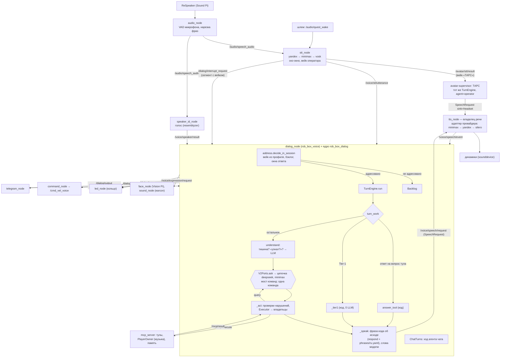

# Диалог v2 целиком: от микрофона до динамика

> Живой документ «как устроено **сейчас**» (ADR-0163 §3.1, п. 2). Почему так — в ADR, ссылки по тексту.
> Сверено с кодом на `origin/develop` @ `0a84efe98` (09.11.2026). Номера строк — на этот коммит; код двигается,
> поэтому ищи по имени функции, если строка уехала.
> Каждое утверждение — со ссылкой `файл:строка` или на ADR. **[догадка]** — не сверено с кодом или с живым роботом.
> Слова — из [`CONTEXT.md`](../../CONTEXT.md).

## Коротко

1. ReSpeaker на Sound Pi → `audio_node` режет речь на фразы по VAD микрофона → `stt_node` распознаёт фразу
   (Yandex → MiniMax → Vosk) и публикует `Utterance` в `/voice/stt/utterance`.
2. `dialog_node` — тонкий ROS-хост. Адресацию решает код: вейк из **профиля продукта**, бэклог, окна ответа.
3. Адресованная реплика — **ход** (`TurnEngine`): ответ на вопрос тула или **Tier-1** без LLM, иначе модель отдаёт
   одну **команду** (речь, вопрос, действия, лицо). Код её проверяет, исполняет действия у владельцев и сам говорит
   **фразу кода** об исходе (ADR-0148, ADR-0150).
4. Всё, что звучит, — **реплика** (голый текст) владельцу речи `tts_node`. Разметку под MiniMax, Yandex или Silero
   делает **адаптер провайдера голоса** (ADR-0160). Звук идёт в динамики, `SpeechEvent` — обратно в ход.
5. Тот же движок хода работает у агента чата Telegram (в процессе `dialog_node`) и у ТАРС (в `avatar-supervisor`).

## Схема

## 1. Путь одной реплики

### 1.1. Микрофон и фраза — `audio_node`

- Захват с ReSpeaker Mic Array v2.0: `src/rob_box_voice/rob_box_voice/audio_node.py:1-5`.
- VAD — встроенный в ReSpeaker (`self.respeaker.get_vad()`, `src/rob_box_voice/rob_box_voice/audio_node.py:983`),
  под музыкой — свой гейт против эха (`_vad_gated`, там же, `:993`). Смену VAD нода публикует в `/audio/vad`
  (`:999`).
- Готовую фразу режет и отдаёт `publish_speech_chunks` в `/audio/speech_audio`
  (`src/rob_box_voice/rob_box_voice/audio_node.py:1059`, публикаторы — `:146-150`). Длинную речь режет на куски — их
  потом склеивает бэклог («куски того же рассказа», `src/rob_box_dialog/rob_box_dialog/backlog.py:1-12`).
- Устройство и сеть: ADR-0159 (голосовой стек — на Sound Pi, `docker/sound/docker-compose.yaml`, контейнер
  `voice-assistant`).

### 1.2. Распознавание — `stt_node`

- Речь людей у робота берёт из `/audio/speech_audio` (`src/rob_box_voice/rob_box_voice/stt_node.py:500-502`); поток шлема
  оператора — из `/audio/quest_in` и `/audio/quest_wake` (`:507-515`).
- Цепочка STT задана в `docker/sound/config/voice_assistant/stt_node.yaml` (`stt_provider_chain: [yandex, minimax,
  vosk]`); Vosk — всегда последний, офлайн (`stt_node.py:1111-1119`, `_normalize_provider_chain` `:1182`).
- Вейки берёт из профиля продукта: `wake_personality` и `wake_operator` (`stt_node.py:423-425`).
- Единственный выход реплики Личности — типизированный `Utterance` в `/voice/stt/utterance` (`stt_node.py:542`).
  Фраза с вейком оператора («ТАРС») с шлема уходит в `/avatar/stt/result` (`stt_node.py:1017-1050`).
- Эхо: фраза, чей голос звучал только в эхо-окне речи робота, — эхо, из неё проходит лишь ясный стоп с вейком;
  повтор слов робота рядом с его речью — тоже эхо (`stt_node.py:517-525`, `src/rob_box_voice/rob_box_voice/core/echo_window.py:175`, `:312`).
  Открытое окно ответа приходит от `dialog_node` в `/dialog/reply_window` (`echo_window.py:156`).
- Ранний сигнал перебивания: на сегмент с вейком нода публикует `/dialog/interrupt_request` и сама речь не глушит —
  решает диалог (`stt_node.py:526-537`, `src/rob_box_voice/rob_box_voice/core/interrupt_request.py:1-10`, `:31`).
- Голос фразы параллельно оценивает `speaker_id_node` (resemblyzer, `src/rob_box_voice/rob_box_voice/speaker_id_node.py:3`)
  и публикует `/voice/speaker/result` с тем же `utterance_id` (`speaker_id_node.py:945`). Порядок STT и биометрии не
  гарантирован: диалог ждёт её по `utterance_id` (`src/rob_box_voice/rob_box_voice/dialog_node.py:215-233`).

### 1.3. Адресация — `dialog_node` + `rob_box_dialog.address`

- Вход: `DialogNode._on_utterance` (`src/rob_box_voice/rob_box_voice/dialog_node.py:459-485`). Реплика Telegram сразу
  уходит агенту чата (`:463-465`, §3.1).
- Решение «адресовано ли» — одна функция `decide_in_session` (`src/rob_box_dialog/rob_box_dialog/address.py:232`), её же
  зовёт сухой стенд. Правила (`address.py:193-215`):
  - оператор держит Личность (кадр `OperatorHold`) — голос с микрофона не слушается (`:153`, лог `[hold]` в
    `dialog_node.py:470-472`);
  - вейк по границам слов → текст после вейка; искажённый STT вейк — `slipped_wake_rest`;
  - без вейка адресованы только ответы в окнах: вопрос об имени (`Identity`), окно после приветствия, вопрос
    выступления (`PerformAsk`), стоп музыки под играющей музыкой (`address.py:1-14`);
  - голое «робот» — **подхват** бэклога (§2.1) или пустой ход-рефлекс (`address.py:243-262`).
- **Вейки из профиля продукта**, а не из кода ядра: `dialog_node.py:385` грузит `assistant.yaml`
  (`src/rob_box_voice/rob_box_voice/robot_profile.py:18-35`, по умолчанию `/config/assistant.yaml`, env
  `ROB_BOX_PROFILE`). Профиль робота — `docker/sound/config/assistant.yaml`, таблица вейков рядом —
  `docker/sound/config/wake_words.yaml` (`personality` для ReSpeaker, `operator` для шлема). Без профиля хосты робота
  не стартуют (`robot_profile.py:1-7`). Нейтральные умолчания ядра (`NEUTRAL`: без имени и вейков, адресовано всё) —
  когда хост профиль не дал (`src/rob_box_dialog/rob_box_dialog/profile.py:61`, ADR-0167 §2.4).
- Не адресовано — фраза ложится в бэклог с автором, если биометрия успела (`dialog_node.py:473-481`).
- Адресовано — сначала проверка ясного стопа (`_interrupt`, §2.3), затем ход в asyncio-цикле ноды
  (`dialog_node.py:482-485`). Новый ход при идущем ждёт его конца под замком — APPEND, речь не рвётся
  (`dialog_node.py:494-502`).

### 1.4. Ход — `TurnEngine`

Ход без ROS: `src/rob_box_dialog/rob_box_dialog/turn.py`. Транспорт — порты `V2Ports`
(`src/rob_box_dialog_host/rob_box_dialog_host/dialog_v2_ports.py:170`).

1. `TurnEngine.run` (`turn.py:2108`): журнал хода, e2e-событие `user`, стадия `addressed` (рефлекс лица и кольца
   без LLM). Голое «робот» без подхвата заканчивается здесь (`wordless`, `turn.py:833`).
2. `turn_work` (`turn.py:1937-1948`) выбирает, кто отвечает:
   - ответ на открытый **вопрос тула** («Удалить «X»? Скажи «да, удаляй».») — кодом, тул зовётся подтверждённым
     вызовом (`answer_tool`, `turn.py:1951-1975`);
   - **Tier-1** — закрытая грамматика: стоп, тишина и «говори», громкость, голос, темп и тон, новая сессия, да/нет,
     очередь лица, «повтори», «выключи музыку» (`src/rob_box_dialog/rob_box_dialog/grammar.py:1-12`, `match` `:54`;
     виды — `knowledge.TIER1_KINDS`, `src/rob_box_dialog/rob_box_dialog/knowledge.py:395`). Исполняет код, 0 вызовов LLM
     (`TurnEngine._tier1`, `turn.py:2153-2178`). Спорный стоп («спой песню про стоп») — не Tier-1, идёт модели;
   - иначе `understand` (`turn.py:846-858`): ход, проглоченный **тишиной**, — без LLM и без речи (`hold_silence`,
     `turn.py:786`); просьба «слушай» из подхвата и «ты меня узнал?» — ответ кодом (`turn.py:800-831`); остальное —
     модели.
3. Потолок хода — `TURN_CEILING_S` = 60 с (`knowledge.py:2877`), действие получает свой срок класса сверх него
   (`turn.deadline.grant`, `turn.py:2296`).

### 1.5. Модель — команда, а не свободный текст

- Цепочка LLM Личности — параметр `llm_providers` (`docker/sound/config/voice_assistant/dialog_node.yaml`:
  `deepseek,minimax`), промпт — основа `src/rob_box_dialog/rob_box_dialog/prompts/personality.txt` с персоной из профиля робота (`docker/sound/config/persona.txt`, ADR-0167 Ш1б-3) плюс правила из
  `knowledge.prompt_rules` (`dialog_v2_ports.py:374-383`). Сборка — `assemble_llm` → `build_llm_chain`
  (`dialog_v2_ports.py:359-371`, `src/rob_box_harness/rob_box_harness/core/assembly.py:152`): цепочка с учётом здоровья
  провайдеров, каждый провайдер обёрнут **режимом команд** моста.
- **Мост команд** (`src/rob_box_dialog_host/rob_box_dialog_host/command_bridge.py:1-25`): форма запроса — по возможностям
  провайдера (`degrade.select_mode`, `src/rob_box_dialog/rob_box_dialog/degrade.py:57`): DeepSeek — тул `command` с
  `tool_choice=required`, MiniMax — тул без принуждения, иначе JSON. Ответ разбирает один парсер
  (`command.parse`, `src/rob_box_dialog/rob_box_dialog/command.py:273`) и валидатор (`command.validate`, `:596`).
  Невалидная команда возвращается модели с перечнем нарушений (`command.explain`, `:1409`) не больше
  `COMMAND_RETRIES_MAX` = 1 раза (`knowledge.py:2980`); длинная речь — отдельный ход «компактнее»
  (`SPEECH_COMPACT_TURNS`, `knowledge.py:2986`).
- Команда (`command.Command`, `command.py:100`): `speech`, `ask`, действия, `passed`, выступление, экспрессия.
  Действий модель присылает до `ACTIONS_ACCEPT_MAX` = 10. До трёх быстрых без поездки (`CHAIN_SHORT_STEPS_MAX`) —
  короткая команда: исполняются разом, итог — фраза исхода. Больше или с поездкой — **вереница** (ADR-0165, #4403):
  фраза плана, ход закрыт, шаги по одному (`turn.start_chain` / `turn.run_chain`, решение — `action_chain.runs_as_chain`),
  итог кодом (`action_chain.summary`).
- **Срез** тулов на ход — функция, не правило в промпте: `tools_view.available_tools`
  (`src/rob_box_dialog/rob_box_dialog/tools_view.py:269`); у агента — своё представление каталога
  (`src/rob_box_dialog/rob_box_dialog/agents.py:49-51`, `src/rob_box_core/rob_box_core/tool_catalog.py:148-165`).
- Снимок хода для модели (`TurnEngine._messages`, `turn.py:2322-2342`): системный промпт, окно истории (только
  озвученное и метки кода), разделы снимка — собеседник, провайдеры, музыка, звучащий голос, бэклог, исходы прошлых
  действий (`dialog_node.py:610-614`, `context.build_context`, `src/rob_box_dialog/rob_box_dialog/context.py:25`).
- Итерации: `query`-тулы возвращают данные модели, не больше `LLM_QUERY_ITERATIONS_MAX` = 4 (`knowledge.py:2976`);
  последний вызов — без query в схеме (`TurnEngine._understand`, `turn.py:2200-2225`).

### 1.6. Действия и фраза об успехе

- `TurnEngine._act` (`turn.py:2227-2256`) сначала проверяет, не должна ли модель исправиться (нарушения вроде
  `done_claim`, `music_promise`, `foreign_name` — `owed_now`), затем исполняет.
- `TurnEngine._execute` (`turn.py:2285-2310`) → `V2Ports.execute` (`dialog_v2_ports.py:225`) →
  `Executor` (`src/rob_box_dialog/rob_box_dialog/execute.py:121`) → `PlanToolExecutor` — планировщик ресурсов поверх MCP
  (`src/rob_box_voice/rob_box_voice/core/plan_host.py:41`, `src/rob_box_voice/rob_box_voice/core/plan_tools.py:68`) →
  `LLMToolCallAdapter` публикует подписанный запрос в `/mcp/execute`
  (`src/rob_box_mcp_tools/rob_box_mcp_tools/llm_adapter.py:155`) → `mcp_server` исполняет тул
  (`src/rob_box_mcp_tools/rob_box_mcp_tools/mcp_server.py:594`) → ответ в `/mcp/result` (`llm_adapter.py:170`).
- **Владелец** ресурса — тот, кто исполняет: плеер музыки — `PlayerOwner` в `mcp_server`
  (`src/rob_box_mcp_tools/rob_box_mcp_tools/engine/player_owner.py:89`), речь — `tts_node`, голос диктора —
  `speaker_id_node`, лицо — `face_node`. Таблица владельцев — ADR-0150 §2.3 и `architecture/ownership.yml` в корне.
- Исход — **событие владельца** из данных результата тула (`execute.owner_event`, `execute.py:72`), а не публикация
  запроса и не слова модели (`execute.py:1-19`). Нет события к сроку класса — честный `timeout`; исход прошлой
  эпохи — `cancelled{stale_epoch}` (`execute.py:273`). Обещание `pending` («Еду к…») закрывает ожидание, итог
  приходит позже в `on_late` → `say_late` (`dialog_node.py:251-256`, `turn.py:1885`).
- **Фразу об успехе строит код**: `respond.phrase_from_result` по ключу `{класс}.{статус}[.{причина}]` из
  `src/rob_box_dialog/rob_box_dialog/phrases/ru.yaml` (`src/rob_box_dialog/rob_box_dialog/respond.py:1-7`, `:159`), несколько
  действий — `respond.join` (`:194`), в ходе — `outcome_phrase` (`turn.py:861`). При действиях речь модели не звучит,
  кроме законных случаев (`TurnEngine._speak`, `turn.py:2258-2283`; ADR-0150 §4.1).
- Движение: стоп Tier-1 шлёт `stop_motion` в `/dialog/intent` (`dialog_v2_ports.py:349-356`), `command_node` переводит
  его в `/cmd_vel_voice` (`src/rob_box_voice/rob_box_voice/command_node.py:49-58`).

### 1.7. Речь — приёмник, адаптер провайдера, динамик

- Реплика хода: `TurnEngine._say` (`turn.py:2344-2354`) → `V2Ports.say` собирает `Utterance` (голый текст, приёмник
  `Sink.SPEAKERS`, голос, эмоция; `dialog_v2_ports.py:249-255`) → `speech_client.say` публикует `SpeechRequest` в
  `/voice/speech/request` (`src/rob_box_core/rob_box_core/speech_client.py:31`, `:137-145`). Голый текст на проводе —
  ADR-0160 §2.3 (`src/rob_box_core/rob_box_core/utterance.py:1-15`).
- **Владелец речи** — `tts_node` через `SpeechOwner`: подписан на `/voice/speech/request` и `/voice/speech/cancel`,
  публикует `/voice/speech/event` и `/voice/speech/envelope`
  (`src/rob_box_voice/rob_box_voice/core/speech_owner.py:280-283`; события `queued → synthesized → started → progress →
  finished | cancelled`, `rejected`, `voice_changed` — `speech_owner.py:1-20`).
- Цепочка TTS: параметр `provider` (на роботе `minimax`, `docker/sound/config/voice_assistant/tts_node.yaml`) →
  `minimax → yandex → silero`, Silero всегда последний (`src/rob_box_voice/rob_box_voice/tts_node.py:2777-2785`,
  `:2822`).
- **Адаптер провайдера голоса** готовит голый текст под свой сервис (`src/rob_box_voice/rob_box_voice/tts_providers/__init__.py:1-9`):
  Yandex — `prepare` (`tts_node.py:3853`), Silero — `prepare` и SSML-конверт (`tts_node.py:3908`,
  `src/rob_box_voice/rob_box_voice/tts_providers/silero.py:140`, `src/rob_box_voice/rob_box_voice/tts_ssml.py:18`), MiniMax — паузы такта рэпа `minimax_text` (`tts_node.py:3707`,
  `src/rob_box_voice/rob_box_voice/tts_providers/beat.py:27`). ADR-0160 §2.5. Статус ADR-0160 в файле — Proposed, а
  шаги PR-2 и адаптеры (#4239–#4241) в коде есть.
- Звук: `playback_manager.play_audio` → `sounddevice` на устройство `device_index` (`tts_node.py:4138-4150`);
  синтезированный PCM динамиков публикуется ещё и в `/voice/audio/speech` (`tts_node.py:829`, `:4010`, `:4749-4759`). Приёмник `headset` (ТАРС) — звук в
  `/avatar/tts/audio` (`tts_node.py:836`, `speech_owner.py:20`).
- Обратно: `SpeechEvent started` и конец реплики приходят в `DialogNode._on_speech_event` (`dialog_node.py:533-551`).
  В окно истории попадает только озвученная часть — по `spoken_chars` (`TurnEngine.speech_ended`, `turn.py:2145-2151`).

### 1.8. Лицо, кольцо, earcon

- Стадии хода (`addressed`, `thinking`, `executing`, итог) — `/dialog/turn_event` и рефлекс без LLM
  (`V2Ports.stage`, `dialog_v2_ports.py:257-275`; `src/rob_box_core/rob_box_core/expression_client.py:19-22`).
- Экспрессия команды красит рефлекс итога `done`, отдельного запроса лицу нет (`turn.py:47-53` в описании модуля,
  `dialog_v2_ports.py:262-275`). Пачка `play_animation` — очередью сцен (`dialog_v2_ports.py:298-323`).
- Исполнители `/voice/expression/request`: `face_node` на Vision Pi в контейнере `led-matrix`
  (`src/rob_box_animations/rob_box_animations/face_node.py:149`,
  `docker/sound/config/voice_assistant/voice_assistant_headless.launch.py:84`), earcon — `sound_node`
  (`src/rob_box_voice/rob_box_voice/sound_node.py:69-71`). Кольцо живёт по `/dialog/turn_event` (`led_node`,
  `src/rob_box_voice/rob_box_voice/led_node.py:169`).
- Сессия латчем в `/dialog/session` (`dialog_node.py:383`, `src/rob_box_voice/rob_box_voice/core/identity_question.py:51`):
  тишину и сцены читают `led_node`, `face_node`, `sound_node` (`face_node.py:146`, `sound_node.py:73`).

## 2. Бэклог, тишина, перебивание

### 2.1. Бэклог и подхват

- Фраза без вейка роботу не адресована и копится в `Backlog` на `BACKLOG_TTL_S` = 180 с
  (`src/rob_box_dialog/rob_box_dialog/backlog.py:1-20`, `knowledge.py:100-106`). Модель её в ход не получает, пока
  код не решит.
- Наружу три пути (`backlog.py:3-20`): **подхват** (голое «робот» забирает свежие фразы не старше 20 с и куски того
  же рассказа, иначе последнюю неуслышанную фразу окна 3 минуты); в снимок хода — фраза того же собеседника; отдельным
  разделом — фон всех авторов за окно.
- У каждой фразы — **автор** (голос самой фразы), у подхвата — ещё **инициатор**; права хода (память о человеке) —
  у автора (`pickup_parties.rights_speaker`, `dialog_node.py:513-519`, решение Шифу 05.11).

### 2.2. Тишина и стоп

- «Замолчи/помолчи» — Tier-1 `silence`: ход кладёт кадр `Silence` (TTL `SILENCE_TTL_S` = 600 с,
  `knowledge.py:2654`, `src/rob_box_dialog/rob_box_dialog/session.py:125-128`; `turn.py:2163-2166`).
- В тишине ход не зовёт LLM и молчит, в окно идёт метка «рот заклеен» (`hold_silence`, `turn.py:786-797`). Снимает
  только «Робот, говори» (`unsilence`, `grammar.py:225-229`); вейк тишину не снимает.
- «Хватит/стоп» — стоп звучащего (речь, выступление, музыка), тишину **не** включает
  (`src/rob_box_dialog/rob_box_dialog/interrupt.py:1-20`, решение Шифу В20).

### 2.3. Перебивание (barge-in)

- Два входа ясного стопа: ранний — `/dialog/interrupt_request` от `stt_node` (`dialog_node.py:567-569`) и сама
  адресованная реплика (`dialog_node.py:483`). Оба идут в `DialogNode._interrupt` (`dialog_node.py:571-586`).
- Решает код: `interrupt.on_interrupt` (`interrupt.py:104`) по грамматике Tier-1. Ясный стоп отменяет речь эпохи
  (`SpeechCancel` с границей: «стой» — сразу, «хватит» — на конце предложения) и все хода в полёте вплоть до
  HTTP-запроса LLM (`TurnsInFlight`, `interrupt.py:109-125`). Не стоп и спорный стоп речь не рвут.
- Ход стопа (Tier-1) переводит сессию в новую эпоху (`TurnEngine._interrupt`, `turn.py:2180-2189`); исходы старой
  эпохи исполнитель отбрасывает, кроме непрерываемых классов — память, голос, знакомство, движение (`execute.py:15-18`).
- Строка лога — `🛑 [interrupt] …` с временем решения в мс (`dialog_node.py:583-585`), метрика
  `voice_barge_in_total` (§5).

## 3. Другие терминалы

### 3.1. Telegram — агент чата

- `telegram_node` публикует текст чата как `Utterance` с `source=telegram` и `chat_id` в тот же `/voice/stt/utterance`
  (`src/rob_box_telegram/rob_box_telegram/telegram_node.py:257`).
- `dialog_node` отдаёт его не Личности, а **агенту чата**: `ChatTurns`, своя сессия `telegram:<chat_id>`, своя
  LLM-цепочка `telegram_llm_providers` и промпт `telegram_chat_prompt.txt` (`dialog_node.py:331-366`, `:487-492`;
  `src/rob_box_dialog/rob_box_dialog/chats.py:314`). «Клод …» в чате — не роботу (`address.py:104`).
- Ответ и фразы кода — `DialogOutput` в `/dialog/output` (`dialog_node.py:340-347`), его читает `telegram_node`
  (`telegram_node.py:140`).
- Чат — **пульт робота**: выступление и лицо исполняет Личность в своей эпохе (`RobotRemote`, `dialog_node.py:305-328`),
  тулы — под общим планировщиком ресурсов Личности (`build_chat_tools`, `dialog_node.py:296-302`).
- `/say` — вслух ровно написанный текст, без LLM: `speech_client.say` прямо из `telegram_node`
  (`telegram_node.py:454`).

### 3.2. ТАРС — агент оператора

- Вход: фраза шлема с вейком «ТАРС» → `stt_node` → `/avatar/stt/result` (`stt_node.py:1017-1050`) и `/avatar/command`
  → `avatar-supervisor` (`src/rob_box_supervisor/rob_box_supervisor/supervisor_node.py:387`).
- Тот же `TurnEngine`, своя сессия `agent=operator`, свои Tier-1 и срез
  (`src/rob_box_supervisor/rob_box_supervisor/operator_turns.py:1-15`, `:216-232`; `agents.py:50`). Реплика хода ТАРС —
  текст ответа оператору (`OperatorPorts`, `operator_turns.py:64-67`, `:101`), ответ панели —
  `/avatar/command_result`. Голос в наушники публикует супервизор: `SpeechRequest(agent=operator, sink=headset)`
  владельцу речи (`src/rob_box_supervisor/rob_box_supervisor/headset_speech.py:1-5`, `:27-33`); лицо и кольцо робота
  стадии ТАРС не трогают (`operator_turns.py:65-67`).
- Держать Личность ТАРС может сервисом `/dialog/control` (hold/resume/reset → кадр `OperatorHold`;
  `dialog_node.py:435`, `:588-598`; `supervisor_node.py:166`).
- Wire-протокол `/avatar/command` — [`avatar-supervisor-agent.md`](avatar-supervisor-agent.md) (в его §4–§5 ещё
  описан `dialogue_node` v1 — устарело).

## 4. Ядро без ROS и профиль продукта

- **Ядро диалога** — пакеты без ROS: `rob_box_dialog`, `rob_box_llm`, `rob_box_harness`, `rob_box_core`, `rob_box_music`
  и связка хода из `rob_box_voice` (мост команд, порты, память). Граница — `packaging/dialog-core/pyproject.toml`
  (пакет `rob-box-dialog-core`, ADR-0160 §8, ADR-0167 §2.1). Отдельный репозиторий `rob_box_dialog_core` — следующий
  шаг (ADR-0167 §4).
- ROS живёт только в хостах: `dialog_node`, `stt_node`, `tts_node`, `avatar-supervisor`. `dialog_node` сам говорит, что
  он тонкий хост (`dialog_node.py:1-17`).
- **Профиль продукта** (`assistant.yaml`, формат 1: `name`, `wake_words`) читает ядро
  (`src/rob_box_dialog/rob_box_dialog/profile.py:47-61`, `load_profile` `:106`); профиль робота лежит у робота
  (`docker/sound/config/assistant.yaml`). Колонка — отдельный репо `rob_box_station` на том же ядре (ADR-0167 §2.3).
- **Сухой стенд**: консоль `scripts/dialogue/chat.py` и сухой марафон `scripts/dialog/dry_marathon.py` гоняют тот же
  ход и ту же сборку LLM без ROS (`chat.py:1-18`, `dialog_v2_ports.py:362-364`).

## 5. Метрики и логи

| Где | Что |
|---|---|
| `📊 [turn] turn_id=… epoch=… agent=… stage=… status=… latency_ms=… llm_calls=… llm_provider=… tokens=… reason=…` | итог каждого хода (`src/rob_box_dialog/rob_box_dialog/turn_log.py:52`, `:143-147`; пишет `TurnEngine._finish`, `turn.py:2356-2368`) |
| `🎤 STT: …` | реплика на входе `dialog_node` (`dialog_node.py:462`) |
| `🧭 [turn-v2] …` | шаги хода: Tier-1, форма команды, отмена, `stale_epoch` (`turn.py:125`) |
| `🧮 [prompt] tokens=… provider=… tools=…` | размер запроса к LLM (`dialog_v2_ports.py:220-221`) |
| `[backlog] accumulated …` | фраза ушла в бэклог (`dialog_node.py:479-480`) |
| `🛑 [interrupt] …` | ясный стоп (`dialog_node.py:583-585`) |
| `🎭 [turn-v2] лицо …` | лицо команды и очередь сцен (`dialog_v2_ports.py:271-273`) |
| Prometheus | порты нод на Sound Pi: `dialog_node` 9100, `tts_node` 9110, `stt_node` 9111, `speaker_id_node` 9112, `audio_node` 9113 (`dialog_node.py:114`, `tts_node.py:898`, `stt_node.py:399`, `speaker_id_node.py:750`, `audio_node.py:282`; сбор — `docker/monitoring/config/prometheus.yml:33-43`) |
| метрики хода | `voice_llm_request_total`, `voice_llm_request_duration_seconds`, `voice_llm_fallback_total`, `voice_barge_in_total` (`src/rob_box_voice/rob_box_voice/core/dialog_metrics.py:1-7`) |
| e2e-БД | текст ходов на диск — только в e2e-БД вне `/data`, если задан `e2e_db_path` (`dialog_node.py:31`, `:620-642`); разбор — `scripts/dialog/turn_metrics.py --db` |

## 6. Узел → файл → топики и сервисы

Все ноды ниже, кроме `face_node` и `telegram_node`, — в контейнере `voice-assistant` на Sound Pi
(`docker/sound/config/voice_assistant/voice_assistant_headless.launch.py:59-162`; `dialog_node` добавляет
`src/rob_box_core/rob_box_core/dialog_engine.py:36-46`).

| Узел | Файл | Слушает | Публикует / сервис |
|---|---|---|---|
| `audio_node` | `src/rob_box_voice/rob_box_voice/audio_node.py` | ReSpeaker (PyAudio), `/voice/music/state` | `/audio/speech_audio`, `/audio/audio`, `/audio/vad`, `/audio/direction`, `/audio/state` (`:146-150`) |
| `stt_node` | `src/rob_box_voice/rob_box_voice/stt_node.py` | `/audio/speech_audio`, `/audio/quest_in`, `/audio/quest_wake`, `/audio/vad`, `/audio/direction`, `SpeechEvent`, `/dialog/reply_window` | `/voice/stt/utterance`, `/dialog/interrupt_request`, `/avatar/stt/result`, `/avatar/ptt/result`, `/voice/stt/state` (`:500-550`) |
| `speaker_id_node` | `src/rob_box_voice/rob_box_voice/speaker_id_node.py` | `/audio/speech_audio`, `/voice/speaker/register`, `/voice/speaker/rename`, `/voice/speaker/merge`, `SpeechEvent` | `/voice/speaker/result` (`:945-1010`) |
| `dialog_node` | `src/rob_box_voice/rob_box_voice/dialog_node.py` | `/voice/stt/utterance`, `/voice/speaker/result`, `/voice/speech/event`, `/voice/sound/event`, `/voice/music/state`, `/voice/music/event`, `/voice/tts/provider_state`, `/voice/providers/state`, `/dialog/interrupt_request`, `/vision/hailo/events` (`:444-455`) | `/dialog/session` (latched), `/dialog/turn_event`, `/voice/expression/request`, `/dialog/intent`, `/dialog/output`, `/dialog/reply_window`, `/voice/speech/request`, `/voice/speech/cancel`, `/mcp/execute`, `/voice/tts/voice_request`, `/voice/llm_status`, `/voice/wake_words`; сервис `/dialog/control` |
| `mcp_server` | `src/rob_box_mcp_tools/rob_box_mcp_tools/mcp_server.py` | `/mcp/execute` (`:594`) | `/mcp/result`, `/voice/music/state`, `/voice/music/event` (ADR-0149) |
| `tts_node` | `src/rob_box_voice/rob_box_voice/tts_node.py` (+ `core/speech_owner.py`, `core/voice_owner.py`) | `/voice/speech/request`, `/voice/speech/cancel` (`speech_owner.py:282-283`), `/voice/tts/voice_request` (`voice_owner.py:48`), `/voice/tts/set_voice` (`tts_node.py:1323`), `/avatar/tts/request` — только образец голоса (`tts_node.py:846`) | `/voice/speech/event`, `/voice/speech/envelope`, `/voice/audio/speech`, `/avatar/tts/audio`, состояние провайдеров; звук — `sounddevice` |
| `command_node` | `src/rob_box_voice/rob_box_voice/command_node.py` | `/dialog/intent` (`:49`) | `/cmd_vel_voice`, `/voice/command/intent`, `/voice/command/feedback` (`:52-58`) |
| `led_node` | `src/rob_box_voice/rob_box_voice/led_node.py` | `/dialog/turn_event`, `/dialog/session`, `/audio/direction` (`:169-177`) | `/voice/expression/event` (`:164`) |
| `sound_node` | `src/rob_box_voice/rob_box_voice/sound_node.py` | `/voice/expression/request`, `/voice/sound/trigger`, `/dialog/session` (`:67-88`) | `/voice/sound/event`, `/voice/expression/event` (`:99-101`) |
| `face_node` (Vision Pi, `led-matrix`) | `src/rob_box_animations/rob_box_animations/face_node.py` | `/voice/expression/request`, `/voice/speech/envelope`, `/dialog/session` (`:143-149`) | `ExpressionEvent{executor=face}` |
| `telegram_node` (контейнер `telegram-bot`) | `src/rob_box_telegram/rob_box_telegram/telegram_node.py` | `/dialog/output` (`:140`) | `/voice/stt/utterance` (`:257`), `/voice/speech/request` для `/say` (`:454`) |
| `supervisor_node` (ТАРС, контейнер `avatar-supervisor`) | `src/rob_box_supervisor/rob_box_supervisor/supervisor_node.py`, `operator_turns.py` | `/avatar/command`, `/avatar/stt/result`, `/voice/speech/event` | `/avatar/command_result`, `/voice/speech/request` (`sink=headset`), `/dialog/intent`; клиент `/dialog/control` |

Публикации `dialog_node` через клиенты: речь — `speech_client` (`src/rob_box_core/rob_box_core/speech_client.py:31-33`),
стадии и лицо — `expression_client` (`expression_client.py:19-22`), `/mcp/execute` — `LLMToolCallAdapter`
(`llm_adapter.py:155`), `/voice/llm_status` и `/voice/wake_words` — `src/rob_box_voice/rob_box_voice/core/dialog_v2_parity.py:55-56`.

## 7. Чего в коде ещё нет

- **Вереница действий** (ADR-0165) — этапы 1–4 в коде: план, шаги по одному, итог; стоп Tier-1 (голосом и из чата)
  гасит вереницу и говорит итог «Остановился. …», «замолчи» — вереница идёт молча (`turn.steer_chains`,
  `turn.close_chain`). Нет: сопровождение по ходу (4б), раздел «выполняю» в снимке и отказ на занятый ресурс (5),
  «Поехали?» и маршрут из нескольких поездок (5б: пока в команде одна поездка, `SINGLE_ACTION_CLASSES`).
- **Идентичность человека** (ADR-0164: кличка лица, связь лица и голоса) — в шапке ADR «кода нет»; что из этапов
  ADR-0164 §6 уже влито — здесь не сверено **[не проверено]**.
- **Отдельный репозиторий ядра** `rob_box_dialog_core` — ещё нет, ядро собирается из этого репо
  (`packaging/dialog-core/pyproject.toml:1-11`).

## Где читать дальше

- Почему команда, а не ответ: [ADR-0148](../adr/0148-code-decides-llm-speaks.md), [ADR-0150](../adr/0150-dialog-v2-session-command-event.md)
  (§2 модули и владельцы, §3 поток реплики — целевой вид на 01.10, местами отличается от кода).
- Речь в три слоя: [ADR-0160](../adr/0160-speech-rendering-plain-text-sink-renderer-provider-adapter.md).
- Ядро и профили: [ADR-0167](../adr/0167-dialog-core-repo-and-station-repo.md).
- Узел Sound Pi: [ADR-0159](../adr/0159-sound-pi-third-node-voice-stack-and-sensor-hub.md).
- Вереница и идентичность: [ADR-0165](../adr/0165-action-chain-after-answer.md), [ADR-0164](../adr/0164-person-identity-face-voice-nickname.md).
- Протокол ТАРС: [avatar-supervisor-agent.md](avatar-supervisor-agent.md), [avatar-floor-protocol.md](avatar-floor-protocol.md).
