# LED-анимации Rob Box

Лицо робота на 381 светодиоде WS2812B: две передние фары-глаза 8×8, рот 25×5
(пять панелей 5×5) и две задние фары 8×8. Стиль — Бендер: тёплые глаза с
квадратными зрачками и металлическими веками, рот-решётка из двух рядов по
шесть зубов.

## Откуда берутся кадры

PNG-кадры и YAML-манифесты в `animations/` **сгенерированы** процедурным
кодом из [`tools/led_face_lab/`](../../../tools/led_face_lab/) — руками их не
правят. Поменять сцену — поправить генератор и перезапечь:

```bash
python tools/led_face_lab/bake_manifests.py src/rob_box_animations/animations
python tools/led_face_lab/render_gifs.py src/rob_box_animations/animations docs/assets/animations
```

Запекание детерминировано (seed внутри сцен): повторный прогон даёт те же
файлы байт в байт.

- **Частота:** 25 кадров в секунду; одинаковые подряд кадры панели склеены в
  один, одинаковые картинки внутри анимации лежат одним файлом.
- **Стороны:** лицо нарисовано для человека напротив робота, а группы
  `wheel_*` привязаны к бортам. Левая фара робота (`wheel_front_left`) у
  зрителя справа; поворот налево мигает ею.
- **Яркость:** арт рисуется в уровнях 0..25 и пишется в PNG на полной шкале.
  Драйвер сейчас стоит на `brightness: 25` и показывает ровно эти уровни.
  В `metadata.brightness_budget` у каждой анимации записано, до какой
  яркости драйвера её самый тяжёлый кадр укладывается в 4,5 А (75% бака
  5 В × 30 Вт, паспортная модель WS2812B). Анимации с бюджетом ниже 128
  запечены тусклее (`bake_scale`), чтобы после подъёма яркости драйвера до
  128 остаться в бюджете.
- **Темп сообщений:** быстрые сцены (пожарная, победа, сон) шлют до
  115 изображений панелей в секунду. Это рассчитано на драйвер без сна
  100 мс и композитор, пишущий ленту не чаще 60 Гц (ros2leds, PR #3674);
  старый драйвер обновлял ленту не чаще ~9 раз в секунду.

## Галерея

Превью собраны из манифестов, как их показывает робот при яркости 25:
`wheel_front_right | рот | wheel_front_left`, справа задние фары со спины.

### Экстренные

| Анимация | Что происходит | Превью |
|----------|----------------|--------|
| `police_lights` | Строгие глаза в красно-синих отсветах, рот — световая балка: двойные вспышки, разбег от центра, чередование |  |
| `ambulance` | Красный крест бьётся в такт пульсу, во рту кардиограмма, синие вспышки сзади | 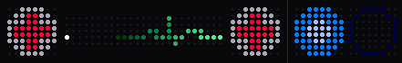 |
| `fire_truck` | Глаза-маяки с вращающимся лучом, красно-белая балка, потом пламя во рту | 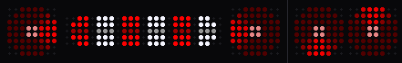 |
| `road_service` | Жёлтые маяки, во рту табло с бегущими стрелками, сзади стрелки | 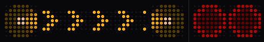 |

### Езда

| Анимация | Что происходит | Превью |
|----------|----------------|--------|
| `turn_left` | Левая фара робота мигает жёлтым, взгляд в поворот, сзади бегущая заливка | 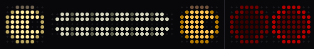 |
| `turn_right` | То же зеркально | 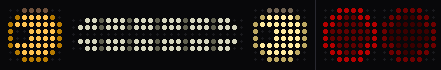 |
| `braking` | Стоп-сигнал, прищур |  |
| `accelerating` | Прищур, сжатые зубы, дрожь, сзади форсаж |  |

### Лицо и эмоции

| Анимация | Что происходит | Превью |
|----------|----------------|--------|
| `idle` | Моргания 2–6 с (иногда двойные), саккады, осмотр, ухмылка; раз в цикл заскучал и зевнул | 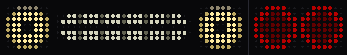 |
| `talking` | Проём между зубами линзой по слогам А/О/Э; взгляд в сторону в начале фразы, кивок на ударном, моргание в конце | 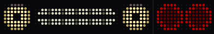 |
| `thinking` | Огонёк бежит по зубам и прищур, потом зрачки по кругу | 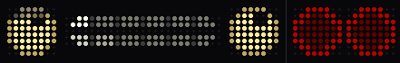 |
| `happy` | Глаза ^^, хихиканье | 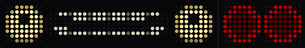 |
| `sad` | Веки домиком, зрачки вниз, слеза |  |
| `angry` | Веки клином, глаза краснеют, скрежет зубами |  |
| `surprised` | Моргнул, глаза распахнуты, зрачок-точка, рот «О» | 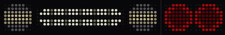 |
| `victory` | Глаза ^^ прыгают, радуга по зубам, салют и конфетти сзади | 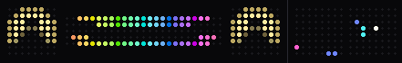 |

### Системные

| Анимация | Что происходит | Превью |
|----------|----------------|--------|
| `sleep` | Веки «︶» дышат, z, похрапывает | 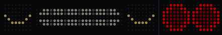 |
| `wakeup` | Включение как у ЭЛТ, зубы загружаются, осмотрелся, зевок (без повтора) | 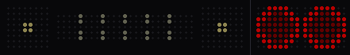 |
| `charging` | Довольные глаза, батарейка во рту наполняется | 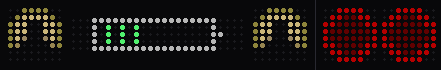 |
| `low_battery` | Сонные веки, во рту батарейка с последним делением |  |
| `error` | Глаза-крестики, глитч решётки | 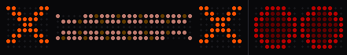 |

## Формат манифеста

Формат прежний, его читает `AnimationLoader`; генератор добавляет только
поля в `metadata`.

```yaml
name: "idle"
description: "..."
duration_ms: 28000
loop: true
fps: 25

panels:
  - logical_group: "wheel_front_left"
    offset_ms: 0
    frames:
      - image: "frames/idle/p8_000.png"   # общий файл для обоих глаз
        duration_ms: 800

metadata:
  priority: "low"
  category: "state"
  tags: [...]
  brightness_budget: 156   # до этой яркости драйвера пик <= 4,5 А
  bake_scale: 1.000        # < 1, если анимация запечена тусклее под цель 128
  peak_ma_at_255: 6706     # ток самого тяжёлого кадра без покоя, драйвер на 255
```

## Связанное

- [ros2leds](https://github.com/krikz/ros2leds) — драйвер и композитор (git submodule `src/ros2leds`)
- [README пакета](../README.md)
