# Лицо Rob Box — сцены

Лицо робота на 381 светодиоде WS2812B: две передние фары-глаза 8×8, рот 25×5
(пять панелей 5×5) и две задние фары 8×8. Стиль — Бендер: тёплые глаза с
квадратными зрачками и металлическими веками, рот-решётка из двух рядов по
шесть зубов.

## Откуда берутся кадры

Кадров на диске нет: `face_node` рисует сцены
`rob_box_animations/face/` в реальном времени, 25 к/с (ADR-0150 §5.5,
PR-3a #3689). Сцена — генератор кадров; живые значения (направление на
говорящего, раскрытие рта по огибающей TTS, темп и фаза трека) идут в
`FaceContext`. Превью ниже рендерит тот же код:

```bash
python tools/led_face_lab/render_gifs.py docs/assets/animations --gallery src/rob_box_animations/docs/ANIMATIONS.md
```

- **Детерминизм:** первый проход сцены при seed по умолчанию — байт в байт
  (дайджесты в `tests/unit/docker/test_animation_assets.py`); следующие
  проходы берут новый seed, моргания не повторяются по кругу.
- **Стороны:** лицо нарисовано для человека напротив робота, группы
  `wheel_*` привязаны к бортам: левая фара робота (`wheel_front_left`) у
  зрителя справа. Таблица — `face/face.py:GROUP_OF`; тест-кадр сторон —
  параметр `test_pattern` (`face/sides.py`).
- **Яркость и ток:** арт рисуется в уровнях 0..25, драйвер стоит на
  `brightness: 25` и показывает ровно эти уровни. Светящаяся часть любой
  сцены ≤ 1 А по модели драйвера (20 мА на канал при 255, тест); пик с
  покоем ленты 381 мА — до ~1,25 А при ограничителе 4,5 А. `face_node` пишет
  `face.peak_ma` в лог раз в 10 с.
- **Эффекты полотна (#3780):** слоты сцены LLM `bg` (фон сквозь всё полотно:
  `rainbow`, `fire`, `matrix`; ≤ 6 уровней, черты светят своим уровнем),
  `fx` (импульс в начале сцены: `slash`, `glitch`, `boot`, `power_down`) и
  `feat` (`loading_eyes`). Полотно — одна таблица `face/face.py:CANVAS_AT`
  рядом с `GROUP_OF`, рендер — `face/effects.py`.
- **Какая сцена когда:** речь — `talk_<mouth_design>` (рот по голосу, В13:
  `jaw`), запрос `play_animation`/`ExpressionRequest` — сцена на время,
  музыка — по темпу (`< 100` кайф, `100–125` грув, `≥ 125` очки), покой —
  `idle_stare`, раз в минуту `idle_bored`; нет голосового стека 7 с —
  `sleep`, вернулся — `wakeup`. Порядок — `face_director.py`.

## Галерея

Превью при яркости 25: `wheel_front_right | рот | wheel_front_left`, справа
задние фары со спины.

<!-- gallery: tools/led_face_lab/render_gifs.py --gallery -->

### Покой

| Сцена | Что происходит | Превью |
|---|---|---|
| `idle_stare` | Покой · «взгляд»: моргания 2–6 с, двойные, саккады, осмотр, ухмылка; взгляд на говорящего по DOA | 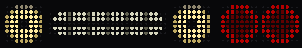 |
| `idle_bored` | Покой · «скучно»: через минуту тишины: веки ниже, зевок | 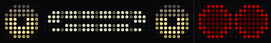 |

### Слушает

| Сцена | Что происходит | Превью |
|---|---|---|
| `listening` | Слушает: веки поднимаются, зрачки на говорящего (DOA), кивок | 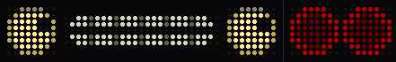 |

### Думает

| Сцена | Что происходит | Превью |
|---|---|---|
| `thinking_teeth` | Думает · «зубы-загрузка»: огонёк бежит по зубам, прищур | 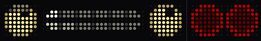 |
| `thinking_orbit` | Думает · «орбита»: зрачки по кругу, прикус наискось «хмм» | 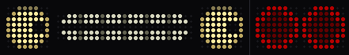 |

### Говорит

| Сцена | Что происходит | Превью |
|---|---|---|
| `talk_jaw` | Говорит · «челюсть»: решётка на месте, проём линзой, челюсть падает сильнее губы, тёплая «глотка» | 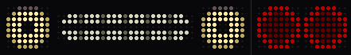 |
| `talk_rubber` | Говорит · «резина»: сжатие-растяжение: закрыт — широкая щель, открыт — уже и выше | 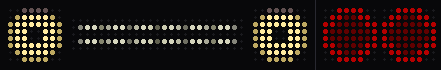 |
| `talk_voicebox` | Говорит · «голос-решётка»: зубы светятся от центра наружу по громкости, как у KITT | 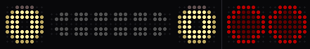 |
| `talk_happy` | Говорит · радостно: глаза ^^, улыбка в паузах | 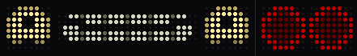 |

### Эмоции

| Сцена | Что происходит | Превью |
|---|---|---|
| `happy` | Радость: глаза ^^, хихиканье |  |
| `wink` | Подмигнул: одним глазом + ухмылка | 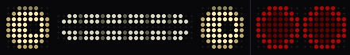 |
| `sad` | Грусть: веки домиком, зрачки вниз, слеза |  |
| `angry` | Злость: веки клином, краснеет, скрежет зубами |  |
| `surprised` | Удивление: моргнул — глаза распахнуты, зрачок-точка, «О» |  |
| `victory` | Победа: глаза ^^ прыгают, радуга по зубам, салют и конфетти сзади |  |

### Музыка

| Сцена | Что происходит | Превью |
|---|---|---|
| `music_groove` | Музыка · «грув»: кивок на долю, эквалайзер в зубах, кольца-динамики | 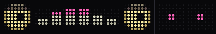 |
| `music_shades` | Музыка · «очки»: очки съезжают, блик раз в такт, диско |  |
| `music_vibe` | Музыка · «кайф»: глаза ^^, тёплая волна по зубам, эквалайзер сзади | 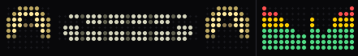 |

### Экстренные

| Сцена | Что происходит | Превью |
|---|---|---|
| `police_lights` | Полиция: Бендер-патрульный: строгие глаза в отсветах, рот — балка: двойные вспышки, разбег, чередование | 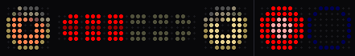 |
| `fire_truck` | Пожарная: глаза — вращающиеся маяки, балка красно-белая, потом «огонь» во рту |  |
| `ambulance` | Скорая: красный крест бьётся в такт пульсу, во рту кардиограмма, синие вспышки |  |
| `road_service` | Дорожная служба: жёлтые маяки, во рту табло со стрелками, сзади стрелки |  |

### Езда

| Сцена | Что происходит | Превью |
|---|---|---|
| `turn_left` | Поворот налево: глаз со стороны поворота мигает жёлтым, бегущая заливка сзади |  |
| `turn_right` | Поворот направо: то же зеркально |  |
| `brake` | Торможение: стоп-сигнал, прищур |  |
| `accelerating` | Разгон: прищур, сжатые зубы, дрожь, сзади форсаж |  |

### Системные

| Сцена | Что происходит | Превью |
|---|---|---|
| `sleep` | Сон: веки «︶» дышат, z, похрапывает |  |
| `wakeup` | Пробуждение: ЭЛТ-включение, зубы загружаются, зевок |  |
| `error` | Ошибка: глаза-крестики, глитч |  |
| `low_battery` | Батарея садится: сонные веки, батарейка во рту |  |
| `charging` | Зарядка: довольные глаза, батарейка наполняется |  |

### Праздники

| Сцена | Что происходит | Превью |
|---|---|---|
| `new_year_eve` | Новогодняя полночь: салют сзади, «2027» во рту |  |
